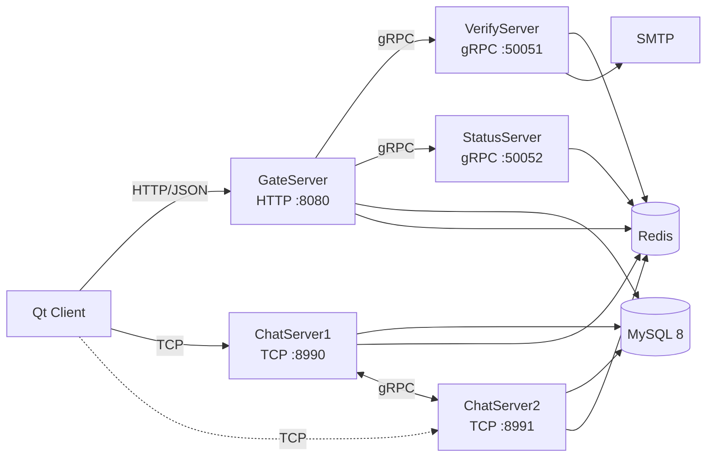

# C++ Full-Stack Chat Project

一个使用 Qt、C++、Node.js、gRPC、MySQL 和 Redis 实现的在线聊天项目。

v1 已完成邮箱验证码、注册登录、好友申请与认证、TCP 长连接、双 ChatServer 在线文本聊天和跨节点消息转发。

## 功能概览

- 邮箱验证码注册、登录和重置密码
- Argon2id 密码哈希
- Redis Token、验证码、在线路由和短期资料缓存
- 双 ChatServer 节点分配
- TCP 长连接与自定义二进制帧
- 用户搜索、好友申请和好友认证
- 同节点文本消息
- 双 ChatServer gRPC 跨节点消息
- Qt Widgets 桌面客户端
- 安全回归、协议测试和分级性能测试

## 系统架构



更完整的服务端流程见：

- [v1 服务端架构与流程](开发文档/架构与流程/v1版本服务端架构.md)
- [v1 客户端架构与流程](开发文档/架构与流程/v1版本客户端架构.md)

## 技术栈

| 模块 | 技术 |
| --- | --- |
| 客户端 | Qt 6、Qt Widgets、QNetworkAccessManager、QTcpSocket |
| C++ 服务 | C++17、Boost.Asio/Beast、gRPC、Protobuf |
| 验证码服务 | Node.js、`@grpc/grpc-js`、Redis、Nodemailer |
| 持久化 | MySQL 8 + Connector/C++ X DevAPI |
| 缓存与状态 | Redis |
| 构建 | CMake + vcpkg；客户端使用 qmake |
| 测试 | Node.js HTTP/TCP 测试与性能压测 |

## 目录结构

```text
.
├── client/                      Qt 桌面客户端
├── server/
│   ├── GateServer/              HTTP 认证与网关
│   ├── VerifyServer/            Node.js 验证码服务
│   ├── StatusServer/            ChatServer 分配
│   ├── ChatServer/              ChatServer1
│   ├── ChatServer2/             ChatServer2
│   ├── proto/                   gRPC 协议
│   ├── sql/                     MySQL 表结构与迁移
│   └── tests/                   回归、协议和性能测试
├── cmake/triplets/              项目自定义 vcpkg triplet
├── 开发文档/                    架构、专题、部署和测试文档
├── CMakeLists.txt
└── CMakePresets.json
```

## 环境要求

### 客户端

- Windows
- Qt 6.x
- MSVC 2022 x64 或与 Qt 匹配的编译器

### 服务端

- CMake 3.20 以上
- vcpkg
- gRPC、Protobuf、Boost、Redis++、MySQL Connector/C++、nlohmann-json、libsodium
- MySQL 8.x
- Redis
- Node.js LTS，仅 VerifyServer 需要
- Visual Studio 2022，或 Linux 的 GCC/Clang + Ninja

MySQL 必须启用 X Protocol，因为 C++ MySQL Connector 使用 `33060` 端口。

## 先准备依赖和数据库

当前项目使用 vcpkg classic 模式，仓库中没有 `vcpkg.json`。首次构建前需要准备依赖。

Linux 示例：

```bash
/opt/vcpkg/vcpkg install \
  grpc protobuf boost-asio boost-beast nlohmann-json \
  redis-plus-plus mysql-connector-cpp libsodium \
  --overlay-triplets=cmake/triplets \
  --triplet x64-linux-release \
  --host-triplet=x64-linux-release
```

Windows 项目预设默认使用：

```text
C:/vcpkg/scripts/buildsystems/vcpkg.cmake
```

如果 vcpkg 在其他位置，请修改本地预设或使用 `CMakeUserPresets.json`。

初始化 MySQL：

```bash
mysql -uroot -p < server/sql/schema.sql
```

MySQL 8 的 `3306` 和 `33060` 都需要可用。

## 配置服务端

仓库只提交配置示例，不提交真实凭据：

```text
server/GateServer/config.example.ini
server/StatusServer/config.example.ini
server/ChatServer/config.example.ini
server/ChatServer2/config.example.ini
server/VerifyServer/config.example.json
client/config.example.ini
```

复制为对应的 `config.ini` 或 `config.json` 后填写：

- MySQL 地址、账号和密码
- Redis 地址和密码
- SMTP 账号与授权码
- 客户端可访问的 ChatServer 地址
- GateServer 地址

各 C++ 服务从当前工作目录读取 `config.ini`，启动时目录必须正确。

每次构建 C++ 服务时，CMake 都会检查对应服务目录下的 `config.ini`，并自动复制到当前构建配置的可执行文件目录。即使 `config.ini` 是在 CMake configure 之后创建或修改的，也会在下一次构建时同步；文件不存在时会输出提醒。

## 构建服务端

### Windows Debug

```powershell
cmake --preset windows-vcpkg
cmake --build --preset windows-debug `
  --target GateServer StatusServer ChatServer ChatServer2
```

### Windows Release

```powershell
cmake --preset windows-vcpkg
cmake --build --preset windows-release `
  --target GateServer StatusServer ChatServer ChatServer2
```

### Linux Release

```bash
cmake --preset linux-vcpkg
cmake --build --preset linux-release -j 2
```

Linux 预设使用 Ninja、Release 和项目内 [x64-linux-release triplet](cmake/triplets/x64-linux-release.cmake)。

## 启动服务端

基础顺序：

```text
MySQL、Redis
  → VerifyServer
  → StatusServer
  → ChatServer1
  → ChatServer2
  → GateServer
  → Qt Client
```

VerifyServer：

```bash
cd server/VerifyServer
npm ci
npm run serve
```

其余服务分别从包含自身 `config.ini` 的目录启动。

## 构建客户端

使用 Qt Creator 打开：

```text
client/client.pro
```

或在配置好 Qt 和 MSVC 环境的终端执行：

```powershell
cd client
qmake client.pro
nmake
```

客户端会从自身目录读取 `config.ini`，并加载 `static/` 资源。

## 测试

功能回归：

```bash
node server/tests/p0_security_smoke.js
```

客户端协议测试：

```powershell
qmake client/tests/client_protocol_test.pro
nmake
release/client_protocol_test.exe
```

性能测试使用：

```text
server/tests/v1_perf_test.js
```

性能测试会创建测试用户和好友关系，应使用隔离的 MySQL/Redis 测试环境。测试辅助配置中的地址和密码仅用于本地测试。

- [v1 性能测试报告](开发文档/测试与性能/v1性能测试报告.md)
- [性能测试原始数据](开发文档/测试与性能/数据/)

## 文档入口

### 架构

- [v1 服务端架构与流程](开发文档/架构与流程/v1版本服务端架构.md)
- [v1 客户端架构与流程](开发文档/架构与流程/v1版本客户端架构.md)

### 构建与部署

- [CMakePresets 与 vcpkg triplet](开发文档/技术专题/CMakePresets与vcpkg-triplet.md)
- [CMake 配置、生成与构建三阶段](开发文档/技术专题/CMake配置生成构建三阶段.md)
- [CMake 管理](开发文档/技术专题/根据本项目架构的CMAKE管理.md)
- [v1 Linux Docker 部署链](开发文档/部署运维/v1-Linux-Docker部署链.md)
- [Docker 部署知识：本项目实战](开发文档/技术专题/Docker部署知识-本项目实战.md)
- [Docker 入门手册](开发文档/技术专题/Docker入门手册.md)

### 安全与排错

- [P0 密码哈希改造](开发文档/安全与健壮性/P0-密码哈希改造.md)
- [P0 Session 身份校验](开发文档/安全与健壮性/P0-Session身份校验与好友消息授权.md)
- [P1 会话与状态一致性](开发文档/安全与健壮性/P1-会话与状态一致性.md)
- [复盘与排错](开发文档/复盘与排错/)

## 当前边界

- 聊天消息只支持在线转发，没有历史消息和离线消息
- 没有心跳、自动重连、送达确认和消息重试
- HTTP 和聊天 TCP 尚未启用 TLS
- v1 适合学习、内网演示和受控测试，不建议直接公开运营
- Docker 部署目前是完整方案文档，仓库尚未加入 Dockerfile 和 Compose 文件
- Linux 应用服务的性能数据尚未完成，现有性能报告使用 Windows Release 服务端

## Git 工作流

建议：

```text
main                稳定版本
feature/*           功能开发
feature/v1收尾      当前 v1 收尾工作
```

提交前至少执行：

```text
git diff --check
cmake --preset <preset>
cmake --build --preset <build-preset>
node server/tests/p0_security_smoke.js
```
