# v1 版本客户端架构与流程

## 0. 文档说明

### 0.1 定位

本文以当前 Qt Widgets 客户端为实现基线，整理架构、关系拓扑、局部流程和完整端到端流程。

参考分析框架：

- `客户端架构2.0.md`：类职责、UI 树、TCP 状态机、消息渲染链。
- `全栈架构与处理流程3.0.md`：客户端到服务端的整体调用链。
- `P0-Session身份校验与好友消息授权.md`：身份字段变化。
- `P1-客户端健壮性优化.md`：UTF-8、2048 字节、HTTP 超时和断线处理。

### 0.2 v1 目标

```text
登录/注册/重置密码
  → HTTP 认证
  → TCP 聊天登录
  → 好友搜索/申请/认证
  → 联系人列表
  → 在线文本消息
```

### 0.3 技术栈

| 能力 | 技术 |
| --- | --- |
| UI | Qt Widgets、`.ui` |
| 样式 | QSS、动态属性 |
| HTTP | QNetworkAccessManager |
| TCP | QTcpSocket |
| JSON | QJsonObject/Array/Document |
| 构建 | qmake |
| 平台 | Windows、Qt 6.11、MSVC 2022 x64 |

## 1. 总体架构

### 1.1 分层视图

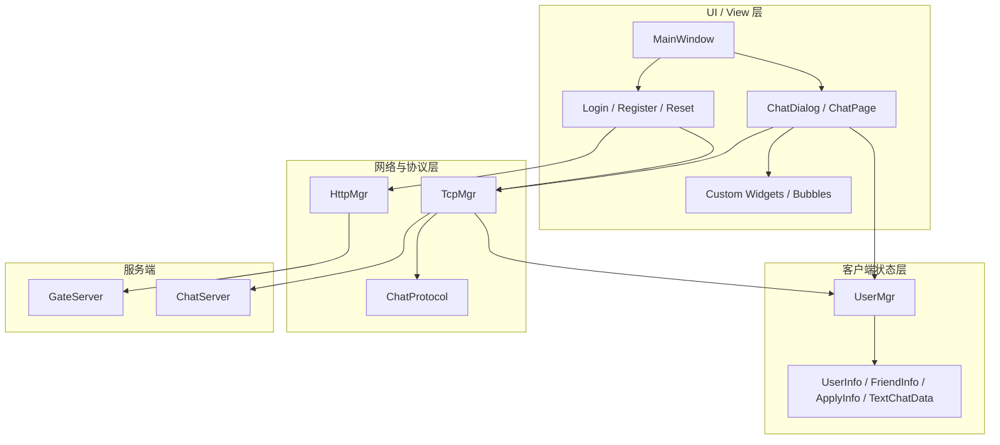

当前是逻辑分层，View 仍会直接调用单例状态和网络层。QML v2 需要新增 ViewModel。

### 1.2 客户端模块关系

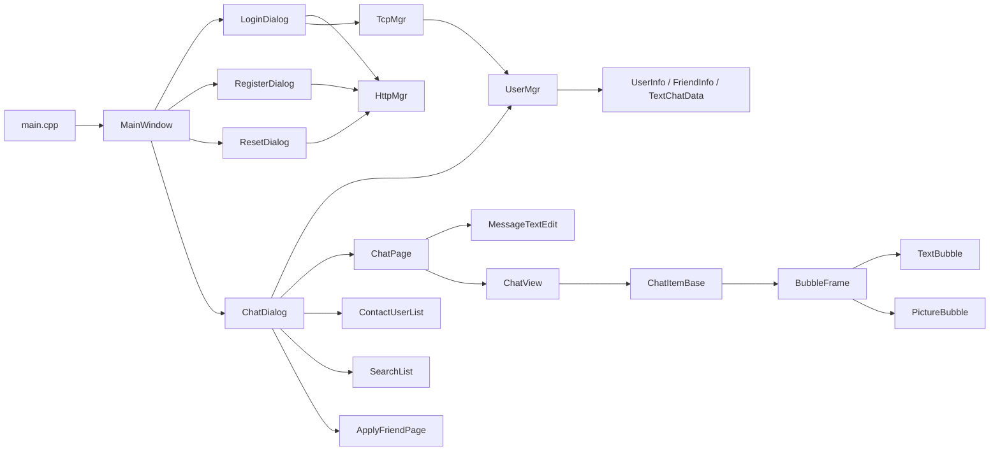

### 1.3 进程拓扑

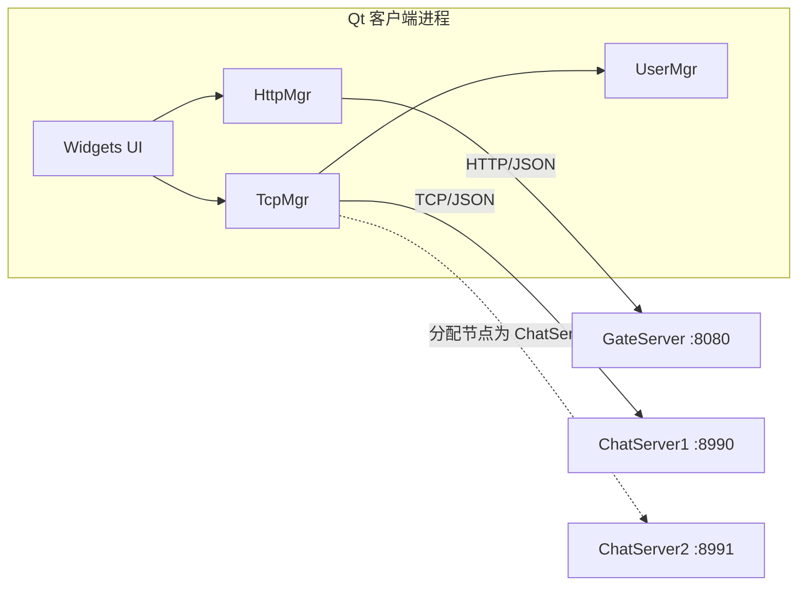

客户端只配置 GateServer 地址，ChatServer 由登录响应动态下发。

## 2. 启动与页面架构

### 2.1 启动流程

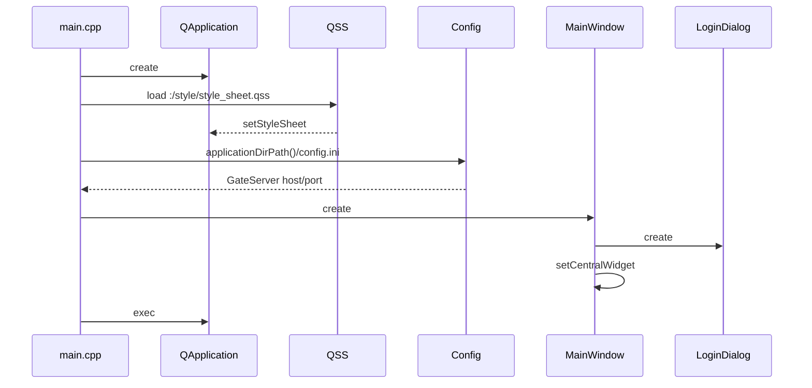

### 2.2 页面状态

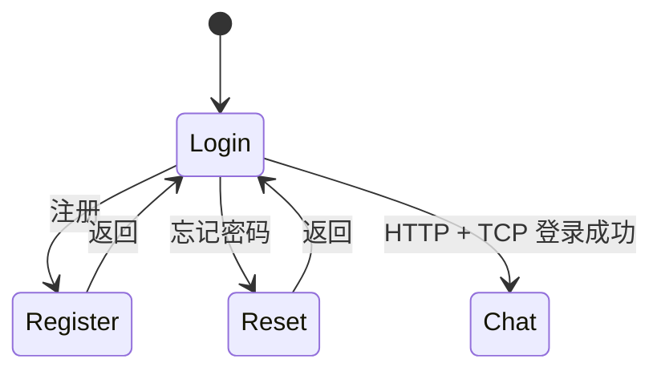

当前页面不是固定实例集合，而是每次切换动态创建 Dialog。

### 2.3 页面职责

| 页面 | 职责 |
| --- | --- |
| `LoginDialog` | 登录校验、HTTP 登录、TCP 连接和聊天登录 |
| `RegisterDialog` | 验证码和注册 |
| `ResetDialog` | 验证码和重置密码 |
| `ChatDialog` | 聊天主窗口、列表和页面切换 |
| `ChatPage` | 当前会话和消息输入/显示 |
| `ApplyFriend` | 填写好友申请 |
| `AuthenFriend` | 填写认证备注 |
| `FindSuccessDlg/FindFailDlg` | 用户搜索结果 |

## 3. 类与组件架构

### 3.1 核心类

| 类 | 职责 |
| --- | --- |
| `HttpMgr` | HTTP 请求与模块信号分发 |
| `TcpMgr` | TCP 连接、拆包、发送和消息分发 |
| `UserMgr` | 当前用户、Token、好友、申请和消息状态 |
| `ChatDialog` | 聊天页面协调器 |
| `ChatPage` | 单个会话页面 |
| `ChatView` | 消息列表容器 |
| `MessageTextEdit` | 图文混排输入 |
| `ChatItemBase` | 单条消息布局 |
| `BubbleFrame` | 气泡外观 |
| `TextBubble/PictureBubble` | 消息内容 |
| `ChatUserWid` | 会话列表条目 |
| `ConUserItem` | 联系人条目 |
| `ApplyFriendItem` | 好友申请条目 |

### 3.2 UI 组件树

```text
MainWindow
└── centralWidget
    ├── LoginDialog
    ├── RegisterDialog
    ├── ResetDialog
    └── ChatDialog
        ├── side_bar_widget
        ├── chat_user_widget
        │   ├── search_edit / add_btn
        │   ├── chat_user_list
        │   ├── search_list
        │   └── con_user_list
        └── stackedWidget
            ├── ChatPage
            ├── ApplyFriendPage
            └── FriendInfoPage

ChatPage
├── title_label
├── ChatView
│   └── ChatItemBase*
└── MessageTextEdit + send_btn
```

### 3.3 自定义控件

| 控件 | 状态机制 |
| --- | --- |
| `ClickedBtn` | normal / hover / press |
| `ClickedLabel` | normal / selected + hover/press |
| `StateWidget` | 侧边栏选择和红点 |
| `TimerBtn` | 验证码倒计时 |
| `CustomizeEdit` | grapheme 安全长度限制 |
| `ListItemBase` | 列表条目基类和 QSS 背景 |

## 4. HTTP 架构

### 4.1 架构关系

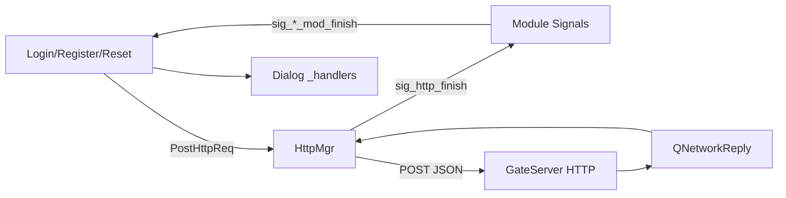

### 4.2 请求

```cpp
PostHttpReq(url, json, req_id, mod);
```

参数：

| 参数 | 含义 |
| --- | --- |
| `url` | GateServer 完整 URL |
| `json` | 请求 JSON |
| `req_id` | 具体操作 ID |
| `mod` | 注册/重置/登录模块 |

### 4.3 配置

- Content-Type：`application/json`
- 超时：10 秒
- 异步完成，不阻塞 UI 线程

### 4.4 模块分发

| Module | 信号 | 页面 |
| --- | --- | --- |
| `MOD_REGISTER` | `sig_reg_mod_finish` | RegisterDialog |
| `MOD_RESET` | `sig_reset_mod_finish` | ResetDialog |
| `MOD_LOGIN` | `sig_login_mod_finish` | LoginDialog |

### 4.5 回调表

每个 Dialog 维护：

```cpp
QMap<ReqId, std::function<void(const QJsonObject&)>> _handlers;
```

使用 `find()` 判断未知 ID，避免调用空函数。

## 5. TCP 架构

### 5.1 连接状态机

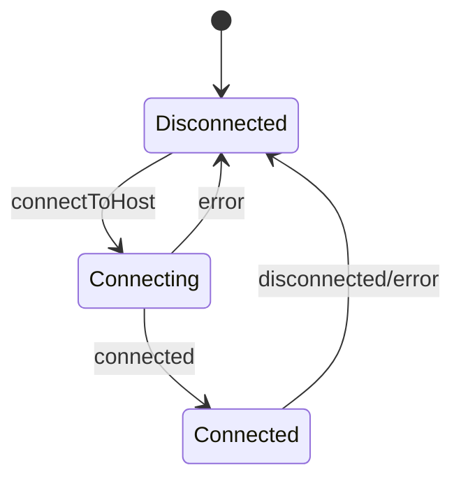

### 5.2 帧格式

```text
+----------------+----------------+----------------------+
| msg_id (2B BE) | len (2B BE)    | JSON body (len B)    |
+----------------+----------------+----------------------+
```

约束：

```text
len <= 2048
```

### 5.3 接收解析

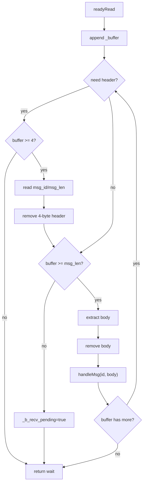

### 5.4 分发

```text
msg_id → _handlers[msg_id]
```

未知 ID 记录日志并丢弃，不影响后续包。

### 5.5 发送保护

发送前检查：

- Socket 是否 Connected。
- payload 是否超过 2048 字节。

## 6. ChatProtocol

### 6.1 接口

```cpp
QByteArray BuildTextRequest(int to_uid, const QJsonArray& messages);
AppendResult TryAppendText(int to_uid, QJsonArray& batch, const QJsonObject& message);
```

### 6.2 结果

| 结果 | 含义 |
| --- | --- |
| `Appended` | 当前批次可加入 |
| `NeedNewBatch` | 当前批次已满 |
| `TooLarge` | 单条消息本身超过 2048 |

### 6.3 分批原则

- 按最终紧凑 JSON 字节数。
- 不按 QString 字符数估算。
- 只在完整消息对象之间拆分。
- 单条消息内容不拆开。

## 7. 状态架构

### 7.1 UserMgr 关系

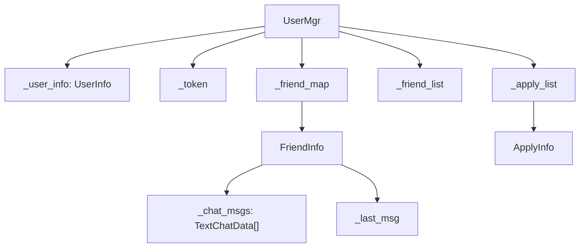

### 7.2 主要 DTO

| 类型 | 主要字段 |
| --- | --- |
| `UserInfo` | uid/name/nick/icon/sex/last_msg/chat_msgs |
| `FriendInfo` | uid/name/nick/icon/sex/desc/back/last_msg/chat_msgs |
| `ApplyInfo` | uid/name/nick/icon/sex/desc/status |
| `TextChatData` | unique_id/content/from_uid/to_uid |
| `TextChatMsg` | from_uid/to_uid/message array |

### 7.3 数据权威性

当前聊天状态不是单一模型：

```text
UserMgr._friend_map
ChatUserWid._user_info
ChatPage._user_info
```

三者共享部分 `shared_ptr`，但容器可能各自追加消息。v1 能工作，但后续 QML 应改为唯一 Store。

## 8. 部分流程

### 8.1 获取验证码

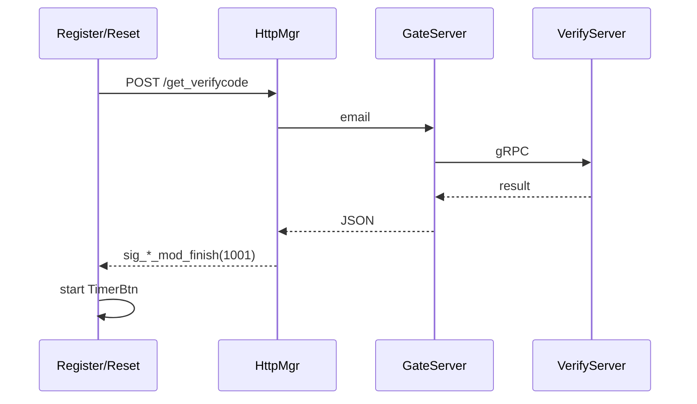

### 8.2 注册/重置密码

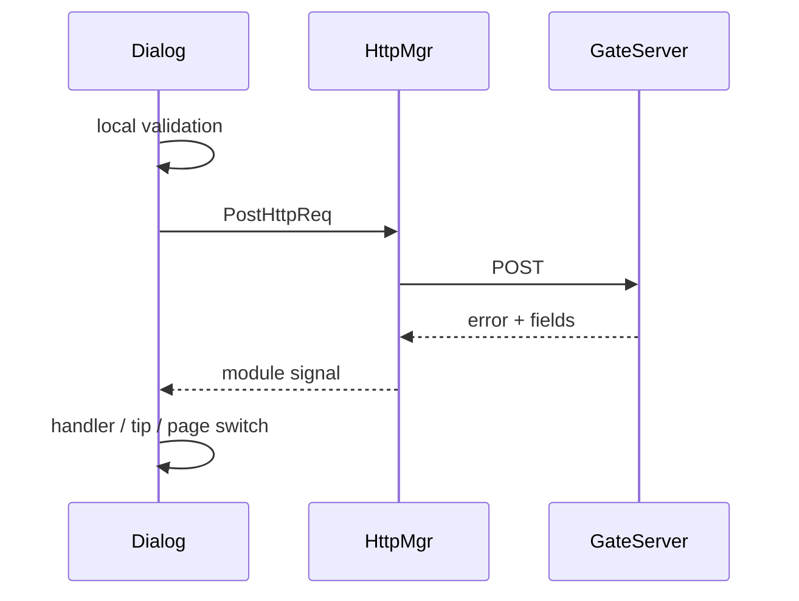

### 8.3 两段式登录

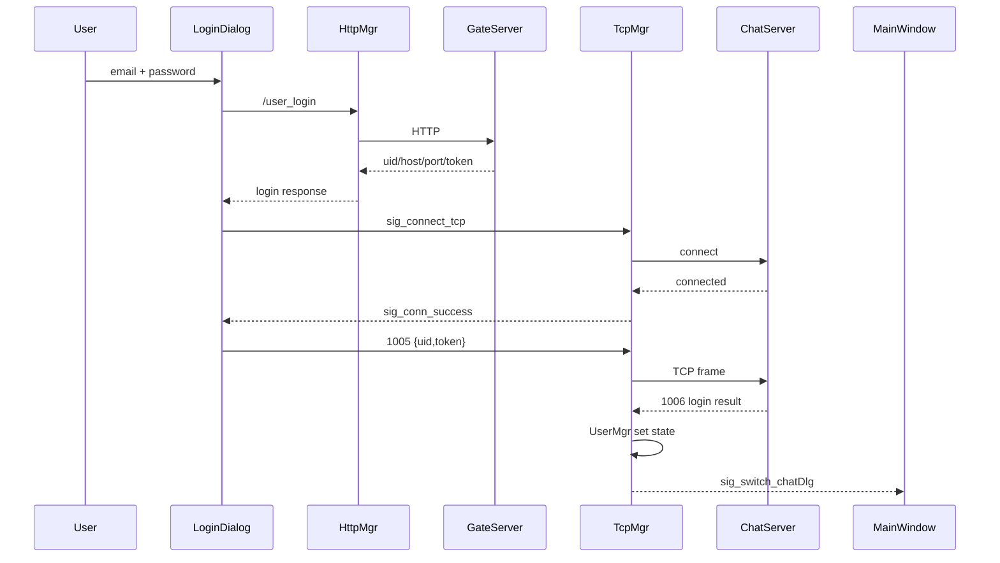

### 8.4 用户搜索

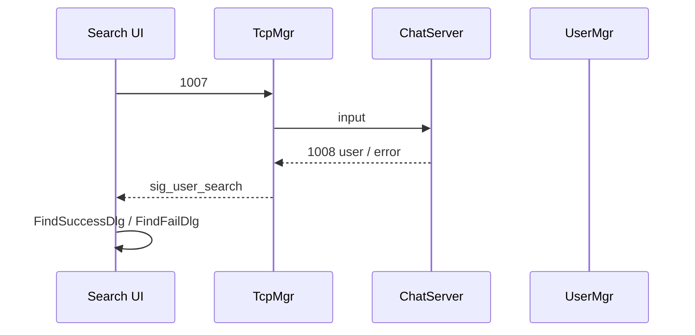

### 8.5 好友申请

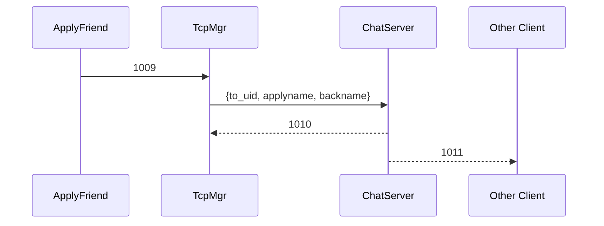

### 8.6 好友认证

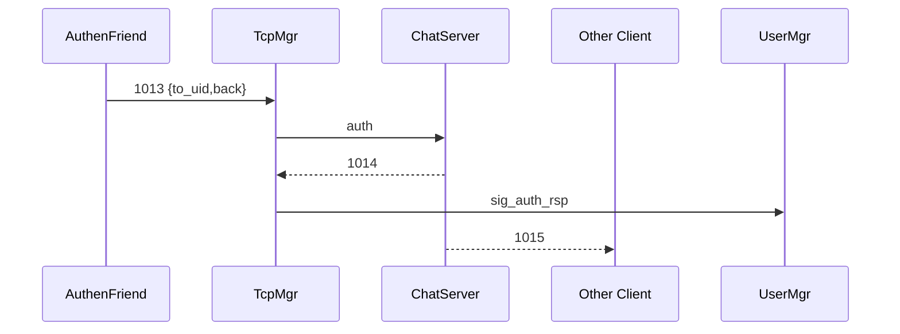

### 8.7 文本消息发送

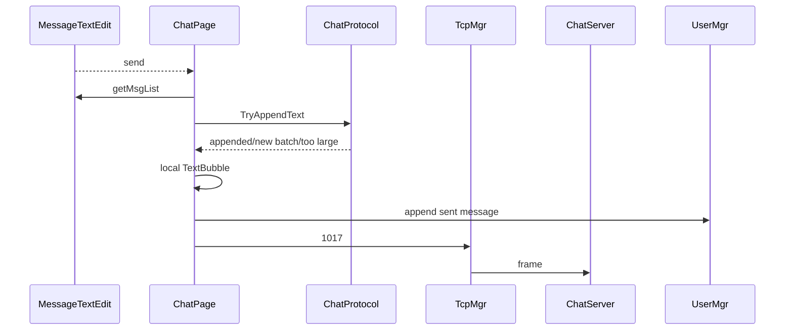

### 8.8 文本消息接收

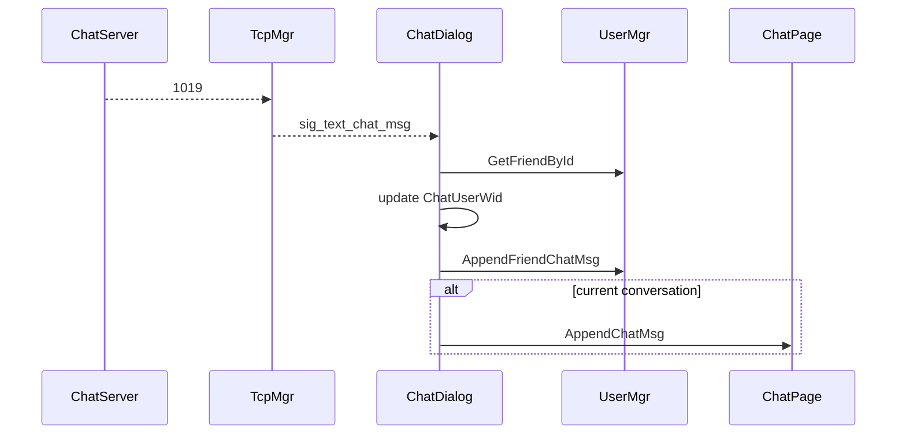

### 8.9 断线

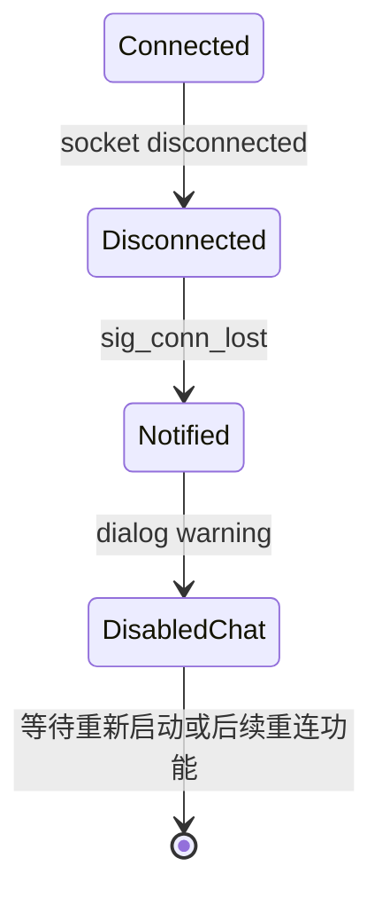

## 9. 完整端到端流程

### 9.1 主流程时序

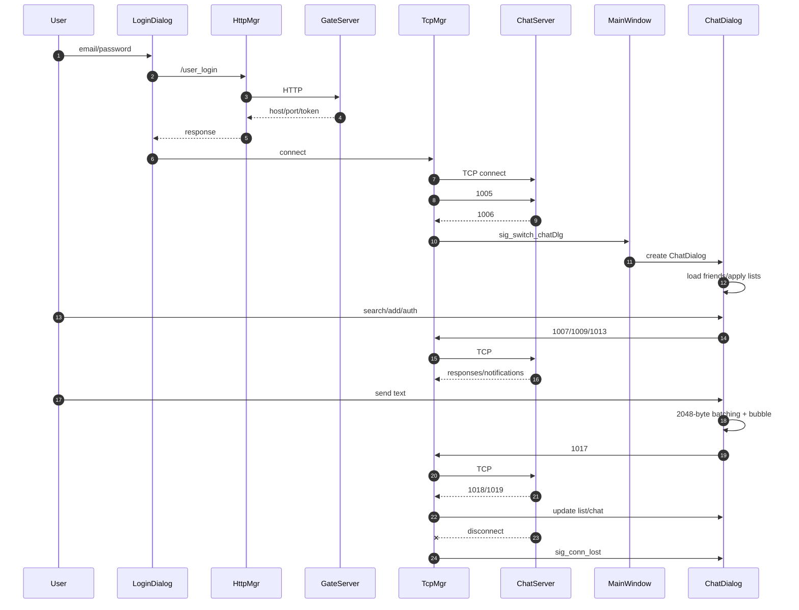

### 9.2 阶段说明

#### 阶段一：认证

```text
LoginDialog
  → HttpMgr
  → GateServer
  → uid/host/port/token
```

#### 阶段二：聊天会话

```text
TcpMgr
  → ChatServer
  → 1005/1006
  → UserMgr 登录态
  → ChatDialog
```

#### 阶段三：好友

```text
搜索
  → 申请
  → 通知
  → 认证
  → 好友列表更新
```

#### 阶段四：在线聊天

```text
MessageTextEdit
  → ChatProtocol
  → 1017
  → ChatServer
  → 1019
  → ChatDialog/ChatPage
```

#### 阶段五：断线

```text
socket disconnected
  → sig_conn_lost
  → warning
  → 聊天页禁用
```

### 9.3 客户端状态变化总表

| 阶段 | UI | UserMgr | TcpMgr |
| --- | --- | --- | --- |
| HTTP 登录前 | Login | 空 | Disconnected |
| HTTP 登录成功 | 等待 TCP | 可暂存 uid/token | Connecting |
| TCP 连接成功 | 等待 1006 | — | Connected |
| TCP 登录成功 | ChatDialog | 用户/好友/申请 | Connected |
| 好友申请 | 申请页/红点 | 追加申请 | Connected |
| 好友认证 | 聊天/联系人 | 追加好友 | Connected |
| 发送消息 | 本地气泡 | 追加聊天 | Connected |
| 接收消息 | 更新列表/气泡 | 追加聊天 | Connected |
| 断线 | 提示并禁用 | 保留内存状态 | Disconnected |

## 10. 消息渲染架构

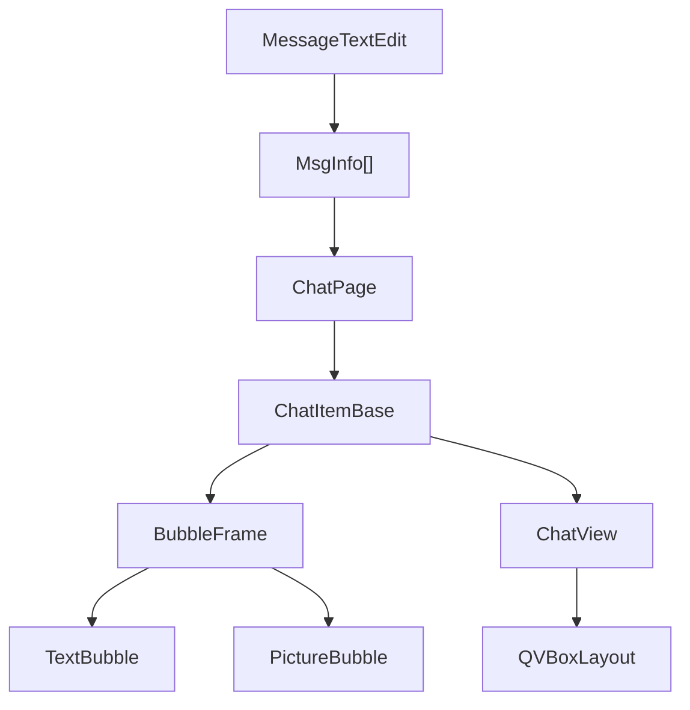

### 10.1 输入

`MessageTextEdit`：

- Enter 发送。
- Shift+Enter 换行。
- 支持文本。
- 支持图片/文件缩略图。
- `getMsgList()` 将文档转为 `MsgInfo` 顺序列表。

### 10.2 气泡

```text
ChatItemBase：名字、头像、气泡布局
BubbleFrame：圆角、背景、小三角
TextBubble/PictureBubble：内容
```

### 10.3 当前限制

- 网络主链路只发送 text。
- image 仅本地显示。
- file 分支为空。
- 消息无持久化。

## 11. 样式与资源架构

```mermaid
graph LR
    QSS["style_sheet.qss"] --> App["QApplication"]
    QRC["rc.qrc"] --> Resources["res/*"]
    State["Dynamic state property"] --> Repolish["repolish"]
    Repolish --> Widget["Widget style"]
    QSS --> Widget
    Resources --> Widget
```

当前样式集中在 QSS，自定义控件通过 `state` 动态属性切换样式。

已知债务：

- 重复规则。
- 颜色和字号参数不完全统一。
- 部分 `::focus` 规则无效。
- 视觉仍处于微信风资源拼接阶段。

v1 暂缓视觉优化，QML v2 建立 Theme 和组件系统。

## 12. 构建与测试

### 12.1 构建

```powershell
qmake client\client.pro
nmake
```

输出：

```text
client/bin/client.exe
```

### 12.2 协议测试

```powershell
qmake client\tests\client_protocol_test.pro
nmake
release\client_protocol_test.exe
```

结果：

```text
client protocol tests passed
```

### 12.3 端到端测试

```powershell
node server\tests\p0_security_smoke.js
```

结果：

```text
P0 security smoke test passed
```

## 13. 当前风险和架构债务

| 类别 | 问题 |
| --- | --- |
| 页面生命周期 | 每次切换动态创建 Dialog |
| UI 解耦 | View 直接调用网络层和 UserMgr |
| 状态一致性 | 好友消息存在多份视图容器 |
| 列表性能 | QListWidget + setItemWidget |
| 消息持久化 | 仅内存 |
| 网络恢复 | 无心跳、无重连 |
| 富媒体 | 网络协议仅文本 |
| 样式 | QSS 重复、参数不统一 |
| 测试 | UI 和状态层缺自动化测试 |

## 14. QML v2 演进方向

```mermaid
graph LR
    QML["QML Views"] --> VM["ViewModels / Models"]
    VM --> Services["Http/Tcp/Session Services"]
    Services --> Protocol["JSON / TCP Protocol"]
```

建议：

- 保留 `HttpMgr`、`TcpMgr`、DTO 和服务端协议。
- 抽出 ViewModel。
- 列表改 `QAbstractListModel`。
- 页面改 StackLayout。
- 样式改 Theme.qml。
- 渐进迁移，不一次性替换 v1。

## 15. 源码索引

| 主题 | 文件 |
| --- | --- |
| 入口 | `client/main.cpp` |
| 页面切换 | `client/mainwindow.cpp` |
| 登录 | `client/logindialog.cpp` |
| 注册 | `client/registerdialog.cpp` |
| 重置 | `client/resetdialog.cpp` |
| HTTP | `client/httpmgr.cpp` |
| TCP | `client/tcpmgr.cpp` |
| 协议分批 | `client/chatprotocol.cpp` |
| 状态 | `client/usermgr.cpp` |
| 数据模型 | `client/userdata.h` |
| 聊天窗口 | `client/chatdialog.cpp` |
| 聊天内容 | `client/chatpage.cpp` |
| 输入 | `client/messagetextedit.cpp` |
| 气泡 | `client/bubbleframe.cpp`、`textbubble.cpp` |
| 样式 | `client/style/style_sheet.qss` |
| 测试 | `client/tests/client_protocol_test.cpp` |

## 16. 结论

v1 客户端已经完成完整的 Qt Widgets 在线聊天闭环，并通过 HTTP、TCP、好友和消息流程形成了稳定的演示版本。

当前架构适合冻结为 v1，不建议继续在 Widgets UI 上做大规模结构调整。下一阶段应优先实现心跳、重连和会话生命周期，再基于现有网络与状态能力启动 QML v2。
