# v1 版本服务端架构与流程

## 0. 文档说明

### 0.1 定位

本文以当前 v1 代码为事实来源，整理服务端架构、关系拓扑、关键局部流程和完整端到端流程。

历史文档主要用于参考分析框架：

- `服务端架构与处理流程4.0.md`：进程拓扑、线程模型、状态落点和风险分类。
- `GateServer 架构分析.md`：HTTP 网关分层和请求生命周期。
- `全栈架构与处理流程3.0.md`：早期端到端调用链。
- `P0-*`、`P1-*`：当前已经完成的认证、身份、缓存和状态一致性改造。

历史文档中已经过时的“好友和聊天未实现”“跨节点 RPC 为空实现”“Token 无 TTL”等结论，不在本文继续沿用。

### 0.2 v1 目标

v1 建立一个可运行、可演示的在线聊天系统：

```text
邮箱验证码
  → 注册/登录/重置密码
  → ChatServer 分配
  → TCP 长连接
  → 搜索用户
  → 申请好友
  → 认证好友
  → 在线文本聊天
  → 双 ChatServer 跨节点转发
```

### 0.3 设计原则

| 原则 | 体现 |
| --- | --- |
| 认证与聊天分离 | GateServer/StatusServer 做认证与发现，ChatServer 做长连接 |
| 状态按访问频率分层 | MySQL 持久化，Redis 路由和短期缓存，内存保存本地 Session |
| 客户端身份不可信 | 操作者取 `Session::GetUserId()` |
| 密码最小暴露 | Argon2id 仅由 GateServer 使用 |
| 跨节点可路由 | Redis `uip_` + gRPC ChatService |
| 先完成主链路 | 暂不实现离线、消息历史、心跳和踢人 |

## 1. 系统架构视图

### 1.1 进程架构

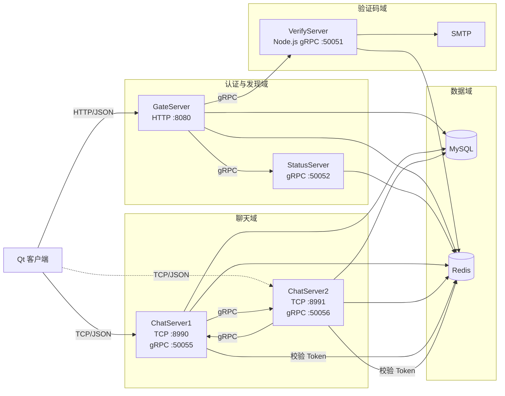

说明：

- 客户端直接连接 GateServer 和分配到的 ChatServer。
- ChatServer 之间只通过 gRPC 传递好友和聊天通知。
- 跨进程共享状态没有共享内存，主要依赖 Redis。
- 用户、好友和申请数据以 MySQL 为准。

### 1.2 组件职责

| 组件 | 运行形态 | 核心职责 | 主要依赖 |
| --- | --- | --- | --- |
| GateServer | C++ HTTP 服务 | 注册、登录、重置密码、验证码代理、节点分配 | Verify、Status、MySQL、Redis、libsodium |
| VerifyServer | Node.js gRPC 服务 | 验证码生成、Redis 缓存、邮件发送 | Redis、SMTP |
| StatusServer | C++ gRPC 服务 | ChatServer 选择、Token 签发与校验 | Redis |
| ChatServer1 | C++ TCP + gRPC 服务 | 会话、好友、在线消息、跨节点源/目标 | MySQL、Redis、对端 ChatServer |
| ChatServer2 | 同源第二实例 | 第二聊天节点 | 同上 |
| MySQL | 数据库 | 用户、好友申请、好友关系 | — |
| Redis | 状态存储 | 验证码、Token、节点归属、计数、资料缓存 | — |

### 1.3 部署拓扑

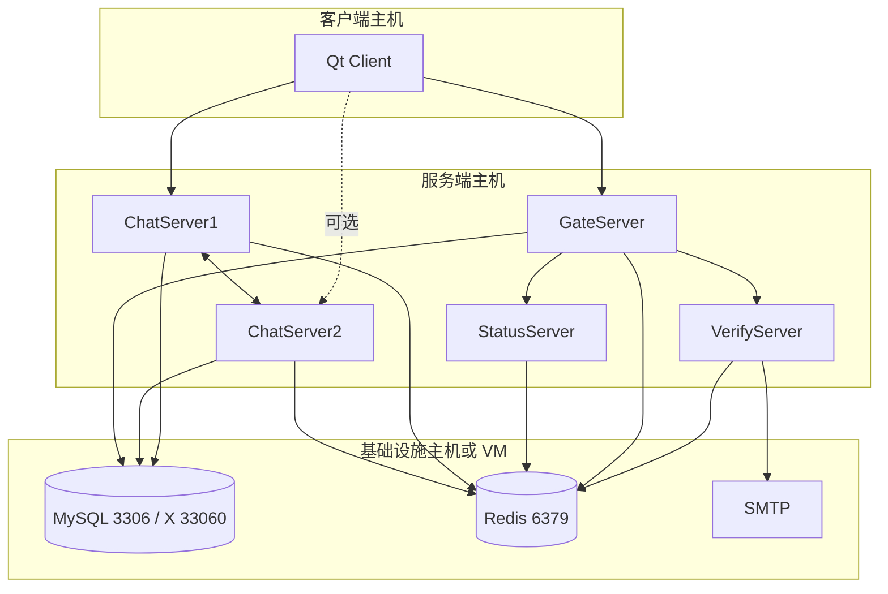

当前示例配置中，多个服务地址使用回环地址，因此“双 ChatServer”首先体现为两个独立进程，而不是两台物理机器。真正跨主机部署时需要统一修改 `[SelfServer]`、`[PeerServer]`、`[chatserverN]` 和客户端下发地址。

### 1.4 默认端口

| 端口 | 服务 | 协议 | 使用者 |
| --- | --- | --- | --- |
| 8080 | GateServer | HTTP | Qt 客户端 |
| 50051 | VerifyServer | gRPC | GateServer |
| 50052 | StatusServer | gRPC | GateServer |
| 8990 | ChatServer1 | 自定义 TCP | Qt 客户端 |
| 50055 | ChatServer1 | gRPC ChatService | ChatServer2 |
| 8991 | ChatServer2 | 自定义 TCP | Qt 客户端 |
| 50056 | ChatServer2 | gRPC ChatService | ChatServer1 |
| 3306 / 33060 | MySQL | SQL / X Protocol | 服务端和运维工具 |
| 6379 | Redis | RESP | 所有服务 |

## 2. GateServer 架构

### 2.1 组件关系

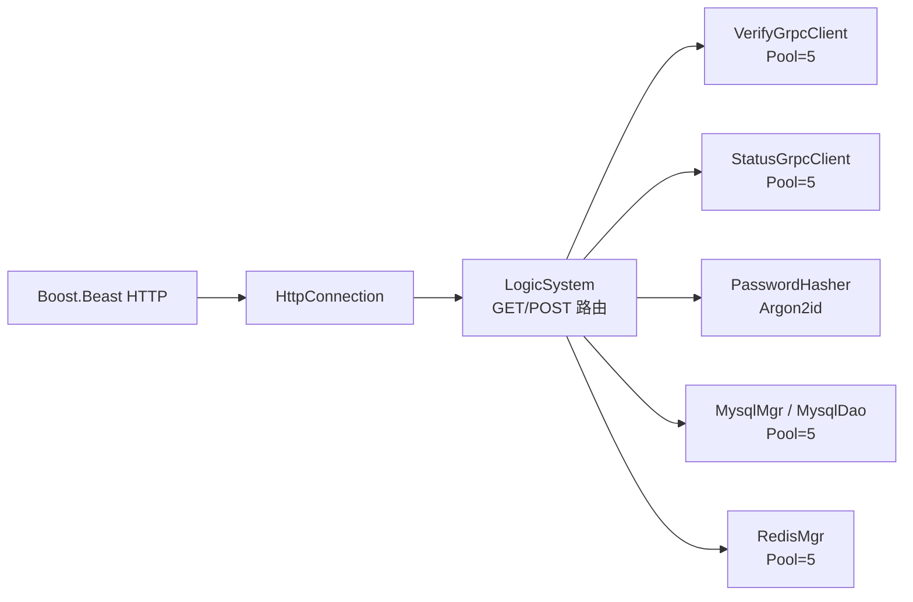

### 2.2 类职责

| 类 | 职责 |
| --- | --- |
| `CServer` | HTTP acceptor |
| `HttpConnection` | 读取完整 HTTP 请求、解析 GET 参数、写回响应、连接超时 |
| `LogicSystem` | 请求路由和认证业务 |
| `VerifyGrpcClient` | 向 VerifyServer 请求验证码 |
| `StatusGrpcClient` | 请求 ChatServer 地址和 Token |
| `PasswordHasher` | Argon2id 哈希和校验 |
| `MysqlDao/MysqlMgr` | 注册、密码、邮箱和用户查询 |
| `RedisMgr` | 验证码读取 |

### 2.3 HTTP 路由

| 方法 | 路径 | 主要副作用 |
| --- | --- | --- |
| GET | `/get_test` | 无 |
| POST | `/get_verifycode` | Redis 验证码、SMTP 邮件 |
| POST | `/user_register` | MySQL 用户记录 |
| POST | `/reset_pwd` | MySQL 密码哈希 |
| POST | `/user_login` | Redis Token、返回 ChatServer |

### 2.4 请求生命周期

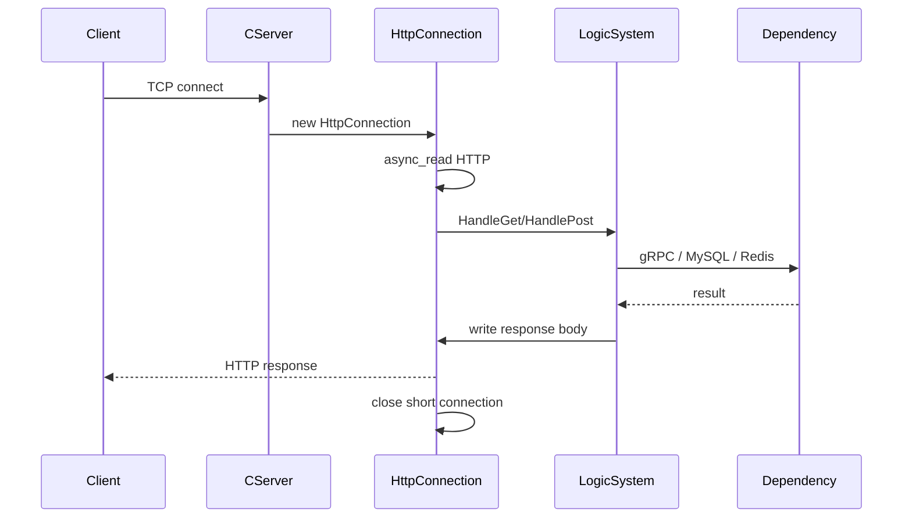

### 2.5 成功回包约束

```text
参数校验
  → 验证码或密码校验
  → 数据库/Redis 主操作
  → error = Success
  → HTTP 响应
```

## 3. VerifyServer 架构

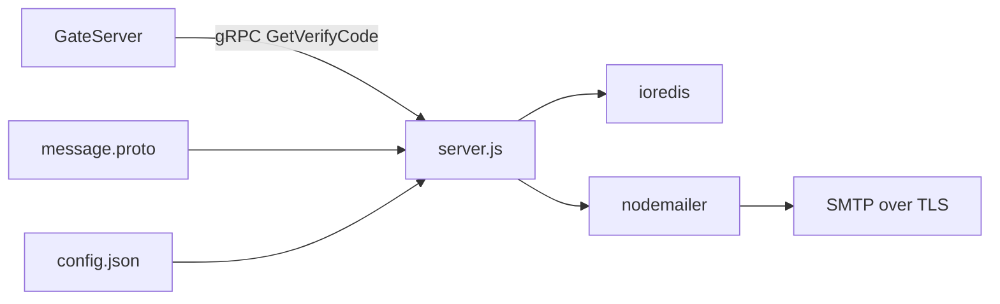

### 3.1 模块

| 文件 | 职责 |
| --- | --- |
| `server.js` | gRPC 服务和验证码业务 |
| `redis.js` | Redis 客户端 |
| `email.js` | SMTP transport |
| `proto.js` | 动态加载 proto |
| `config.js` | 本地配置 |

### 3.2 验证码状态

```text
code_<email> → 4 位验证码
TTL = 600 秒
```

已存在验证码时复用，不刷新 TTL。

## 4. StatusServer 架构

### 4.1 内部结构

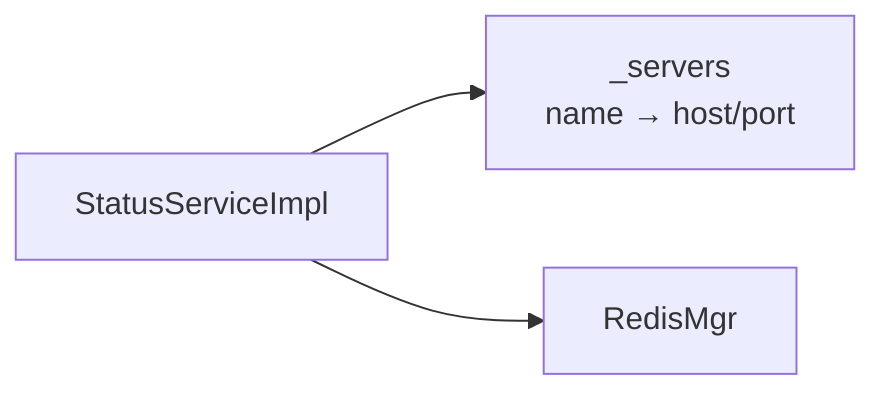

### 4.2 GetChatServer

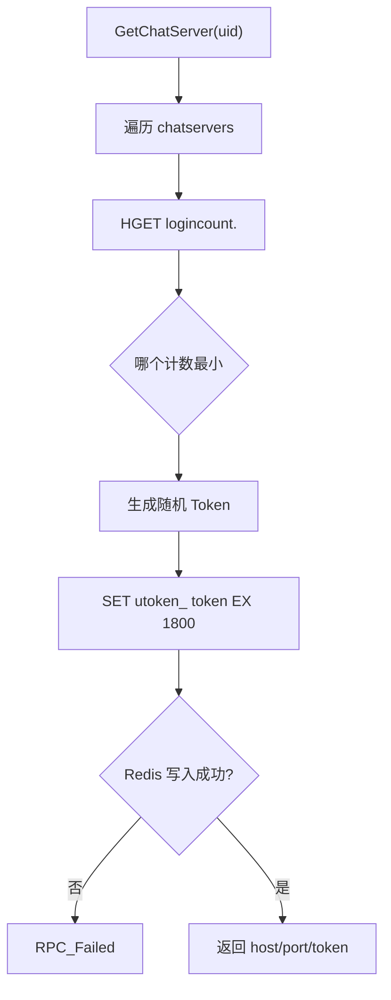

Token 默认 TTL 在配置中覆盖：

```ini
[Auth]
TokenTtlSeconds = 1800
```

### 4.3 Login

`Login(uid, token)` 读取 Redis `utoken_<uid>` 并比较。当前主要登录链路在 ChatServer 中也直接读取同一 Token key。

## 5. ChatServer 架构

### 5.1 内部组件

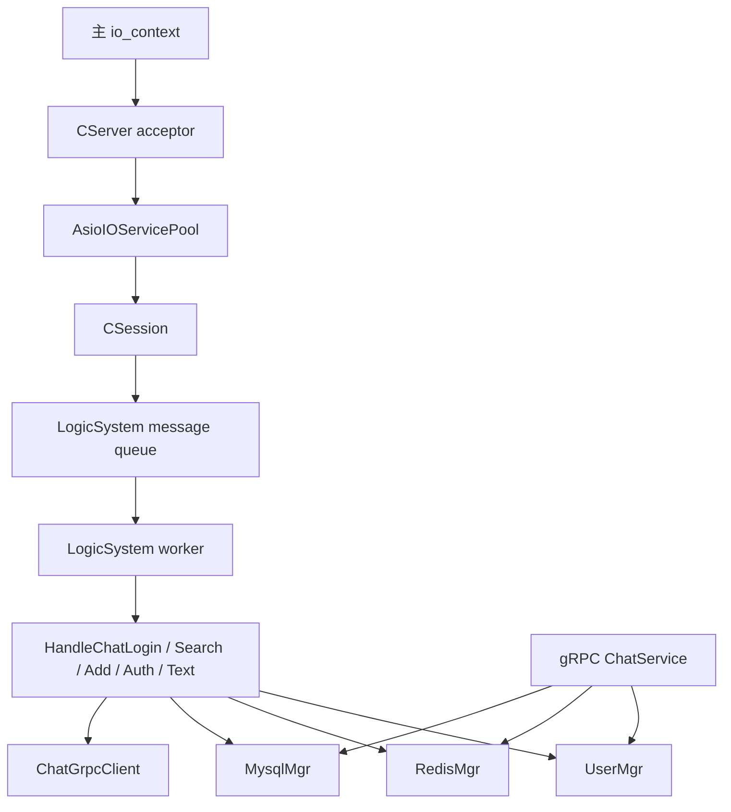

### 5.2 类职责

| 类 | 职责 |
| --- | --- |
| `CServer` | 接受连接、管理 `session_id → CSession`、断线清理 |
| `CSession` | 单连接帧读写、发送队列 |
| `LogicNode` | 会话 + 已接收消息 |
| `LogicSystem` | 消息队列、处理器注册、用户查询辅助 |
| `UserMgr` | `uid → 本地 Session` |
| `ChatServiceImpl` | 接收跨节点好友和文本通知 |
| `ChatGrpcClient` | 向对端 ChatServer 发通知 |
| `StatusGrpcClient` | 调用 StatusServer |
| `MysqlDao` | 用户、好友申请和好友关系 |
| `RedisMgr` | Token、路由、资料缓存和计数 |

### 5.3 启动

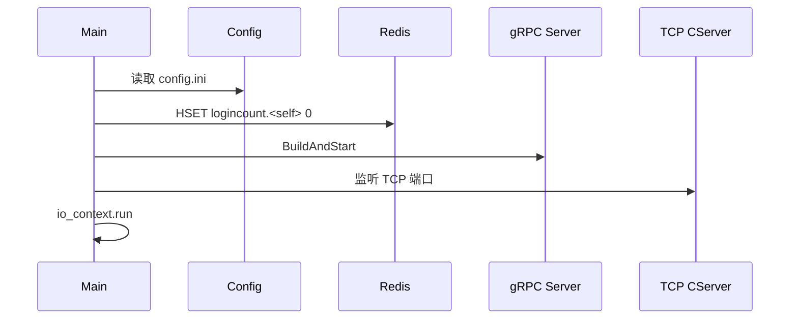

### 5.4 线程模型

| 执行体 | 数量 | 职责 |
| --- | --- | --- |
| Asio 线程池 | 接近 CPU 核心数 | socket 读写、accept 回调 |
| Chat 主 io_context | 1 | acceptor 和信号 |
| 逻辑工作线程 | 1 | 所有客户端 JSON 业务 |
| gRPC 服务线程 | 1 | 跨节点通知 |

单业务线程保证客户端消息处理顺序，但 Redis/MySQL 抖动会影响该节点全部客户端业务。

### 5.5 消息处理器

```text
1005 → LogicSystem::HandleChatLogin
1007 → LogicSystem::HandleSearchUser
1009 → LogicSystem::HandleAddFriend
1013 → LogicSystem::HandleAuthFriend
1017 → LogicSystem::HandleTextChatMsg
```

处理器定义在 `LogicSystem.cpp`，`RegisterCallBacks` 只做映射。

## 6. 通信架构

### 6.1 通道

| 通道 | 发起方 | 目标 | 编码 |
| --- | --- | --- | --- |
| HTTP | 客户端 | GateServer | JSON |
| gRPC | C++/Node 服务 | 其他服务 | Protobuf |
| TCP | 客户端 | ChatServer | 4B 头 + JSON |
| Redis | 所有服务 | Redis | RESP |

### 6.2 TCP 帧

```text
+----------------+----------------+----------------------+
| msg_id (2B BE) | len (2B BE)    | JSON body (len B)    |
+----------------+----------------+----------------------+
```

硬约束：

```text
len <= 2048
```

### 6.3 gRPC 服务

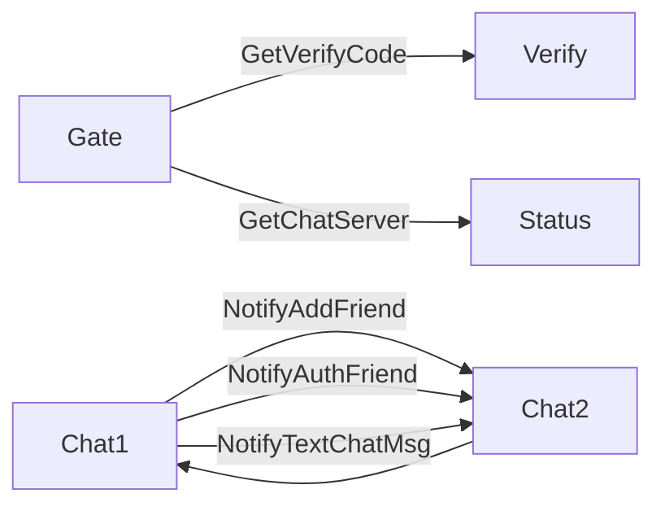

## 7. 数据与状态架构

### 7.1 状态拓扑

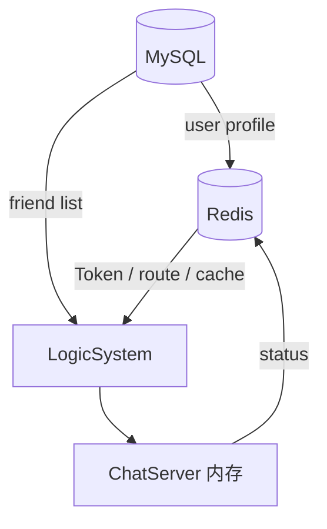

### 7.2 权威来源

| 数据 | 权威来源 | 派生状态 |
| --- | --- | --- |
| 账号、密码哈希 | MySQL | 无 |
| 好友申请 | MySQL | 无 |
| 好友关系 | MySQL | `AreFriends` 查询 |
| 验证码 | Redis | 无 |
| Token | Redis | 无 |
| 用户在线节点 | Redis `uip_` | 本地 Session 为实际连接 |
| 本地连接 | ChatServer 内存 | Redis 仅保存路由和计数 |
| 聊天消息 | 仅在线内存 | 无持久化 |

### 7.3 MySQL

| 表 | 重要字段 |
| --- | --- |
| `user` | `uid/name/email/password_hash/nick/desc/sex/icon` |
| `user_id` | `id`，单行 UID 发号器 |
| `friend_apply` | `from_uid/to_uid/status` |
| `friend` | `self_id/friend_id/back` |

关键约束：

```text
user.uid UNIQUE
user.name UNIQUE
user.email UNIQUE
friend(self_id,friend_id) UNIQUE
```

### 7.4 Redis

| Key | 内容 | TTL |
| --- | --- | --- |
| `code_<email>` | 验证码 | 600s |
| `utoken_<uid>` | Token | 默认 1800s |
| `uip_<uid>` | ChatServer 名 | 无 |
| `ubaseinfo_<uid>` | 用户资料 JSON | 默认 600s |
| `nameinfo_<name>` | UID 字符串 | 默认 600s |
| `logincount` Hash | 每节点连接数 | 无 |

### 7.5 用户缓存拓扑

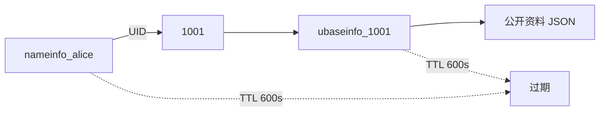

## 8. 部分流程

### 8.1 获取验证码

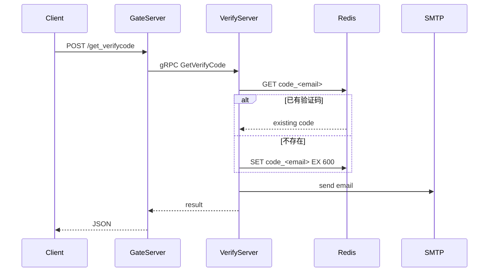

### 8.2 注册

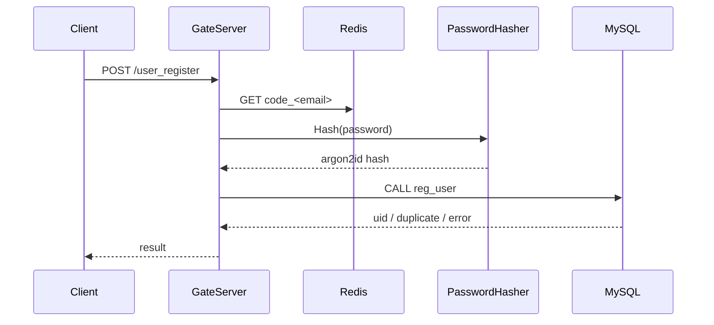

### 8.3 重置密码

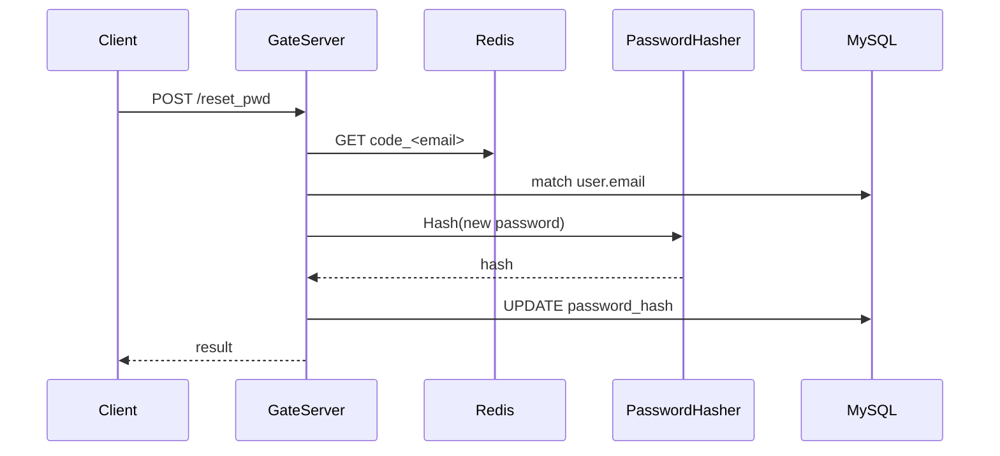

### 8.4 HTTP 登录和节点分配

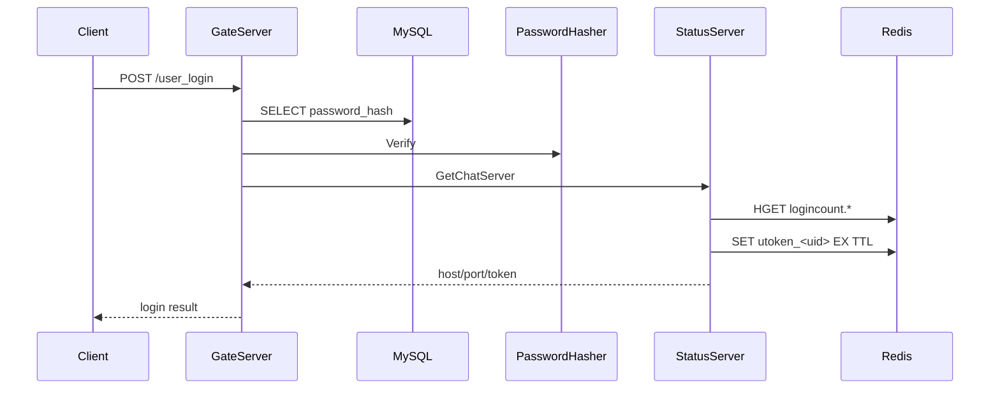

### 8.5 TCP 登录

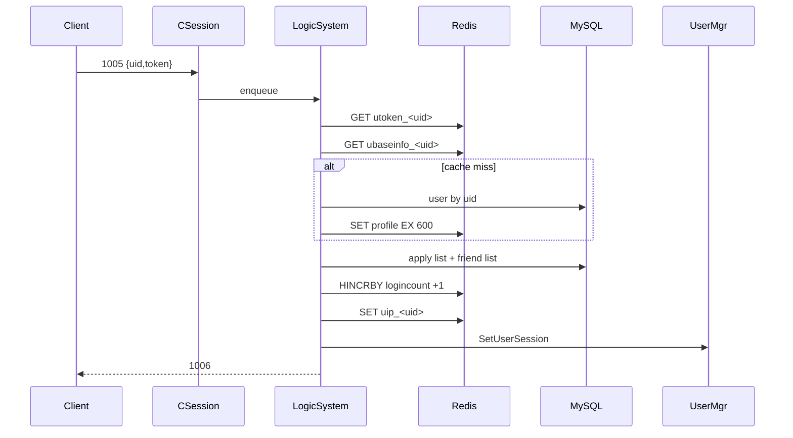

### 8.6 用户搜索

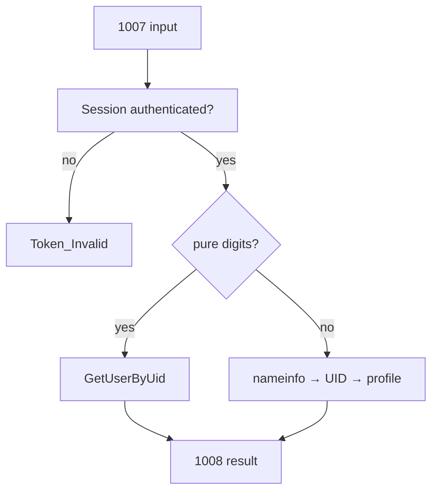

### 8.7 好友申请

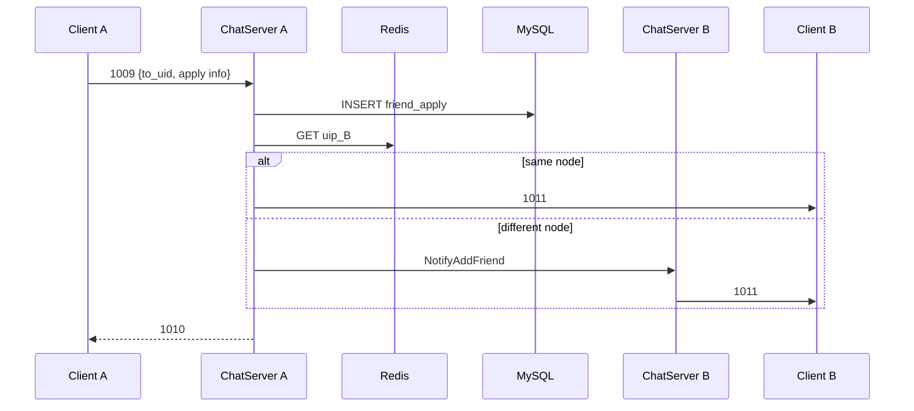

### 8.8 好友认证

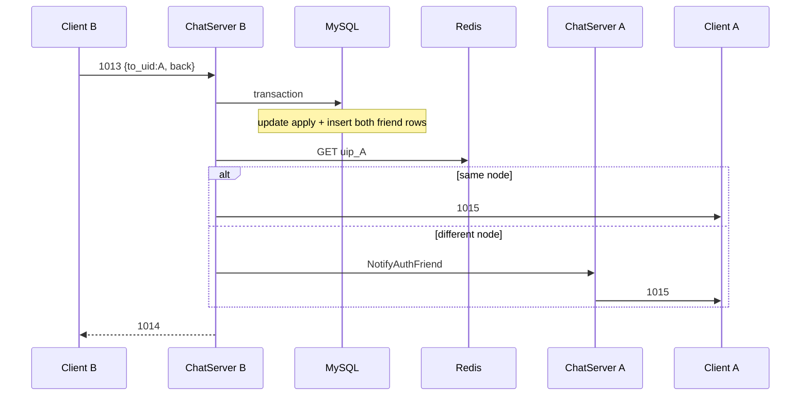

### 8.9 同节点文本消息

```mermaid
sequenceDiagram
    participant A as Client A
    participant C as ChatServer
    participant DB as MySQL
    participant R as Redis
    participant B as Client B

    A->>C: 1017
    C->>C: Session UID + field validation
    C->>DB: AreFriends(A,B)
    C->>R: GET uip_B
    R-->>C: current server
    C->>B: 1019
    C-->>A: 1018 success
```

### 8.10 跨节点文本消息

```mermaid
sequenceDiagram
    participant A as Client A
    participant C1 as ChatServer1
    participant DB as MySQL
    participant R as Redis
    participant C2 as ChatServer2
    participant B as Client B

    A->>C1: 1017
    C1->>DB: AreFriends(A,B)
    C1->>R: GET uip_B
    R-->>C1: chatserver2
    C1->>C2: gRPC NotifyTextChatMsg
    C2->>B: 1019
    C2-->>C1: Success
    C1-->>A: 1018 success
```

### 8.11 断线清理

```mermaid
flowchart TD
    A["socket read/write error"] --> B["CSession.Close"]
    B --> C["CServer.ClearSession(session_id)"]
    C --> D{"session exists?"}
    D -- no --> Z["return"]
    D -- yes --> E["erase session"]
    E --> F{"uid > 0?"}
    F -- no --> Z
    F -- yes --> G["RmvUserSession(uid)"]
    G --> H["HINCRBY logincount -1"]
    H --> I{"other local session?"}
    I -- yes --> Z
    I -- no --> J{"uip_<uid> still self?"}
    J -- yes --> K["DEL uip_<uid>"]
```

## 9. 完整端到端流程

### 9.1 主流程

```mermaid
sequenceDiagram
    autonumber
    participant A as Client A
    participant G as GateServer
    participant V as VerifyServer
    participant S as StatusServer
    participant C1 as ChatServer1
    participant R as Redis
    participant DB as MySQL
    participant C2 as ChatServer2
    participant B as Client B

    A->>G: get verify code
    G->>V: GetVerifyCode
    V->>R: code_<email>
    V-->>G: success
    A->>G: register
    G->>DB: reg_user + argon2id
    A->>G: login
    G->>DB: verify password hash
    G->>S: GetChatServer
    S->>R: choose count + token TTL
    G-->>A: host/port/token
    A->>C1: TCP connect + 1005
    C1->>R: token + profile + route
    C1->>DB: apply/friend lists
    C1-->>A: 1006

    B->>C2: TCP connect + 1005
    C2-->>B: 1006

    A->>C1: 1007 search B
    C1-->>A: 1008
    A->>C1: 1009 add B
    C1->>DB: friend_apply
    C1->>C2: NotifyAddFriend
    C2->>B: 1011
    B->>C2: 1013 accept
    C2->>DB: friend transaction
    C2->>C1: NotifyAuthFriend
    C1->>A: 1015

    A->>C1: 1017 text
    C1->>DB: AreFriends
    C1->>R: uip_B = chatserver2
    C1->>C2: NotifyTextChatMsg
    C2->>B: 1019
    C1-->>A: 1018

    A--xC1: disconnect
    C1->>R: logincount -1 / clear uip
```

### 9.2 按阶段说明

#### 阶段一：账号建立

```text
验证码
  → 注册
  → Argon2id
  → MySQL user
```

#### 阶段二：发现聊天节点

```text
HTTP 登录
  → 密码校验
  → StatusServer 选择最小负载节点
  → Token 写 Redis
  → 返回 host/port/token
```

#### 阶段三：建立聊天会话

```text
TCP connect
  → 1005
  → Token 校验
  → 用户资料
  → 好友/申请列表
  → uip + Session + logincount
  → 1006
```

#### 阶段四：建立好友关系

```text
搜索
  → 申请写入 MySQL
  → 在线通知
  → 对方同意
  → 事务写双向好友关系
  → 通知双方
```

#### 阶段五：在线聊天

```text
1017
  → Session 身份
  → AreFriends
  → 查 uip
  → 同服直发 / 跨服 gRPC
  → 1019
  → 1018
```

#### 阶段六：会话结束

```text
TCP 断开
  → Session 清理
  → 在线计数 -1
  → 清 uid → Session
  → 清 uip
  → Token 等待 TTL
```

### 9.3 一次操作的状态变化总表

| 阶段 | MySQL | Redis | ChatServer 内存 |
| --- | --- | --- | --- |
| 验证码 | — | `code_` | — |
| 注册 | 新增 `user` | — | — |
| HTTP 登录 | 读取密码哈希 | 新增 `utoken_` | — |
| TCP 登录 | 读取用户/好友 | `ubaseinfo_`、`nameinfo_`、`uip_`、`logincount+1` | `uid → Session` |
| 好友申请 | 新增 `friend_apply` | — | 无 |
| 好友认证 | 更新申请、新增双向 `friend` | — | 无 |
| 发送消息 | 读取好友关系 | 读取 `uip_` | 使用目标 Session |
| 接收消息 | — | — | 目标 Session Send |
| 断线 | — | `logincount-1`、可能删 `uip_` | 删除 `uid → Session` |

## 10. 构建、启动与测试

### 10.1 构建

```powershell
cmake --preset windows-vcpkg
cmake --build build --config Debug --target GateServer StatusServer ChatServer ChatServer2
```

### 10.2 启动

```text
MySQL/Redis
  → npm run serve（VerifyServer）
  → StatusServer
  → GateServer
  → ChatServer
  → ChatServer2
  → Qt 客户端
```

各服务必须从包含本地 `config.ini/config.json` 的目录启动。

### 10.3 测试

```powershell
node server\tests\p0_security_smoke.js
```

最近一次 v1 回归结果：

```text
P0 security smoke test passed
```

覆盖完整账号、好友和文本消息链路，包括跨节点通知。

## 11. 风险和边界

### 11.1 会话

- 同账号重复登录仍可能覆盖 UID → Session。
- 没有踢人。
- 没有心跳和重连。

### 11.2 消息

- 只有在线转发。
- 没有消息持久化、离线消息、送达确认和重试。
- 发送队列满时可能丢消息。

### 11.3 分布式

- `uip_` 无 TTL，异常路径可能残留。
- ChatServer1/ChatServer2 仍为双份源码。
- 内部 gRPC 无 TLS/mTLS。

### 11.4 数据

- `AreFriends` 每条消息查询 MySQL。
- 好友列表未分页。
- Redis 与 MySQL 没有跨存储事务。

### 11.5 运维

- 没有统一结构化日志。
- 没有指标、Trace 和告警。
- HTTP 未启用 HTTPS。

## 12. 源码索引

| 主题 | 源码 |
| --- | --- |
| HTTP 入口 | `server/GateServer/HttpConnection.cpp` |
| HTTP 业务 | `server/GateServer/LogicSystem.cpp` |
| 密码哈希 | `server/GateServer/PasswordHasher.cpp` |
| 节点分配 | `server/StatusServer/StatusServiceImpl.cpp` |
| Chat 启动 | `server/ChatServer/ChatServer.cpp` |
| Session | `server/ChatServer/CSession.cpp` |
| Chat 业务 | `server/ChatServer/LogicSystem.cpp` |
| 跨节点 RPC | `server/ChatServer/ChatServiceImpl.cpp` |
| 跨节点客户端 | `server/ChatServer/ChatGrpcClient.cpp` |
| MySQL | `server/ChatServer/MysqlDao.cpp` |
| Redis | `server/ChatServer/RedisMgr.cpp` |
| SQL | `server/sql/schema.sql` |
| 测试 | `server/tests/p0_security_smoke.js` |

## 13. 结论

v1 服务端的核心架构是“HTTP 认证入口 + Status 发现 + 双 ChatServer 在线业务 + MySQL/Redis 分层状态”。

主链路已经完整，并经过真实端到端测试。下一阶段应围绕会话生命周期、可靠消息、双 ChatServer 合并和可观测性继续演进。
