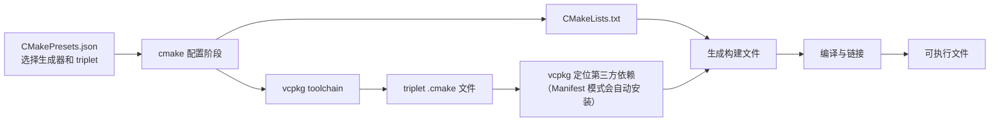

# CMake、CMakePresets、CMakeLists 与 vcpkg triplet

## 0. 文档定位

本文整理以下概念之间的关系：

```text
cmake 命令
CMakeLists.txt
CMakePresets.json
vcpkg
triplet
host triplet
target triplet
```

同时结合当前项目的实际目录、预设和依赖关系，说明配置为什么会这样组织，以及后续迁移到 Linux、Docker 或其他架构时应注意什么。

## 1. 一句话区分

| 名称 | 一句话职责 |
| --- | --- |
| `cmake` | 执行配置、生成构建系统并驱动构建的命令行工具 |
| `CMakeLists.txt` | 描述“构建什么、依赖什么、如何生成目标” |
| `CMakePresets.json` | 描述“在哪种环境中、用哪个生成器和哪个 triplet 构建” |
| vcpkg | 管理第三方 C/C++ 依赖及其 CMake 导出配置 |
| triplet | 告诉 vcpkg 为哪个目标平台、以哪种链接方式构建依赖 |
| host triplet | vcpkg 构建构建机自身要运行的宿主工具时使用 |
| target triplet | vcpkg 构建最终运行在目标平台上的库时使用 |

注意术语：

```text
正确：triplet
中文习惯说法：三元组 / 目标配置
不建议：triple
```

## 2. 整体工作流



实际执行路径：

```text
cmake --preset <configure-preset>
  → 读取 CMakePresets.json
  → 选择生成器、构建目录、cacheVariables
  → 加载 CMAKE_TOOLCHAIN_FILE
  → vcpkg 根据 target/host triplet 定位依赖
  → Manifest 模式下此时自动安装依赖
  → CMake 执行 CMakeLists.txt
  → find_package 找到依赖
  → 生成 Ninja 或 Visual Studio 构建文件

cmake --build --preset <build-preset>
  → 编译源文件
  → 生成协议代码
  → 链接依赖
  → 产出可执行文件
```

## 3. `cmake` 是什么

这里的 `cmake` 指命令行程序：

```bash
cmake --version
cmake --preset linux-vcpkg
cmake --build --preset linux-release
```

CMake 本身不是编译器，也不是包管理器。它负责：

- 读取 `CMakeLists.txt`
- 探测编译器和目标平台
- 执行 `find_package`
- 生成 Ninja、Makefile 或 Visual Studio 工程
- 调用底层编译器、链接器和代码生成工具

在当前项目中，CMake 最终会调用：

```text
protoc
grpc_cpp_plugin
g++ / cl.exe
ninja / MSBuild
linker
```

## 4. `CMakeLists.txt` 是什么

`CMakeLists.txt` 是项目的构建脚本，强调平台无关的项目逻辑。

当前项目分为三层：

```text
CMakeLists.txt
  └── server/CMakeLists.txt
        ├── GateServer/CMakeLists.txt
        ├── StatusServer/CMakeLists.txt
        ├── ChatServer/CMakeLists.txt
        └── ChatServer2/CMakeLists.txt
```

### 4.1 顶层 `CMakeLists.txt`

当前顶层负责：

- 声明最低 CMake 版本
- 设置 C++17
- 设置 MSVC 编译选项
- 查找 Protobuf、gRPC、Boost
- 进入 `server`

它不应该写死：

```text
C:/vcpkg
/opt/vcpkg
Visual Studio 路径
Linux 专用路径
```

这些环境相关内容更适合由 `CMakePresets.json` 或本地用户预设提供。

### 4.2 `server/CMakeLists.txt`

当前服务端公共层负责：

- 查找服务端公共依赖
- 定位 `protoc` 和 gRPC 插件
- 把 `message.proto` 生成成 C++ 代码
- 创建 `chat_proto` 静态库
- 引入四个 C++ 服务子目录

`chat_proto` 的公共头文件目录通过 `PUBLIC` 属性向下传递：

```cmake
target_include_directories(chat_proto PUBLIC ${GENERATED_DIR})
```

### 4.3 具体服务 `CMakeLists.txt`

以 GateServer 为例，它负责：

- 声明自己的源文件
- 创建 `GateServer` 可执行目标
- 链接 gRPC、Protobuf、Boost、Redis++、MySQL Connector、libsodium
- 在构建后复制本地 `config.ini`

它不需要知道 vcpkg 安装目录在哪里，只需要使用 vcpkg 导出的标准 target，例如：

```text
gRPC::grpc++
protobuf::libprotobuf
Boost::asio
redis++::redis++
unofficial::mysql-connector-cpp::connector
```

### 4.4 当前可优化的地方

当前顶层和 `server/CMakeLists.txt` 都调用了部分 `find_package`。重复调用通常不会出错，但会让依赖职责不够集中。

更清晰的边界可以是：

```text
顶层 CMakeLists:
  项目级策略 + add_subdirectory(server)

server/CMakeLists:
  服务端公共依赖 + proto + 子服务
```

或者创建公共接口目标：

```cmake
add_library(chat_dependencies INTERFACE)
target_link_libraries(chat_dependencies INTERFACE
    gRPC::grpc++
    protobuf::libprotobuf
    Boost::asio
    Boost::boost
)
```

具体服务只链接：

```cmake
target_link_libraries(GateServer PRIVATE chat_dependencies)
```

当前项目规模还不大，不必立即重构；但新增服务增多后，这能减少重复配置和依赖漂移。

## 5. `CMakePresets.json` 是什么

`CMakePresets.json` 是 CMake 的环境入口，解决“每次手动输入一长串 cmake 参数”的问题。

它不是普通的 CMake 脚本，不执行 `add_executable`、`target_link_libraries` 等构建逻辑。

### 5.1 Configure Preset

当前 Windows：

```json
{
  "name": "windows-vcpkg",
  "generator": "Visual Studio 17 2022",
  "architecture": {
    "value": "x64",
    "strategy": "set"
  },
  "binaryDir": "${sourceDir}/build",
  "cacheVariables": {
    "CMAKE_TOOLCHAIN_FILE": "C:/vcpkg/scripts/buildsystems/vcpkg.cmake"
  }
}
```

它决定：

- 使用 Visual Studio 17 2022
- 生成 x64 工程
- 使用 `build/`
- 加载 Windows vcpkg toolchain

当前 Linux：

```json
{
  "name": "linux-vcpkg",
  "generator": "Ninja",
  "binaryDir": "${sourceDir}/build/linux-release",
  "cacheVariables": {
    "CMAKE_BUILD_TYPE": "Release",
    "CMAKE_TOOLCHAIN_FILE": "/opt/vcpkg/scripts/buildsystems/vcpkg.cmake",
    "VCPKG_HOST_TRIPLET": "x64-linux-release",
    "VCPKG_OVERLAY_TRIPLETS": "${sourceDir}/cmake/triplets",
    "VCPKG_TARGET_TRIPLET": "x64-linux-release"
  }
}
```

它决定：

- 使用 Ninja
- 项目自身按 Release 构建
- 使用 Linux vcpkg
- 从项目内 overlay 目录加载自定义 triplet
- host 和 target 使用同一个 triplet

### 5.2 Build Preset

Configure Preset 之后还需要 Build Preset：

```text
windows-debug
windows-release
linux-release
```

原因是 Visual Studio 是**多配置生成器**：

```text
Debug 和 Release 共用同一套解决方案文件
具体配置在构建时选择
```

Linux Ninja 通常是**单配置生成器**：

```text
配置阶段决定 CMAKE_BUILD_TYPE
构建阶段直接使用它
```

因此 Windows 和 Linux 的构建配置方式不完全相同。

### 5.3 `CMakePresets.json` 与 `CMakeUserPresets.json`

建议：

| 文件 | 是否提交 | 内容 |
| --- | --- | --- |
| `CMakePresets.json` | 提交 | 团队共享的预设 |
| `CMakeUserPresets.json` | 不提交 | 个人 vcpkg 路径、私有工具链 |

个人路径不应长期硬编码到团队预设中。当前 Windows 的 `C:/vcpkg` 和 Linux 的 `/opt/vcpkg` 是基于现有环境确定的路径；换机器时应改成个人预设或通过环境变量配置。

## 6. vcpkg 是什么

vcpkg 是 C/C++ 依赖管理器。它负责：

- 下载第三方库源码
- 按 triplet 编译依赖
- 安装头文件、库文件和工具
- 生成可供 `find_package` 使用的 CMake config
- 处理依赖之间的传递关系

它不负责：

- 编译本项目源文件
- 定义本项目有哪些可执行文件
- 决定业务代码结构

### 6.1 Toolchain 注入

CMakePresets 中：

```json
"CMAKE_TOOLCHAIN_FILE": "/opt/vcpkg/scripts/buildsystems/vcpkg.cmake"
```

会在配置阶段把 vcpkg 接入 CMake 的包查找路径。

之后项目中的：

```cmake
find_package(gRPC CONFIG REQUIRED)
```

才能找到 vcpkg 安装的 gRPC CMake config。

### 6.2 Classic 模式与 Manifest 模式

当前项目使用 classic 模式：

```text
没有 vcpkg.json
依赖需要预先 vcpkg install
具体版本由本地 vcpkg 仓库决定
```

Manifest 模式则使用：

```text
vcpkg.json
vcpkg-configuration.json
```

并在配置项目时按清单自动安装依赖。

Manifest 模式更适合部署和团队协作，因为它可以固定：

- 依赖名称
- 依赖版本
- vcpkg baseline
- 功能特性

当前项目后续迁移到 Docker 或云服务器时，建议补充 `vcpkg.json`，避免每台机器手工安装依赖。

### 6.3 vcpkg 与 `find_package`

大致关系：

```text
vcpkg 安装依赖
  → 生成 xxx-config.cmake
  → CMake find_package 找到它
  → 得到 Imported Target
  → CMakeLists target_link_libraries 使用它
```

因此 vcpkg 安装成功并不代表项目一定配置成功；还需要：

- `find_package` 名称正确
- 所需 feature 已安装
- target 名称正确
- triplet 与项目要求的动态/静态链接方式一致

## 7. triplet 是什么

triplet 是 vcpkg 的目标配置脚本，本质是 `.cmake` 文件。

它主要描述：

- CPU 架构
- 操作系统
- 静态库或动态库
- CRT 链接方式
- Debug、Release 或两者都构建
- 目标工具链特性

常见 triplet：

```text
x64-windows
x64-windows-static
x64-linux
arm64-linux
```

### 7.1 项目内自定义 triplet

当前文件：

```text
cmake/triplets/x64-linux-release.cmake
```

内容：

```cmake
set(VCPKG_TARGET_ARCHITECTURE x64)
set(VCPKG_CRT_LINKAGE dynamic)
set(VCPKG_LIBRARY_LINKAGE dynamic)
set(VCPKG_BUILD_TYPE release)
set(VCPKG_CMAKE_SYSTEM_NAME Linux)
```

含义：

```text
目标架构：x64
依赖库：动态链接
依赖构建类型：只构建 Release
目标系统：Linux
```

`VCPKG_CRT_LINKAGE` 主要影响 Windows MSVC 运行时。保留它是为了与常规 triplet 格式保持一致；在 Linux 上不是主要配置项。

### 7.2 `CMakePresets.json` 能否代替 triplet

不能完全代替。

`CMakePresets.json` 可以设置：

```json
"VCPKG_TARGET_TRIPLET": "x64-linux-release"
```

这只是选择一个名字。真正定义该 triplet 的规则，仍来自：

```text
cmake/triplets/x64-linux-release.cmake
```

如果只使用 vcpkg 自带的 `x64-linux`，确实可以不要自定义 triplet 文件，直接：

```json
"VCPKG_TARGET_TRIPLET": "x64-linux"
```

但自带 `x64-linux` 通常会构建 Debug 和 Release 两套依赖。当前自定义 triplet 的目标是：

- 只构建 Release 依赖
- 使用动态链接
- 保持 Linux 原生构建
- 让 host/target 使用同一规则

### 7.3 `CMAKE_BUILD_TYPE=Release` 能否代替 triplet

不能。

```text
CMAKE_BUILD_TYPE=Release
```

控制的是**当前项目源文件**如何编译。

triplet 中的：

```cmake
set(VCPKG_BUILD_TYPE release)
```

控制的是**vcpkg 依赖包**如何编译。

两者相互独立：

```text
项目可以是 Release
但 vcpkg 依赖仍同时构建 Debug 和 Release
```

这既会增加构建时间，也会增加磁盘占用。

### 7.4 为什么放在 `cmake/triplets/`

triplet 不是 CMake 项目主构建逻辑，不适合放在根目录并命名为普通源代码文件。

当前结构：

```text
项目根目录/
├── CMakeLists.txt
├── CMakePresets.json
└── cmake/
    └── triplets/
        └── x64-linux-release.cmake
```

这样做的好处：

- 明确 triplet 属于项目构建基础设施
- 不修改系统级 vcpkg 仓库
- 团队可以共享同一 triplet
- Docker 构建时可以复用
- 以后可增加 `arm64-linux-release.cmake`
- `VCPKG_OVERLAY_TRIPLETS` 可以直接指向目录

`VCPKG_OVERLAY_TRIPLETS` 指向的是**目录**，不是单个文件。

### 7.5 Overlay triplet 与系统 triplet

vcpkg 查找自定义 triplet 时，可以通过：

```json
"VCPKG_OVERLAY_TRIPLETS": "${sourceDir}/cmake/triplets"
```

优先使用项目内定义。

不建议直接修改：

```text
/opt/vcpkg/triplets/x64-linux.cmake
```

因为：

- 修改会被 vcpkg 更新覆盖
- 影响该机器上其他项目
- 项目无法通过 Git 复现

## 8. Host triplet 与 target triplet

### 8.1 Target triplet

```text
target triplet
  = 为最终程序将要运行的目标平台构建依赖
```

例如：

```text
为 Linux x64 构建 libgrpc
```

### 8.2 Host triplet

```text
host triplet
  = 为当前构建机器自身运行的工具构建依赖
```

典型 host 工具：

```text
protoc
grpc_cpp_plugin
其他代码生成器
```

代码生成器需要在构建机当前架构上运行，最终程序则在目标架构上运行。

### 8.3 本机构建

普通 x64 Linux 本机编译时：

```text
host = x64-linux-release
target = x64-linux-release
```

这样：

- 不需要交叉编译器
- host 工具和目标库使用同一套规则
- 避免 vcpkg 误判为交叉编译
- 避免额外生成一套宿主机 gRPC/Protobuf

### 8.4 交叉编译示例

如果开发机是 x64 Linux，目标机器是 arm64 Linux：

```text
host triplet   = x64-linux
target triplet = arm64-linux
```

此时：

- `protoc` 仍编译成 x64，供构建机运行
- 目标库编译成 arm64，供目标程序链接

因此 host 和 target 不能在所有场景下简单写成相同值。

## 9. 当前项目的配置关系

当前目录：

```text
C++_Full-Stack_Chat_Project/
├── CMakeLists.txt
├── CMakePresets.json
├── cmake/
│   └── triplets/
│       └── x64-linux-release.cmake
└── server/
    ├── CMakeLists.txt
    ├── proto/message.proto
    ├── GateServer/CMakeLists.txt
    ├── StatusServer/CMakeLists.txt
    ├── ChatServer/CMakeLists.txt
    └── ChatServer2/CMakeLists.txt
```

配置职责：

| 文件 | 当前职责 |
| --- | --- |
| `CMakeLists.txt` | 全局设置，进入 server |
| `CMakePresets.json` | Windows/Linux 环境、生成器、构建目录 |
| `cmake/triplets/x64-linux-release.cmake` | Linux 依赖的 Release/动态 triplet |
| `server/CMakeLists.txt` | 公共依赖、proto 生成、服务子目录 |
| 各服务 `CMakeLists.txt` | 源文件、目标、链接库、配置复制 |
| vcpkg | 第三方依赖和 CMake package config |

## 10. 当前项目的构建命令

### 10.1 Windows Debug

```powershell
cmake --preset windows-vcpkg
cmake --build --preset windows-debug `
  --target GateServer StatusServer ChatServer ChatServer2
```

### 10.2 Windows Release

```powershell
cmake --preset windows-vcpkg
cmake --build --preset windows-release `
  --target GateServer StatusServer ChatServer ChatServer2
```

### 10.3 Linux Release

```bash
cmake --preset linux-vcpkg
cmake --build --preset linux-release -j 2
```

4GB 内存 VM 使用 `-j 2` 可以降低 gRPC、Protobuf 等大目标并行编译时的 OOM 风险。

## 11. 配置阶段和构建阶段

### 11.1 配置

```bash
cmake --preset linux-vcpkg
```

完成：

- 选择编译器
- 加载 vcpkg toolchain
- 解析 triplet
- 查找依赖
- 检查 CMakeLists
- 生成 `build/linux-release/build.ninja`

这一步失败时，通常先看：

```text
CMake Error
Could not find package
CMAKE_TOOLCHAIN_FILE
VCPKG_TARGET_TRIPLET
```

### 11.2 构建

```bash
cmake --build --preset linux-release
```

完成：

- 编译 `.cpp`
- 运行 `protoc`
- 生成 `.pb.cc` 和 `.grpc.pb.cc`
- 编译 `chat_proto`
- 链接四个服务

这一步失败时，通常是：

```text
C++ 编译错误
头文件缺失
链接目标名称错误
动态库/静态库不匹配
```

## 12. 常见问题

### 12.1 只改 triplet，不复用旧构建目录

triplet 会影响 ABI 和库路径。切换 triplet 后应使用独立构建目录，或重新生成配置。

当前预设已经将 Linux 构建放在：

```text
build/linux-release
```

避免与 Windows 的 `build/` 混用。

### 12.2 把 `CMAKE_BUILD_TYPE` 当成 vcpkg 构建类型

错误理解：

```text
设置 CMAKE_BUILD_TYPE=Release
所以 vcpkg 只会安装 Release 依赖
```

两者没有直接等价关系。依赖构建方式由 triplet 控制。

### 12.3 修改系统 vcpkg triplet

推荐项目 overlay：

```json
"VCPKG_OVERLAY_TRIPLETS": "${sourceDir}/cmake/triplets"
```

不推荐修改 `/opt/vcpkg/triplets/...`。

### 12.4 动态 target 与静态 triplet 混用

项目当前使用：

```text
redis++::redis++
```

如果 vcpkg 安装的是静态 Redis++，导出目标可能主要提供：

```text
redis++::redis++_static
```

这时会出现 target 不匹配。

正确做法是：

- 使用动态 triplet，继续链接 `redis++::redis++`
- 或改用静态 triplet，同时调整 CMakeLists 使用 `_static` target

不能只修改 triplet 名称而不检查导出的 target。

### 12.5 Host 与 target 不一致导致额外构建

在原生 Linux 构建中，如果 target 是自定义 triplet，而 host 仍是另一个 triplet，vcpkg 可能认为发生交叉编译。

表现可能是：

```text
目标依赖构建一套
host 端 protoc/gRPC 又构建一套
构建时间和磁盘占用翻倍
```

本机构建时应确认：

```json
"VCPKG_HOST_TRIPLET": "x64-linux-release",
"VCPKG_TARGET_TRIPLET": "x64-linux-release"
```

### 12.6 VS 生成器没有 `CMAKE_BUILD_TYPE`

Visual Studio 使用 `--config Debug` 或 `--config Release`。

当前项目通过：

```text
windows-debug
windows-release
```

两个 Build Preset 解决。

### 12.7 依赖安装了但 `find_package` 找不到

检查顺序：

1. `CMAKE_TOOLCHAIN_FILE` 是否加载。
2. triplet 是否与安装依赖时相同。
3. vcpkg 的 `installed/<triplet>` 目录是否存在。
4. `find_package` 名称是否与 vcpkg config 名称一致。
5. 需要 feature 是否已安装。

### 12.8 清缓存不是首选

不要一遇到配置错误就删除整个 `build/`。

先看 CMake 输出中的：

```text
Could not find
Target not found
triplet
toolchain
cache
```

如果确实需要重新配置，可以使用新的构建目录，避免破坏可能仍可用的构建缓存。

## 13. 推荐演进

### 13.1 增加 Manifest

建议后续增加：

```text
vcpkg.json
vcpkg-configuration.json
```

示例结构：

```json
{
  "name": "full-stack-chat",
  "version-string": "1.0.0",
  "dependencies": [
    "grpc",
    "protobuf",
    "boost-asio",
    "boost-beast",
    "nlohmann-json",
    "redis-plus-plus",
    "mysql-connector-cpp",
    "libsodium"
  ]
}
```

配合固定 vcpkg baseline，可以让 Docker、CI 和开发机安装同一组依赖。

### 13.2 统一依赖声明

可新增：

```cmake
add_library(chat_dependencies INTERFACE)
target_link_libraries(chat_dependencies INTERFACE
    gRPC::grpc++
    protobuf::libprotobuf
    Boost::asio
    Boost::boost
    nlohmann_json::nlohmann_json
    redis++::redis++
    unofficial::mysql-connector-cpp::connector
)
```

只被部分服务使用的 libsodium 不必放入公共依赖，可继续由 GateServer 单独链接。

### 13.3 拆分个人预设

建议将机器相关路径从团队预设移到：

```text
CMakeUserPresets.json
```

或者使用环境变量，例如：

```text
VCPKG_ROOT
```

再由个人预设展开。

## 14. 记忆模型

```text
CMakeLists
  = 建什么

CMakePresets
  = 在哪个环境里、怎么启动构建

cmake
  = 执行配置和构建的工具

vcpkg
  = 准备第三方依赖

triplet
  = vcpkg 按什么架构、平台和链接方式准备依赖

host triplet
  = 为构建机运行的代码生成工具准备依赖

target triplet
  = 为最终目标平台准备依赖
```

最简关系：

```text
CMakePresets 选择 triplet
triplet 控制 vcpkg
vcpkg 提供依赖
CMakeLists 使用依赖生成目标
cmake 执行整个流程
```

## 15. 相关文档

- [CMake 配置、生成与构建三阶段](CMake配置生成构建三阶段.md)
- [CMakePresets.json](../../CMakePresets.json)
- [Linux Release triplet](../../cmake/triplets/x64-linux-release.cmake)
- [根据本项目架构的 CMAKE 管理](根据本项目架构的CMAKE管理.md)
- [v1 Linux Docker 部署链](../部署运维/v1-Linux-Docker部署链.md)
- [Docker 部署知识：本项目实战](Docker部署知识-本项目实战.md)
