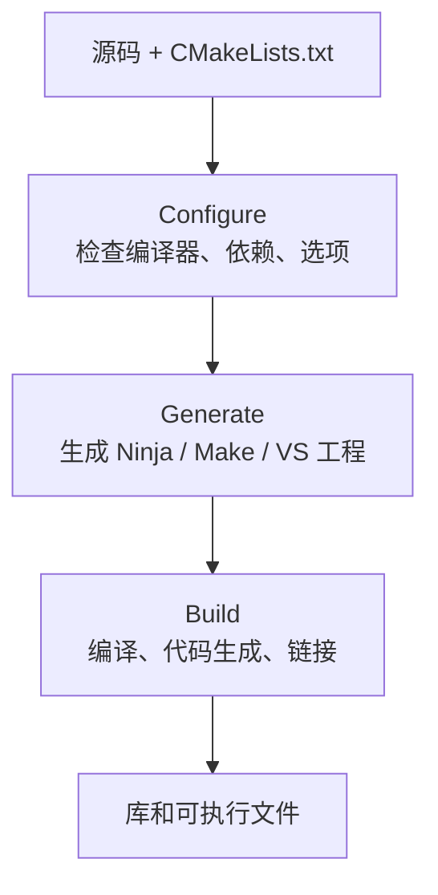

# CMake 配置、生成与构建三阶段

## 0. 先给结论

在 CMake 语境中，三个核心阶段是：

```text
Configure → Generate → Build
配置       生成       构建
```

| 阶段 | 核心问题 | 主要输出 |
| --- | --- | --- |
| Configure | 当前机器上“应该怎么构建” | 配置结果、`CMakeCache.txt`、内部状态 |
| Generate | 把配置结果翻译成什么构建文件 | Ninja、Make 或 Visual Studio 工程 |
| Build | 按构建文件真正生成什么产物 | 目标文件、库、可执行文件 |

一句话记忆：

```text
配置决定参数
生成产出构建文件
构建调用编译器并链接产物
```

常用命令：

```bash
# 配置 + 生成
cmake --preset windows-vcpkg

# 构建
cmake --build --preset windows-release
```

## 1. CMake 三阶段总览



在实际使用中，`cmake -S . -B build` 或 `cmake --preset ...` 通常同时完成 Configure 和 Generate，因此很多人把它们合称为“配置”。

严格区分时：

```text
Configure = 分析和决策
Generate  = 把决策翻译成具体构建工程
```

## 2. 配置阶段

### 2.1 配置阶段做什么

CMake 读取 `CMakeLists.txt`，并执行其中的配置逻辑：

- 检查 C/C++ 编译器
- 读取工具链文件
- 检查目标操作系统和处理器架构
- 处理 `option()`、`if()`、`set()` 等命令
- 执行 `find_package()`
- 查找头文件、库和可执行工具
- 计算宏定义、包含路径和编译选项
- 处理 `CMakePresets.json` 注入的 cacheVariables
- 把探测结果写入 `CMakeCache.txt`

示例：

```bash
cmake -S . -B build \
  -G Ninja \
  -DCMAKE_BUILD_TYPE=Release
```

它回答的问题是：

```text
在当前机器上：
用哪个编译器？
用哪个 triplet？
开哪些宏？
找得到 gRPC、Protobuf、MySQL Connector 吗？
生成 Debug 还是 Release？
```

### 2.2 配置阶段可能执行编译探测

配置阶段通常不会编译项目业务代码，但可能执行 `try_compile` 或编译器 ABI 探测。

例如 CMake 会编译一个很小的测试源文件，用来确认：

- 编译器是否可用
- 编译器 ID 和版本
- ABI 是否兼容
- 某个函数、头文件或语言特性是否存在

因此更准确的说法是：

```text
配置阶段不一定“完全不调用编译器”，
但正常情况下不生成项目最终二进制。
```

### 2.3 CMakeCache

配置结果主要保存在：

```text
build/CMakeCache.txt
build/CMakeFiles/
```

缓存包含：

- 编译器路径
- 生成器
- 构建类型
- 依赖库路径
- 用户传入的 cacheVariables
- 各种探测结果

缓存能减少重复探测，但也可能导致旧配置残留。

更换生成器、编译器或 vcpkg triplet 时，应使用新的构建目录，避免 ABI 或工具链缓存冲突。

### 2.4 配置失败常见原因

- 找不到编译器
- `CMAKE_TOOLCHAIN_FILE` 路径错误
- vcpkg triplet 不存在
- `find_package` 找不到依赖
- 动态库和静态库 target 不匹配
- 选项组合冲突
- 生成器与已有缓存不兼容

## 3. 生成阶段

### 3.1 生成阶段做什么

生成阶段读取配置结果，将其翻译成底层构建工具能执行的工程文件。

使用 Ninja：

```bash
cmake -S . -B build -G Ninja
```

输出：

```text
build/build.ninja
build/.ninja_deps
build/.ninja_log
```

使用 Unix Makefiles：

```bash
cmake -S . -B build -G "Unix Makefiles"
```

输出：

```text
build/Makefile
build/CMakeFiles/
```

使用 Visual Studio：

```bash
cmake -S . -B build -G "Visual Studio 17 2022"
```

输出：

```text
build/FullStackChat.sln
build/server/GateServer/GateServer.vcxproj
build/server/ChatServer/ChatServer.vcxproj
...
```

生成阶段回答的问题是：

```text
把 CMake 的抽象目标图翻译成 Ninja、Make 或 MSBuild 能执行的工程？
```

### 3.2 生成阶段不生成业务二进制

生成阶段只产出构建系统文件，不负责最终编译链接。

```text
Generate ≠ 编译
Generate ≠ 链接
```

例外是某些 `try_compile` 探针会在配置期间生成很小的测试程序，但它们不是项目最终产物。

### 3.3 生成器不是编译器

| 名称 | 角色 |
| --- | --- |
| Visual Studio 17 2022 | CMake 生成器 |
| Ninja | 构建工具 |
| GNU Make | 构建工具 |
| MSBuild | Visual Studio 工程构建工具 |
| MSVC / GCC / Clang | 编译器 |

生成器决定 CMake 输出哪种工程；构建工具根据工程执行编译。

## 4. 构建阶段

### 4.1 构建阶段做什么

构建阶段真正调用 Ninja、Make 或 MSBuild，再由它们调用编译器和链接器：

```bash
cmake --build build
```

该命令是统一入口，实际调用取决于生成器：

```text
Ninja             → ninja
Unix Makefiles    → make
Visual Studio     → MSBuild
```

构建阶段可能执行：

- 预处理
- 编译 `.cpp` 为 `.obj` / `.o`
- 运行 `protoc`
- 生成 `.pb.cc`、`.pb.h`、`.grpc.pb.cc`
- 编译静态库
- 链接可执行文件
- 复制运行时资源或配置
- 生成安装包或镜像

### 4.2 构建阶段不是只有“编译”

构建是一个调度过程，内部可能包含：

```text
代码生成 → 编译 → 链接 → 后处理
```

CMake 的 `add_custom_command` 和 `add_custom_target` 可以在构建期间执行额外任务。

当前项目会在构建期间：

- 使用 `protoc` 和 gRPC 插件生成协议代码
- 编译 `chat_proto`
- 链接四个 C++ 服务
- 复制服务配置到可执行文件目录

### 4.3 构建工具可能自动重新配置

通常说“修改 `CMakeLists.txt` 后要重新配置”，但用户不必每次手动执行 configure。

生成的 Ninja、Make 和 Visual Studio 工程通常包含重新配置规则。执行：

```bash
cmake --build build
```

时，如果检测到 `CMakeLists.txt`、preset 或工具链输入发生变化，构建工具可能先自动调用 CMake 重新执行 configure/generate，再继续构建。

所以实际过程可能是：

```text
cmake --build
  → 检测到 CMake 输入变化
  → 自动 reconfigure
  → 自动 regenerate
  → 执行编译和链接
```

主动执行 configure 仍然更清晰，尤其是修改了工具链、triplet 或依赖路径时。

## 5. 三者关系

### 5.1 对比表

| 项目 | Configure | Generate | Build |
| --- | --- | --- | --- |
| 输入 | `CMakeLists.txt`、Preset、工具链、缓存 | 配置结果、生成器类型 | 构建文件、源码 |
| 输出 | Cache、配置状态、目标图 | `build.ninja`、Makefile、`.sln/.vcxproj` | 库、可执行文件 |
| 是否调用编译器 | 可能有探测性 `try_compile` | 通常没有 | 有 |
| 是否生成业务二进制 | 否 | 否 | 是 |
| 常见命令 | `cmake --preset ...` | 同一命令自动执行 | `cmake --build ...` |

### 5.2 常见命令对应关系

```bash
# 配置 + 生成
cmake -S . -B build -G Ninja -DCMAKE_BUILD_TYPE=Release

# 构建
cmake --build build

# 测试
ctest --test-dir build

# 安装
cmake --install build --prefix /opt/myapp
```

### 5.3 为什么 CMake 要分阶段

- 配置结果可以缓存
- 同一份 `CMakeLists.txt` 可以生成不同构建系统
- 配置阶段集中处理平台差异
- 增量构建不需要每次重复依赖探测
- 构建工具只负责执行生成好的工程

## 6. 广义项目中的“配置、生成、构建”

离开 CMake 后，这三个词会随语境变化。

### 6.1 项目配置

项目配置通常表示：

- Debug/Release
- 优化级别和宏定义
- 数据库地址、端口和日志级别
- 开发、测试、生产环境
- CMake option、vcpkg triplet、工具链

典型形式：

```text
CMakeLists.txt
CMakePresets.json
CMakeCache.txt
config.ini
config.json
.env
docker-compose.yml
```

### 6.2 项目中的“生成”

“生成”可能有多种含义：

| 语境 | 含义 |
| --- | --- |
| CMake | 生成构建工程 |
| Protobuf | 生成 `.pb.cc/.pb.h` |
| Qt | `moc` 生成元对象代码，`uic` 生成界面代码 |
| 脚手架 | 生成项目目录模板 |
| 发布流程 | 生成安装包、镜像或制品 |

因此不能看到“生成”就默认是代码生成。

### 6.3 广义的“构建”

广义构建可能包含：

```text
配置 → 代码生成 → 编译 → 链接 → 测试 → 打包
```

CI 中说“build job”时，可能包括上述多步；而 C++ 语境中的狭义构建通常只指编译和链接。

## 7. 容易混淆的概念

### 7.1 配置与生成

配置负责决定参数，生成负责输出工程文件。

一条命令可能同时完成两步：

```bash
cmake -S . -B build
```

概念上仍然可以区分。

### 7.2 配置与 `config.ini`

CMake 的 Configure 和项目运行配置不是同一件事：

```text
CMake Configure
  = 分析项目构建环境

config.ini
  = 程序运行时读取的业务配置
```

当前项目在构建时复制 `config.ini`，但这个复制动作是构建调度的一部分，不是 CMake Configure。

### 7.3 `CMAKE_BUILD_TYPE` 与 vcpkg 构建类型

```text
CMAKE_BUILD_TYPE=Release
```

控制当前项目源码的编译配置。

triplet 中的：

```cmake
set(VCPKG_BUILD_TYPE release)
```

控制 vcpkg 依赖的构建配置。

两者互相独立。

### 7.4 Generate 与代码生成

```text
CMake Generate
  = 生成构建文件

Protobuf 代码生成
  = 生成协议源码
```

当前项目中，`protoc` 代码生成发生在构建阶段，而不是 CMake Generate 阶段。

### 7.5 Configure 与 `find_package`

`find_package()` 主要在 Configure 阶段执行。

依赖找不到时，优先检查：

- toolchain
- triplet
- vcpkg 安装目录
- package config 名称

### 7.6 Build 与 Test

构建成功不代表测试通过。

```text
Build → 生成可执行文件
Test  → 验证可执行文件和业务流程
```

当前项目分别使用 CMake 构建、Node.js 回归测试和 Qt 协议测试。

## 8. 当前项目的实际流程

### 8.1 Windows 配置和生成

```powershell
cmake --preset windows-vcpkg
```

完成：

- 选择 Visual Studio 17 2022
- 选择 x64
- 使用 `C:/vcpkg`
- 输出 `build/FullStackChat.sln`
- 输出各服务的 `.vcxproj`

### 8.2 Windows 构建

```powershell
cmake --build --preset windows-release `
  --target GateServer StatusServer ChatServer ChatServer2
```

完成：

- 运行 `protoc`
- 编译 `chat_proto`
- 编译四个服务
- 链接 Release 可执行文件
- 从服务源码目录复制 `config.ini`

### 8.3 Linux 配置和生成

```bash
cmake --preset linux-vcpkg
```

完成：

- 使用 Ninja
- 使用 `/opt/vcpkg`
- 使用 `x64-linux-release` triplet
- 生成 `build/linux-release/build.ninja`

### 8.4 Linux 构建

```bash
cmake --build --preset linux-release -j 2
```

完成：

- 生成 protobuf/gRPC 代码
- 编译服务
- 链接 Linux 可执行文件
- 在每次目标构建前检查并复制 `config.ini`

## 9. 推荐工作流

```text
首次构建
  → 安装或准备依赖
  → configure + generate
  → build
  → test

仅修改源码
  → build
  → test

修改 CMakeLists / 依赖 / preset / triplet
  → configure + generate
  → build
  → test

更换编译器或 triplet
  → 使用新的构建目录
  → configure + generate
  → build
  → test
```

## 10. 常见问题

### 10.1 为什么只改源码不需要重新 configure

构建工程已经存在，编译器可直接处理源码变化。

### 10.2 为什么修改 `CMakeLists.txt` 通常需要重新配置

目标、依赖、选项或源文件列表发生变化后，已有构建工程需要更新。

不过 `cmake --build` 可能自动触发 reconfigure/regenerate。

### 10.3 为什么换了 triplet 不能继续使用旧缓存

triplet 会影响库路径、链接方式和 ABI。旧缓存可能仍指向原来的依赖。

### 10.4 Ninja 会配置项目吗

Ninja 本身只执行构建规则。它可能调用生成的“reconfigure”规则来请求 CMake 更新，但真正的配置和生成逻辑属于 CMake。

### 10.5 为什么构建目录里既有 CMake 文件又有 Ninja 文件

它们属于不同阶段：

```text
CMakeCache.txt  → Configure 结果
build.ninja     → Generate 结果
.ninja_log      → Build 执行记录
```

## 11. 面试回答模板

> CMake 中配置、生成和构建通常分为三个阶段。Configure 阶段读取 CMakeLists.txt，检查编译器、工具链、依赖和选项，把结果写入 CMakeCache 等状态；Generate 阶段把配置结果翻译成 Ninja 的 build.ninja、Make 的 Makefile 或 Visual Studio 的 .sln/.vcxproj；Build 阶段才调用 Ninja、Make 或 MSBuild，再调用编译器和链接器生成二进制。`cmake -S . -B build` 通常同时完成配置和生成，`cmake --build build` 执行构建。
>
> 广义项目中，“配置”还可以指编译参数、运行配置和环境配置；“生成”可以指构建文件、代码生成、脚手架或发布制品；“构建”可以指从源码到可交付产物的完整流程，包括代码生成、编译、链接、测试和打包。
>
> 核心区别是：配置决定怎么构建，生成产出构建所需的文件或代码，构建真正产出最终二进制。

## 12. 记忆模型

```text
Configure = 决策
Generate  = 翻译成构建系统文件
Build     = 执行构建
```

更短的版本：

```text
配置：怎么建
生成：给谁建
构建：真正建
```

## 13. 相关文档

- [CMakePresets 与 vcpkg triplet](CMakePresets与vcpkg-triplet.md)
- [根据本项目架构的 CMAKE 管理](根据本项目架构的CMAKE管理.md)
- [v1 Linux Docker 部署链](../部署运维/v1-Linux-Docker部署链.md)
- [CMakePresets.json](../../CMakePresets.json)
