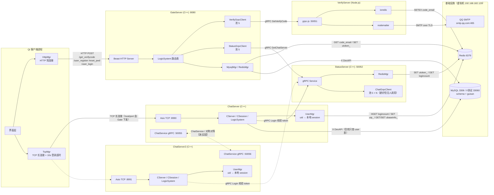
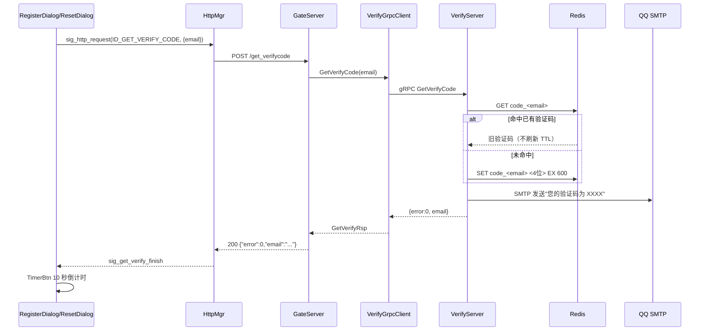
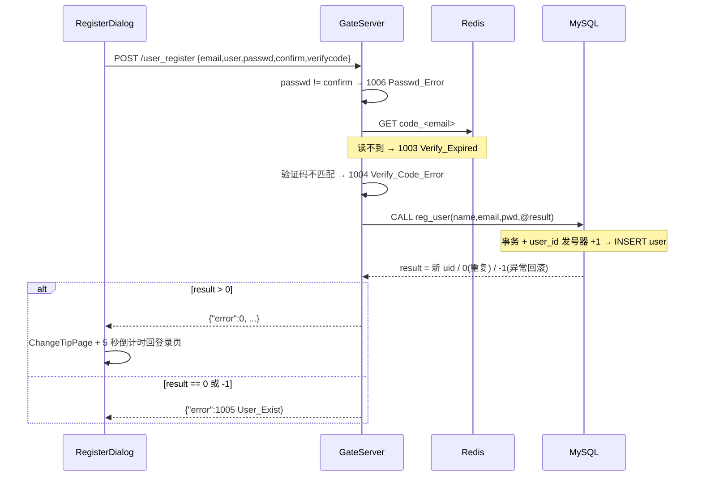
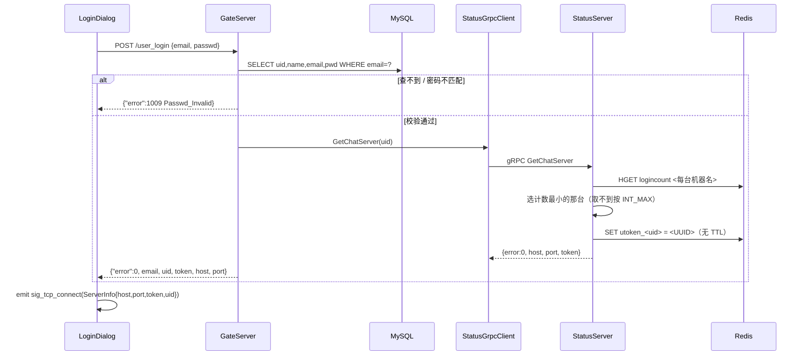
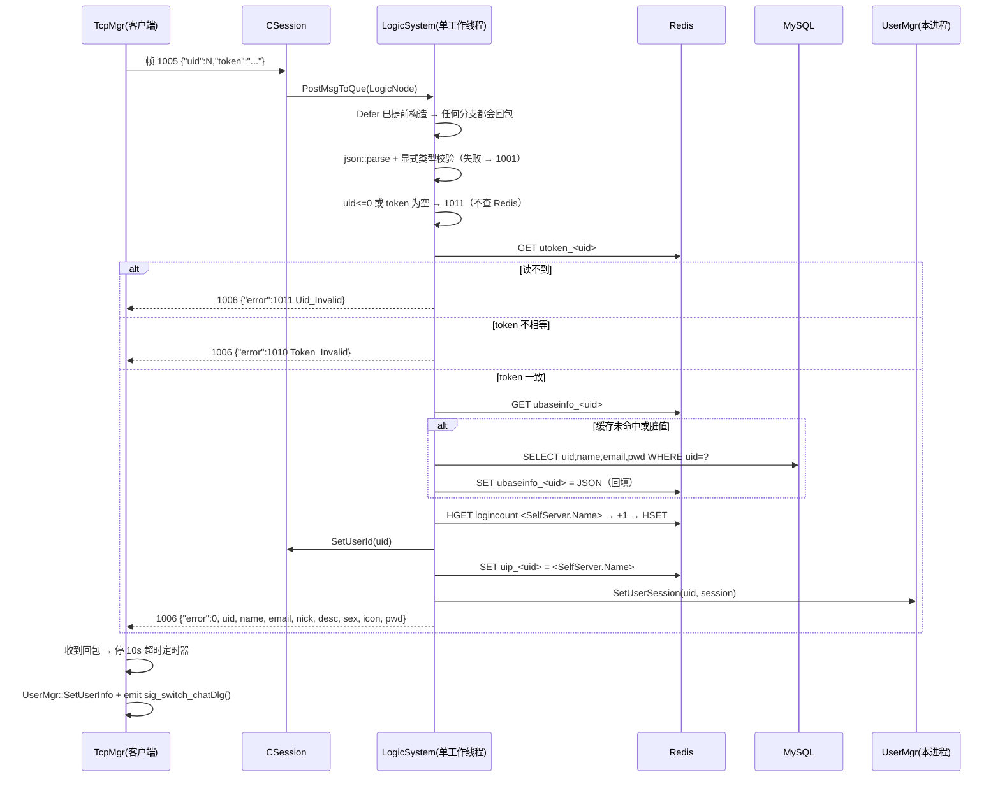
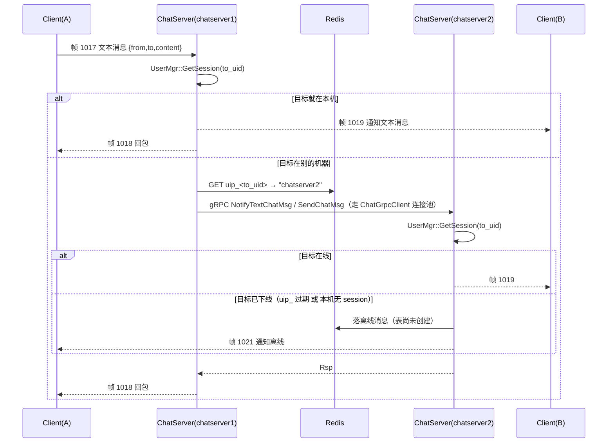

# 服务端架构与处理流程 4.0

> 整理日期：2026-10-13
> 覆盖范围：`server/GateServer`、`server/VerifyServer`、`server/StatusServer`、`server/ChatServer`、`server/ChatServer2`、`server/proto/message.proto`
> 依据：当前工作区源码（含尚未提交的分布式改造）+ 5 份 `config.ini` / `config.json` + 虚拟机实测（MySQL `guisan` 库、Redis key 快照）
> 与旧文档的关系：本篇是**服务端侧的当前状态的权威描述**，取代《全栈架构与处理流程3.0.md》的第 1、2、4、5、6、7、8、9 章中与服务端有关的内容；3.0 的客户端章节（第 3 章）与《客户端架构2.0.md》继续有效。本篇与《踩坑复盘-登录成功但界面不跳转.md》是**互补**关系：那篇讲排查方法和那次缺陷的完整因果链，本篇讲"改完之后服务端到底长什么样"。

## 修订记录

| 版本 | 日期 | 变更 |
| --- | --- | --- |
| 4.0 | 2026-10-13 | 首次整理：分布式改造后的五进程拓扑、Redis 状态布局、跨节点转发骨架、长连接登录新流程、现状清单与剩余工作 |
| 4.0.1 | 2026-10-14 | 复核第一轮修复（在线计数递减 / 回包补 `token` / `value()` 替换 / `uip_` 清理 / 分配判空）并逐条给出结论。三个新增发现：**① 这五项修复只落在 `ChatServer/`，`ChatServer2/` 仍是旧代码（另有一处未提及的 `Close()` 修复同样只在 ChatServer）；② `value()` 只挡住了"字段缺失"，字段类型不符时仍会抛 `json::type_error` 打死工作线程；③ 递减没有区分"是否真的登录过"，未登录的连接断开也会扣减计数**。详见 6.2.0 |
| 4.0.2 | 2026-10-14 | 第二轮修复落地后的**定稿复核**：`uid <= 0` 早退、`DealMsg` 全局 try/catch、`Defer` 提前 + 显式类型校验、`uip_` 三条件删除全部到位，且 `ChatServer2/` 已同步（逐文件 MD5：共享源码全部 SAME，仅 `ChatServer.cpp` / `CMakeLists.txt` / `config.ini` 三个应差异文件不同）。新增 6.2.1 记录定稿状态，新增第 9 章"字符编码统一方案（待执行）"，新增《总结-关于uid小于等于0的讨论.md》 |

---

## 0. 阅读指南

### 0.1 标注约定

| 标注 | 含义 |
| --- | --- |
| 【已实现】 | 当前工作区代码里能跑通的能力，有源码依据 |
| 【半成品】 | 骨架已搭（类/协议/连接池存在），关键逻辑为空或未接线 |
| 【未开始】 | 只在常量、结构体、注释里出现，没有任何实现 |
| 【实测】 | 2026-10-13 在真机/真库上实际取到的证据，不是推断 |
| 【风险】 | 已确认的缺陷或安全隐患，集中在第 6 章 |

### 0.2 本次整理的三个前提（开工前你想让我先提问，我把选择连同默认值一起写在这里）

由于一次只能交付一个版本，我按下面三个默认值来写；每一条都给出了"如果换另一种选择会怎么改"，你可以直接推翻：

| 决策点 | 本次采用的默认值 | 换成另一种会怎么变 |
| --- | --- | --- |
| 文档基准 | **现状快照 + 目标与差距**：以代码真实行为为准逐项标注完成度，并把分布式终态设计放在第 7 章单独成章 | 只要你想要"纯现状"，删掉第 7 章即可，其余章节不受影响；想要"纯目标设计"则相反，把第 3–6 章压成一张差异表 |
| 文档边界 | **服务端 + 与服务端交互的协议/字段**：进程拓扑、进程间调用、存储、TCP/HTTP/gRPC 协议、客户端与服务端之间的字段流转；不展开客户端内部实现 | 若需要"仅服务端内部"，删掉 2.4、5.4、5.5 中客户端侧的字段对照；若需要"全链路"，第 3 章要从《客户端架构2.0.md》并入 |
| 交付形态 | **单篇 `服务端架构与处理流程4.0.md`** | 若你更想拆成《服务端总览》《分布式改造设计》《各服务内部结构》三篇，第 1 章 / 第 3–5 章 / 第 4 章天然就是这三篇的切分线 |

### 0.3 一句话概括 4.0 相对 3.0 的变化

**3.0 的 ChatServer 是一个"孤岛"：token 校验走 StatusServer 内存、在线状态全在进程内、每个用户连哪台机器没人知道。4.0 做的是把这些状态搬到 Redis，让两台 ChatServer 通过各自的 gRPC 端口互相看得见——共享状态与转发骨架已经落地，但"跨节点真正转发消息"这条链路目前还是空实现。**

**4.0.2 的状态**：4.0.1 提出的问题已全部修完并同步到两份副本——`uid <= 0` 早退、`logincount` 成对递减、`uip_` 三条件删除、`DealMsg` 全局 try/catch、`Defer` 提前 + 显式类型校验、`token` 回包、非法帧 `Close()`、分配函数判空。剩下的是**第一版之后再重构**的项：`_user_id` 的原子性、`logincount` 读改写非原子、`ClearSession` 持锁做 Redis、同一条连接重复 1005 / 换 uid 的簿记错配，以及跨节点转发仍是空实现（见 6.2.1）。另有一条与功能无关的待办：服务端源码编码统一（第 9 章）。

---

## 1. 分布式总览

### 1.1 进程拓扑



### 1.2 组件清单

| 组件 | 目录 | 技术栈 | 职责 | 监听 |
| --- | --- | --- | --- | --- |
| 网关 | `server/GateServer/` | C++17、Beast/Asio、gRPC C++、redis++、mysql-connector-cpp | 唯一 HTTP 入口、四个 POST 路由、验证码/注册/重置/登录业务 | HTTP `0.0.0.0:8080` |
| 验证码服务 | `server/VerifyServer/` | Node.js、`@grpc/grpc-js`、`nodemailer`、`ioredis` | 生成验证码、写 Redis、发邮件、60s 心跳 | gRPC `0.0.0.0:50051`（硬编码在 `server.js`） |
| 状态服务 | `server/StatusServer/` | C++17、gRPC C++、redis++ | 分配 ChatServer、签发 token、校验 token | gRPC `0.0.0.0:50052` |
| 聊天服务 1 | `server/ChatServer/` | C++17、Boost.Asio、gRPC C++（服务端+客户端）、redis++、mysqlx | 长连接接入、登录鉴权、会话管理、**同节点推送**、跨节点转发（骨架） | TCP `8990`、gRPC `50055` |
| 聊天服务 2 | `server/ChatServer2/` | 与 ChatServer **同一份源码**（仅缩进差异），仅 `config.ini` 不同 | 同上，作为第二个实例 | TCP `8991`、gRPC `50056` |
| 共享协议 | `server/proto/message.proto` | protobuf 3 | `VerifyService` / `StatusService` / `ChatService` 三个服务与全部消息体 | — |
| 协议产物 | `build/generated/` | 自动生成 | `message.pb.*`、`message.grpc.pb.*`，打包为静态库 `chat_proto` | — |

> 【实测】服务器之间**没有**任何共享可写内存，也没有消息队列。所有跨进程共享状态都落在 Redis 上；MySQL 只存账号。

### 1.3 端口与地址矩阵（全部为配置文件里的真实值）

| 端口 | 归属 | 协议 | 配置位置 | 谁连它 |
| --- | --- | --- | --- | --- |
| 8080 | GateServer | HTTP/1.1 | `GateServer/config.ini` `[GateServer]Port` | Qt 客户端（`client/config.ini` `[GateServer]host/port`） |
| 50051 | VerifyServer | gRPC | `server.js` 硬编码；GateServer 侧 `[VerifyServer]Host/Port` | GateServer |
| 50052 | StatusServer | gRPC | `StatusServer/config.ini` `[StatusServer]Host/Port` | GateServer、ChatServer、ChatServer2 |
| 8990 | ChatServer 长连接 | 自定义 TCP 帧 | `ChatServer/config.ini` `[SelfServer]Port`；同值登记在 `StatusServer/config.ini` `[chatserver1]Port` | Qt 客户端 |
| 50055 | ChatServer 的 gRPC 服务端 | gRPC `ChatService` | `ChatServer/config.ini` `[SelfServer]RPCPort`；对端登记为 `ChatServer2/config.ini` `[chatserver1]Port` | ChatServer2（未实现调用） |
| 8991 | ChatServer2 长连接 | 自定义 TCP 帧 | `ChatServer2/config.ini` `[SelfServer]Port`；同值登记在 `StatusServer/config.ini` `[chatserver2]Port` | Qt 客户端 |
| 50056 | ChatServer2 的 gRPC 服务端 | gRPC `ChatService` | `ChatServer2/config.ini` `[SelfServer]RPCPort`；对端登记为 `ChatServer/config.ini` `[chatserver2]Port` | ChatServer（未实现调用） |
| 3306 / 33060 | MySQL 经典协议 / X Protocol | TCP | 各 `config.ini` `[Mysql]Port` / `XPort` | GateServer、ChatServer、ChatServer2（X 协议）；运维工具（3306） |
| 6379 | Redis | RESP | 各 `config.ini` `[Redis]Port`、`VerifyServer/config.json` `redis.port` | VerifyServer、GateServer、StatusServer、ChatServer、ChatServer2 |
| 465 | QQ 邮箱 SMTP | SMTP over TLS | `VerifyServer/email.js` 硬编码 | VerifyServer |

**长连接端口与 gRPC 端口必须分开**（8990/8991 vs 50055/50056）。这是《踩坑复盘》第一层问题的修复结果：早先 ChatServer 用 `[SelfServer]Port` 监听 8090 而 StatusServer 登记给客户端的是 8990，客户端连不上；现在两边统一，并额外把服务间 gRPC 挪到 `RPCPort`。

### 1.4 基础设施连接参数（真实值）

| 项 | 值 |
| --- | --- |
| MySQL Host / Port | `192.168.182.129` / `3306`（X 协议 `33060`） |
| MySQL User / Passwd / Schema | `root` / `123456` / `guisan` |
| Redis Host / Port / Passwd | `192.168.182.129` / `6379` / 空 |
| 发件邮箱 / 授权码 | `3550828344@qq.com` / `yvwzxtfoxrnzdbgi`（明文，见第 6 章 P0） |

### 1.5 服务间地址配置的三份差异（`[SelfServer]` / `[PeerServer]` / `[chatserverN]`）

| 配置项 | 谁读它 | ChatServer 的值 | ChatServer2 的值 | 语义 |
| --- | --- | --- | --- | --- |
| `[SelfServer]Name` | ChatServer、StatusServer | `chatserver1` | `chatserver2` | 本机身份；用作 Redis `logincount` 的 field |
| `[SelfServer]Host` | gRPC 监听地址 | `0.0.0.0` | `0.0.0.0` | 本机监听用"所有网卡" |
| `[SelfServer]Port` | TCP 长连接监听 | `8990` | `8991` | 必须与 StatusServer 登记值一致 |
| `[SelfServer]RPCPort` | 自己的 gRPC 监听 | `50055` | `50056` | 给对端连的端口 |
| `[PeerServer]Servers` | `ChatGrpcClient` 构造时按名字建池 | `chatserver2` | `chatserver1` | 只列"别人"，不含自己 |
| `[chatserver2]` / `[chatserver1]` | 对端地址 | `127.0.0.1:50056` | `127.0.0.1:50055` | 连接目标必须是具体 IP，不能是 `0.0.0.0`（原因见《主机号配置问题.md》） |
| `[chatservers]Name` | StatusServer 的可分配列表 | — | — | `chatserver1,chatserver2` |
| `[chatserverN]Host/Port` | StatusServer 下发给客户端 | — | — | `127.0.0.1:8990` / `127.0.0.1:8991` |

> 【风险】目前五份配置里所有跨进程地址都是 `127.0.0.1`，也就是"两台 ChatServer 必须和 StatusServer 在同一台机器上"。要做真正的多机分布式，这些值必须换成真实内网 IP，同时把 `[PeerServer]` / `[chatserverN]` 的 `127.0.0.1` 全部替换掉——只改 `[SelfServer]Host` 是不够的。
>
> 【风险】`ChatServer2/` 是与 `ChatServer/` 逐字节相同的源码副本（`git diff --no-index` 只有两处缩进差异）。两个 CMake 目标各自从自己目录编译同一份代码，**任何改动都要改两处**。建议改造成"一份源码 + 启动参数选择实例名"（见第 7 章阶段四）。

---

## 2. 通信协议与消息定义

### 2.1 四条通道

| 通道 | 使用方 | 承载 | 特点 |
| --- | --- | --- | --- |
| HTTP/JSON | 客户端 → GateServer | JSON 文本 | 短连接，`Connection: close`，一请求一响应，60s 超时定时器 |
| gRPC + protobuf | GateServer → VerifyServer / StatusServer；ChatServer → StatusServer；**ChatServer ↔ ChatServer2** | `message.proto` | 同步阻塞调用，客户端侧固定大小连接池（各 5） |
| 自定义 TCP 帧 | 客户端 ↔ ChatServer | 4 字节头 + JSON 体 | 长连接，双向，服务端可主动下发 |
| Redis RESP | 所有 C++ 服务 / Node → Redis | 共享状态 | 见第 3 章，这是当前唯一的事实来源跨进程通道 |

> 注意：**只有服务端之间的调用才走 protobuf**。客户端与 ChatServer 之间的长连接仍然是"2 字节 id + 2 字节长度 + JSON"。

### 2.2 proto 全量定义（`server/proto/message.proto`，共 3 个 service）

```protobuf
syntax = "proto3";
package message;

service VerifyService {
    rpc GetVerifyCode (GetVerifyReq) returns (GetVerifyRsp) {}
}

service StatusService {
    rpc GetChatServer (GetChatServerReq) returns (GetChatServerRsp) {}
    rpc Login (LoginReq) returns (LoginRsp) {}
}

service ChatService {                          // 4.0 新增：服务之间互调
    rpc NotifyAddFriend(AddFriendReq) returns (AddFriendRsp);        // 通知/转发好友申请
    rpc RplyAddFriend(RplyFriendReq) returns (RplyFriendRsp);        // 回复好友申请
    rpc SendChatMsg(SendChatMsgReq) returns (SendChatMsgRsp);        // 发送聊天消息（简版）
    rpc NotifyAuthFriend(AuthFriendReq) returns (AuthFriendRsp);     // 通知已成为好友
    rpc NotifyTextChatMsg(TextChatMsgReq) returns (TextChatMsgRsp);  // 通知文本消息
    rpc NotifyKickUser(KickUserReq) returns (KickUserRsp);           // 踢用户下线
}
```

消息体清单（4.0 新增部分用 ★ 标注）：

| 消息 | 方向 | 字段 | 备注 |
| --- | --- | --- | --- |
| `GetVerifyReq/Rsp` | Gate → Verify | `email` / `error,email,code` | `code` 字段始终未被使用，验证码改由 Redis 传递 |
| `GetChatServerReq/Rsp` | Gate → Status | `uid` / `error,host,port,token` | token 是 UUID |
| `LoginReq/Rsp` | Chat → Status | `uid,token` / `error,uid,token` | 长连接鉴权 |
| ★ `AddFriendReq` | Chat ↔ Chat | `apply_uid,name,desc,icon,nick,sex,to_uid` | 申请方资料随请求带过去，避免对端再查库 |
| ★ `AddFriendRsp` | Chat ↔ Chat | `error,apply_uid,to_uid` | |
| ★ `RplyFriendReq/Rsp` | Chat ↔ Chat | `rply_uid,agree,to_uid` / `error,rply_uid,to_uid` | |
| ★ `AddFriendMsg` | 内嵌 | `sender_id,unique_id,msg_id,thread_id,msg_content,status` | 好友申请的消息载体 |
| ★ `AuthFriendReq/Rsp` | Chat ↔ Chat | `from_uid,to_uid,repeated AddFriendMsg` / `error,from_uid,to_uid` | |
| ★ `SendChatMsgReq/Rsp` | Chat ↔ Chat | `from_uid,to_uid,message` / `error,from_uid,to_uid` | 简版，无时间戳 |
| ★ `TextChatData` | 内嵌 | `unique_id,msg_id,msg_content,chat_time` | 单条文本消息 |
| ★ `TextChatMsgReq/Rsp` | Chat ↔ Chat | `from_uid,to_uid,thread_id,repeated TextChatData` / `error,from_uid,to_uid,thread_id,repeated TextChatData` | 真实转发走这条 |
| ★ `KickUserReq/Rsp` | Chat ↔ Chat | `uid` / `error,uid` | 单点登录踢人（未实现） |

生成方式：`server/CMakeLists.txt` 用 `protoc` + `grpc_cpp_plugin` 生成到 `build/generated/`，打包为 `chat_proto` 静态库，四个 C++ 目标统一链接；Node 端 `proto.js` 用 `@grpc/proto-loader` 动态加载**同一个** `.proto`。

> 【风险】proto 里定义了 `ChatService` 的 6 个 RPC，但 ChatServer / ChatServer2 侧的**三个 `Notify*` 全是空实现**（`ChatServiceImpl.cpp` 里 `return Status();`），客户端侧的 `ChatGrpcClient::Notify*` 同样返回默认构造的响应。协议是"已定义、未实现"。

### 2.3 TCP 长连接帧格式（4.0 已修正长度语义）

```
 0        1        2        3        4                      4+len
 +--------+--------+--------+--------+------------------------+
 |      msg_id (2B)  |     msg_len (2B) |   body (msg_len B) |
 +--------+--------+--------+--------+------------------------+
       大端序（网络字节序）               UTF-8 JSON 字符串
```

| 字段 | 长度 | 字节序 | 说明 |
| --- | --- | --- | --- |
| `msg_id` | 2 字节 | 大端 | 消息类型，见 2.4 |
| `msg_len` | 2 字节 | 大端 | **body 的字节数**，上限 `MAX_LENGTH = 2048` |
| `body` | `msg_len` 字节 | — | UTF-8 JSON |

【已修复】服务端 `SendNode` 原先把头部的长度字段写成 `_total_len`（包头 4 + 包体），客户端按"包体长度"解析，于是永远在等 4 个不会到来的字节。现在 `MsgNode.cpp` 写入的是 `max_len`（纯包体长度），两侧语义一致。**这条约定是全项目的硬约束**：以后每加一个服务端推送都要遵守，否则表现是"客户端什么都不显示"。

| 位置 | 方向 | 长度字段怎么算 | 状态 |
| --- | --- | --- | --- |
| `client/tcpmgr.cpp` `slot_send_data` | 客户端 → 服务端 | `quint16(dataBytes.size())` | 正确 |
| `server/CSession::HandleReadHead` | 读客户端包 | 按包体长度读 `RecvNode(msg_len)` | 正确 |
| `server/SendNode` | 服务端 → 客户端 | 已改为 `max_len` | 已修复 |
| `client/TcpMgr` `readyRead` | 读服务端包 | 按包体长度等 | 正确 |

### 2.4 消息 ID 总表（客户端与服务端必须逐值一致）

| ID | 名称 | 方向 | 客户端 | 服务端 | 状态 |
| --- | --- | --- | --- | --- | --- |
| 1001 | `ID_GET_VERIFY_CODE` | HTTP | 已实现 | 已实现 | 【已实现】 |
| 1002 | `ID_REG_USER` | HTTP | 已实现 | 已实现 | 【已实现】 |
| 1003 | `ID_RESET_PWD` | HTTP | 已实现 | 已实现 | 【已实现】 |
| 1004 | `ID_LOGIN_USER` | HTTP | 已实现 | 已实现 | 【已实现】 |
| 1005 | `ID_CHAT_LOGIN` / `MSG_CHAT_LOGIN` | 客户端 → Chat | 已实现 | 已实现 | 【已实现】 |
| 1006 | `ID_CHAT_LOGIN_RSP` / `MSG_CHAT_LOGIN_RSP` | Chat → 客户端 | 已实现 | 已实现 | 【已实现】 |
| 1007 / 1008 | 搜索用户 请求/回包 | 客户端 ↔ Chat | ID 已定义 | 常量已定义 | 【未开始】 |
| 1009 / 1010 | 添加好友 申请/回复 | 客户端 ↔ Chat | ID 已定义 | 常量已定义 | 【未开始】 |
| 1011 | 通知我被加好友 | Chat → 客户端 | ID 已定义 | 常量已定义 | 【未开始】 |
| 1013 / 1014 | 认证好友 请求/回复 | 客户端 ↔ Chat | ID 已定义 | 常量已定义 | 【未开始】 |
| 1015 | 通知我被认证为好友 | Chat → 客户端 | ID 已定义 | 常量已定义 | 【未开始】 |
| 1017 / 1018 / 1019 | 文本消息 请求/回复/通知 | 客户端 ↔ Chat | 仅服务端定义 | 常量已定义 | 【未开始】 |
| 1021 | 通知离线 | Chat → 客户端 | 仅服务端定义 | 常量已定义 | 【未开始】 |
| 1023 / 1024 | 心跳 请求/回复 | 客户端 ↔ Chat | 仅服务端定义 | 常量已定义 | 【未开始】 |
| 1025 / 1026 | 加载会话线程 请求/回包 | 客户端 ↔ Chat | 仅服务端定义 | 常量已定义 | 【未开始】 |
| 1027 / 1028 | 创建私聊会话 请求/回复 | 客户端 ↔ Chat | 仅服务端定义 | 常量已定义 | 【未开始】 |
| 1029 / 1030 | 加载历史消息 请求/回包 | 客户端 ↔ Chat | 仅服务端定义 | 常量已定义 | 【未开始】 |

> 【风险】当前 `ChatServer/LogicSystem.cpp` 的 `_func_callbacks` **只注册了 1005 一个**。收到其它 ID 时 `DealMsg` 会打印 `msg id [N] handler not found` 并丢弃——客户端侧虽然有对应的 UI 与信号，但链路另一端是空的。
>
> 注意 1012 / 1016 / 1020 / 1022 是**跳过的空号**（两端的枚举都跳过了），不要顺手补上，否则和客户端 `client/global.h` 的 `ReqId` 会对不齐。

### 2.5 错误码分层

四套互不相同的 error 编码，务必区分：

| 来源 | 取值 | 含义 |
| --- | --- | --- |
| 客户端 `ErrorCodes`（`client/global.h`） | 0 / 1 / 2 | 本地网络层：`SUCCESS` / `ERR_JSON` / `ERR_NETWORK` |
| 客户端 `TipErr` | 0–6 | 前端表单校验提示 |
| 三个 C++ 服务的 `ErrorCodes` | 见下表 | 业务错误 |
| Node `Errors`（`VerifyServer/const.js`） | 0 / 1 / 2 | 仅用于 `/get_verifycode` 的 `error` 字段：`Success` / `RedisErr` / `Exception` |

服务端业务错误码（4.0 新增 1012 / 1013）：

| 值 | 名称 | 出现位置 |
| --- | --- | --- |
| 0 | `Success` | 全部 |
| 1001 | `Error_Json` | GateServer、ChatServer |
| 1002 | `RPC_Failed` | GateServer、ChatServer |
| 1003 | `Verify_Expired` | GateServer（Redis 无验证码） |
| 1004 | `Verify_Code_Error` | GateServer（验证码不匹配） |
| 1005 | `User_Exist` | GateServer（用户名/邮箱已存在；**也包含存储过程内部异常回滚**） |
| 1006 | `Passwd_Error` | GateServer（两次密码不一致） |
| 1007 | `Email_Not_Match` | GateServer（重置时用户名与邮箱不匹配） |
| 1008 | `Passwd_Up_Failed` | GateServer（更新密码失败） |
| 1009 | `Passwd_Invalid` | GateServer（登录密码错误） |
| 1010 | `Token_Invalid` | StatusServer、ChatServer |
| 1011 | `Uid_Invalid` | StatusServer、ChatServer |
| 1012 | `CREATE_CHAT_FAILED` | ChatServer（构造中，尚未使用） |
| 1013 | `LOAD_CHAT_FAILED` | ChatServer（构造中，尚未使用） |

客户端的判断很粗：只比较 `error != 0`，非 0 就统一提示"参数错误"/"登录失败"。**服务端的细分错误码目前在 UI 上被全部丢弃。**

---

## 3. 分布式状态布局（4.0 的核心章节）

### 3.1 状态住在哪里

| 状态 | 存放位置 | 生命周期 | 谁能读 |
| --- | --- | --- | --- |
| 账号（name/email/pwd） | MySQL `guisan.user` | 永久 | GateServer、ChatServer、ChatServer2 |
| uid 发号器 | MySQL `guisan.user_id`（单行） | 永久 | 存储过程 `reg_user` 内部 |
| 验证码 | Redis `code_<email>` | 600 秒 | GateServer |
| 登录 token | Redis `utoken_<uid>` | **无 TTL，永不过期** | StatusServer、ChatServer、ChatServer2 |
| 在线的机器归属 | Redis `uip_<uid>` = 服务器名 | 无 TTL；用户退出时不删（代码已注释） | **目前无人读**（转发设计要读） |
| 各机器登录计数 | Redis `logincount` Hash（field = 服务器名） | 进程存活期间 | StatusServer |
| 用户资料缓存 | Redis `ubaseinfo_<uid>` | 无 TTL | ChatServer、ChatServer2 |
| uid → session 映射 | 各 ChatServer 进程内 `UserMgr::_uid_to_session` | 进程存活期间 | 仅本进程 |
| 会话对象表 | 各 ChatServer 进程内 `CServer::_sessions`（session_id → CSession） | 连接存活期间 | 仅本进程 |
| 客户端登录态 | Qt 客户端 `UserMgr`（内存） | 客户端退出即失效 | 客户端 |

**设计含义**：`utoken_` / `uip_` / `ubaseinfo_` / `logincount` 是"跨进程共享层"，`UserMgr` / `CServer::_sessions` 是"本节点私有层"。跨节点消息转发必须走"先查共享层拿机器名 → 再用 gRPC 把消息送到那台机器 → 在目标机器上查私有层拿到 socket"这条两跳路径——这正是 `ChatServiceImpl` + `ChatGrpcClient` 要承担的角色。

### 3.2 Redis key 空间明细（依据源码逐条核对）

| key / 前缀 | 类型 | 值 | 写入方 | 读取方 | TTL | 状态 |
| --- | --- | --- | --- | --- | --- | --- |
| `code_<email>` | String | 4 位验证码 | `VerifyServer/redis.js::SetRedisExpire` | GateServer `/user_register`、`/reset_pwd` | 600s | 【已实现】 |
| `heartbeat` | String | 毫秒时间戳 | VerifyServer 每 60s | 无人读（保活） | 无 | 【已实现】 |
| `utoken_<uid>` | String | UUID token | `StatusServiceImpl::insertToken` | `StatusServiceImpl::Login`、ChatServer 登录回调 | **无** | 【已实现】 |
| `logincount` | Hash | field=服务器名 → value=**当前已登录连接数** | ChatServer 启动 `HSet 0`、登录成功 `+1`、`ClearSession`（仅 `uid > 0`）`−1`、进程退出 `HDel` | `StatusServiceImpl::getChatServer` | 无 | 【已实现】 |
| `uip_<uid>` | String | 服务器名（`chatserver1`/`chatserver2`） | ChatServer 登录成功时 `Set`；`ClearSession` 在"确实登过 + 归属仍是自己 + 本机已无该 uid 其它会话"时才 `Del` | 无人读（转发设计要读） | 无 | 【半成品：只写不读】 |
| `ubaseinfo_<uid>` | String | 用户信息 JSON（uid/pwd/name/email/nick/desc/sex/icon） | ChatServer `GetBaseInfo` 回填 | ChatServer `GetBaseInfo` 优先读 | 无 | 【已实现】 |
| `ipcount_` | — | — | 无 | 无 | — | 【未开始】宏已定义 |
| `usession_` | — | — | 无 | 无 | — | 【未开始】宏已定义 |
| `lock_` / `lockcount` | — | — | 无 | 无 | — | 【未开始】宏已定义，`LOCK_TIME_OUT=10` / `ACQUIRE_TIME_OUT=5` 也已定义但无实现 |
| `nameinfo_` | — | — | 无 | 无 | — | 【未开始】宏已定义 |

### 3.3 【实测】Redis 运行态快照（2026-10-13）

用裸 RESP 协议（`KEYS *` / `HGETALL logincount`）直连 `192.168.182.129:6379` 取到的真实内容，共 18 个 key：

```
heartbeat
logincount
utoken_1      utoken_2      utoken_3      utoken_5      utoken_7      utoken_8      utoken_9      utoken_987654
uip_1         uip_8         uip_9         uip_987654
ubaseinfo_1   ubaseinfo_8   ubaseinfo_9   ubaseinfo_987654

HGETALL logincount ⇒ chatserver1 = 2,  chatserver2 = 1
```

> 【时效性】这张快照拍于 **2026-10-14 修复之前**。其中 `logincount` 的语义当时是"累计登录次数"（只加不减），所以你看到的 `2 / 1` 是**历史累计值，不代表当时有 3 个人在线**；在任何一台 ChatServer 重启之后，启动时的 `HSet ... "0"` 会把它重置为 0，从那之后（若已应用递减修复）它才等于"当前连接数"。

这张快照同时验证了几件事，也暴露了几个问题：

| 观察 | 结论 |
| --- | --- |
| `utoken_*` / `uip_*` / `ubaseinfo_*` 三组 key 都带 uid 后缀 | 4.0 的"以 uid 为分布式主键"设计确实跑通了 |
| `logincount` 同时有 `chatserver1=2`、`chatserver2=1` | 两台 ChatServer **都曾被成功分配过用户**，分配逻辑与 gRPC 服务端监听确实工作过 |
| 计数是"累计登录次数"而非"当前在线数" | ChatServer 登录时 `+1`，但**没有任何地方 `-1`**（只有进程退出时整条 field 删除）。同一个用户重登 3 次就 +3。**负载均衡的数据源从根上就是错的**——这会持续偏向"较晚启动/较少被连"的那台，直到两台都跑过足够多次登录 |
| `utoken_7` 存在，但没有配套的 `uip_7` | HTTP 登录拿到 token 之后没有成功建立长连接（或已断开）。`utoken_` 与 `uip_` 的写入时机不同，这个"孤儿 token"就是两步之间的窗口 |
| 所有 key 都没有 TTL | token / 用户信息缓存 / 机器归属永不失效，只能靠"下次登录覆盖"自愈 |
| 存在 `987654` 这种明显是测试数据的 uid | 排查期间留下的测试数据（《踩坑复盘》附录已记录），可以按需清理 |

### 3.4 【实测】MySQL 现状（`guisan` 库）

```
show tables ⇒ user, user_id          ← 只有两张表
```

`user` 表（`desc` 实测）：

| 字段 | 类型 | Null | Key | Extra | 说明 |
| --- | --- | --- | --- | --- | --- |
| `id` | int | NO | PRI | `auto_increment` | 物理主键，业务上**未被使用** |
| `uid` | int | NO | — | — | 业务用户 ID（登录/鉴权/长连接/Redis key 全用它） |
| `name` | varchar(255) | NO | — | — | 用户名，注册时查重 |
| `email` | varchar(255) | NO | — | — | 邮箱，登录时作为账号 |
| `pwd` | varchar(255) | NO | — | — | 客户端 `xorString` 处理后的密文（明文等价，见风险项） |

`user_id` 表（单行发号器，实测当前值为 `10`）：

| 字段 | 类型 | Null | Key | 说明 |
| --- | --- | --- | --- | --- |
| `id` | int | NO | PRI | 当前已发放的最大 uid，无自增属性，只有一行 |

存储过程 `reg_user(IN new_name, IN new_email, IN new_pwd, OUT result)`：

```sql
DECLARE EXIT HANDLER FOR SQLEXCEPTION BEGIN ROLLBACK; SET result = -1; END;
START TRANSACTION;
  IF EXISTS (SELECT 1 FROM `user` WHERE `name` = new_name)  THEN SET result = 0; COMMIT;   -- 用户名重复
  ELSE IF EXISTS (SELECT 1 FROM `user` WHERE `email` = new_email) THEN SET result = 0; COMMIT;  -- 邮箱重复
  ELSE
      UPDATE `user_id` SET `id` = `id` + 1;                 -- 发号器 +1（行锁串行化）
      SELECT `id` INTO @new_id FROM `user_id`;
      INSERT INTO `user` (`uid`,`name`,`email`,`pwd`) VALUES (@new_id, new_name, new_email, new_pwd);
      SET result = @new_id;                                 -- 成功返回新 uid
      COMMIT;
  END IF;
```

`result` 三种取值与 GateServer 的处理：`> 0` 注册成功（值就是新 uid）→ 返回 `error = 0`；`0` 用户名或邮箱重复；`-1` 存储过程内部异常已回滚。GateServer 用 `if (uid == 0 || uid == -1)` 把后两者**合并成同一个 `1005 User_Exist`**，所以线上出现 `User_Exist` 时需要查 MySQL 日志才能区分"真重名"和"库出错"。

**4.0 缺失的表**：`data.h` 里已经定义了 `ChatThreadInfo`（注释直接提到 `private_chat.user1_id / user2_id`）与 `ChatMessage`（含 `thread_id`、`unique_id`、`chat_time`、`status`），`const.h` 里已经定义了加载会话线程（1025/1026）、创建私聊会话（1027/1028）、加载历史消息（1029/1030）的消息 ID——但**库里还没有 `friend` / `friend_apply` / `private_chat` / `chat_message` 这些表**。也就是说：数据结构已经按目标设计写好了，DDL 是下一步。

### 3.5 一致性边界与已知缺口

1. **token 校验从"StatusServer 内存"变成"读 Redis"**：`StatusServiceImpl::Login` 与 ChatServer 登录回调现在都直接读 `utoken_<uid>`。好处是可跨实例、StatusServer 重启不再踢人；代价是 ChatServer 每次登录多一跳 Redis，且**没有 TTL、没有单点登录控制、没有签发时间**。
2. **`uip_<uid>` 只写不读**：写它的地方是 ChatServer 登录成功分支，但全仓库没有任何 `Get(uip_...)`。跨节点转发必须先补上"读 `uip_` 找目标机器"这一步。
3. **`uip_` 的清理规则（4.0.2 定稿）**：`CServer::ClearSession` 只在三个条件同时成立时才删——① 这条会话真的登录过（`uid > 0`）；② 本机已无该 uid 的其它会话（扫 `_sessions` 排除自己）；③ `GET uip_<uid>` 仍等于自己的 `[SelfServer]Name`。这样既不会被"连上就断"的探测连接误删，也不会被"用户已在别台重登"的旧连接误删；"只写不读"（转发时按 `uip_` 找机器）仍未开始。推导过程见《总结-关于uid小于等于0的讨论.md》。
4. **`logincount` 已改成成对记账（4.0.2）**：登录成功 `+1`、`ClearSession` 里 `uid > 0` 才 `−1`，语义从"累计登录次数"纠正为"当前已登录连接数"。残余两点：`HGet → stoi → ±1 → HSet` 不是原子操作，并发登录/断链会丢更新；"同一条连接重复发 1005"会重复 `+1`（见 6.2.1 的 N8）。
5. **没有分布式锁**：`LOCK_PREFIX` / `LOCK_TIME_OUT` / `ACQUIRE_TIME_OUT` 都已定义，`StatusServer/RedisMgr.h` 里还留着一段被注释掉的 `acquireLock` / `releaseLock` / `IncreaseCount` / `DecreaseCount` 签名。当前所有"并发保护"都靠进程内的 `std::mutex`，跨节点没有互斥手段（例如同一个用户同时从两个客户端登录、同时被两台机器接管 session）。

---

## 4. 各服务内部结构

### 4.1 GateServer（HTTP 网关，`:8080`）

启动顺序（`GateServer.cpp::main`）：`ConfigMgr` → **`RedisMgr::GetInst()`（唯一在启动时就建 Redis 连接的进程）** → `AsioIOServicePool`（2 个 io_context）→ `CServer(ioc, 8080)` → `ioc.run()`。

| 类 | 文件 | 职责 |
| --- | --- | --- |
| `CServer` | `CServer.h/cpp` | acceptor，每个连接 new 一个 `HttpConnection` |
| `HttpConnection` | `HttpConnection.h/cpp` | 解析 HTTP，`keep_alive(false)`，60s `steady_timer` 超时；`_get_params` 只解析 GET 的 query |
| `LogicSystem` | `LogicSystem.h/cpp` | **只有路由表**（`_get_handlers` / `_post_handlers`），没有工作线程，handler 在 HTTP 线程里同步跑 |
| `VerifyGrpcClient` | — | 到 VerifyServer 的连接池（5），`GetVerifyCode(email)` |
| `StatusGrpcClient` | — | 到 StatusServer 的连接池（5），`GetChatServer(uid)` / `Login(uid, token)` |
| `MysqlMgr` / `MysqlDao` | — | mysqlx 连接池（5）：`RegUser`（走存储过程）、`CheckEmail`、`UpdatePwd`、`CheckPwd`、`GetUser` |
| `RedisMgr` | — | redis++ 连接池（5）：读 `code_<email>` |

注册的五个路由：

| 方法 | 路径 | 做什么 | 依赖 |
| --- | --- | --- | --- |
| GET | `/get_test` | 回显 query 参数 | 无 |
| POST | `/get_verifycode` | 解析 email → gRPC 调 VerifyServer → 回 `{error, email}` | VerifyServer |
| POST | `/user_register` | 校验两次密码 → 读 Redis 验证码 → 校验验证码 → `RegUser` 存储过程 → 回 `{error, email, user, passwd, verifycode}` | Redis、MySQL |
| POST | `/reset_pwd` | 读 Redis 验证码 → `CheckEmail` 核对用户名邮箱 → `UpdatePwd` | Redis、MySQL |
| POST | `/user_login` | `CheckPwd` 校验邮箱密码 → gRPC 调 StatusServer 拿 `host/port/token` → 回 `{error, email, uid, token, host, port}` | MySQL、StatusServer |

【风险】`/user_login` 里 `CheckPwd` 失败返回 `1009 Passwd_Invalid`；`/user_register` 把 `passwd`、`verifycode` 原样回显；所有错误都以 HTTP 200 + `{"error":100x}` 返回，通用工具与监控无法区分成败。

### 4.2 VerifyServer（Node.js，`:50051`）

| 文件 | 职责 | 关键点 |
| --- | --- | --- |
| `server.js` | `main()` 用 `bindAsync('0.0.0.0:50051')`（**端口硬编码**）；`GetVerifyCode` 实现 | 先 `GET code_<email>`：命中则**复用旧验证码**，未命中才 `uuidv4().substring(0,4)` 并 `SET ... EX 600`；随后 `nodemailer` 发信 |
| `redis.js` | ioredis 客户端 + `GetRedis` / `QueryRedis` / `SetRedisExpire` | `enableOfflineQueue:false`、`enableReadyCheck:true`、自动重连；`SET key value EX ttl` 一条命令原子完成；每 60s 写 `heartbeat` |
| `email.js` | nodemailer + QQ SMTP `smtp.qq.com:465` | 授权码来自 `config.json` |
| `config.js` / `config.json` | 配置读取 | 用 `path.join(__dirname, 'config.json')`，**不受工作目录影响** |
| `proto.js` | `@grpc/proto-loader` 动态加载 `../proto/message.proto` | 与 C++ 端共用同一份 proto |
| `const.js` | `code_prefix = "code_"`、`Errors{Success:0, RedisErr:1, Exception:2}` | 前缀必须与 GateServer 的 `CODEPREFIX` 一致 |

【风险】① 命中已有验证码时不刷新 TTL，邮件文案写"请三分钟内完成注册"而 `SETEX` 是 600 秒（5 分钟），两者不一致；② 注册/重置成功后 GateServer 不删除 `code_<email>`，同一个码在 TTL 内可反复使用。

### 4.3 StatusServer（gRPC `:50052`）

启动顺序（`StatusServer.cpp`）：`RunServer()` → `ConfigMgr` → `StatusServiceImpl service` → `ServerBuilder` 绑定 `[StatusServer]Host:Port` → `BuildAndStart()` → `signal_set` 回调里 `server->Shutdown()`；另外起一个 **detached 线程跑 `ioc.run()`** 专门等信号；主线程 `server->Wait()`。

`StatusServiceImpl`（`StatusServiceImpl.h/cpp`）：

| 成员 | 内容 |
| --- | --- |
| `_servers` | `unordered_map<string, ChatServer>`，构造时按 `[chatservers]Name` 逗号切分，从 `[chatserverN]Host/Port/Name` 填入 |
| `_server_mtx` | 保护 `_servers`（读 `logincount` 期间一直持有，见风险） |

三个方法：

| 方法 | 逻辑 | 4.0 的变化 |
| --- | --- | --- |
| `GetChatServer` | `getChatServer()` 选出目标 → `set_host/set_port/set_error(Success)` → `set_token(generate_unique_string())`（boost UUID）→ `insertToken(uid, token)` | token 落 Redis 而不是内存 |
| `Login` | 读 `utoken_<uid>`：读不到 → `1011 Uid_Invalid`；值不等于请求 token → `1010 Token_Invalid`；否则 `error=0` + 回显 | 原来是查进程内 `_tokens` |
| `getChatServer()` | 对每台机器 `HGet logincount <name>`；**取不到的按 `INT_MAX` 处理**；返回计数最小的那台 | 原来是比较内存里的 `conn_count`（且 `conn_count` 从不更新，恒返回第一台） |

【风险】`getChatServer()` 第一行 `_servers.begin()->second` 在 `_servers` 为空时是未定义行为（配置缺失即崩）；`start` 时 `std::lock_guard<std::mutex> lk(_server_mtx)` 一直持有到函数结束，而函数内部有 2N 次 Redis 往返——**这把 StatusServer 的全部分配请求串行化在一把锁上**。

【未使用】StatusServer 目录下仍然编译并链接了 `MysqlDao` / `MysqlMgr` / `AsioIOServicePool` / `RedisMgr`，其中 `MysqlMgr` 与 `AsioIOServicePool` **从未被实例化**（死代码）；新增的 `ChatGrpcClient` 会在构造时按 `[chatservers]Name` 为每台 ChatServer 建 5 个连接，但**没有任何调用者**（`NotifyAddFriend` 只算了个 `std::to_string` 就返回默认响应）。

### 4.4 ChatServer / ChatServer2（长连接 + 自己的 gRPC 服务）

#### 4.4.1 启动顺序（`ChatServer.cpp::main`，两台完全一致，只读不同的 `config.ini`）

```
ConfigMgr::GetInst()
  ↓
AsioIOServicePool::GetInst()                     # hardware_concurrency 个 io_context
  ↓
RedisMgr::HSet("logincount", SelfServer.Name, "0")   # 上线时把自己登记为 0
  ↓
ServerBuilder 绑定 SelfServer.Host:SelfServer.RPCPort  # 0.0.0.0:50055 / 0.0.0.0:50056
RegisterService(&ChatServiceImpl service)        # service 是栈对象
BuildAndStart()
  ↓
std::thread grpc_server_thread → server->Wait()
  ↓
net::io_context ioc + signal_set(SIGINT, SIGTERM)  # 回调里 ioc.stop() + pool->Stop() + server->Shutdown()
  ↓
CServer s(ioc, SelfServer.Port)                  # 8990 / 8991
  ↓
ioc.run()                                        # 主线程阻塞在这里
  ↓（退出后）
HDel("logincount", SelfServer.Name); RedisMgr::Close(); grpc_server_thread.join();
```

【风险】`ChatServiceImpl service;` 是局部栈对象，而 `ChatServiceImpl::RegisterServer(std::shared_ptr<CServer>)` **从未被调用**，所以 `_p_server` 恒为 `nullptr`。跨节点转发要向本机客户端推送消息，必须先补上这一步（把 `CServer` 交给 `ChatServiceImpl`）。

#### 4.4.2 线程模型（4 条并行执行路径）

| 执行体 | 数量 | 干什么 |
| --- | --- | --- |
| `AsioIOServicePool` 线程 | `hardware_concurrency()` 个 | 跑各自 `io_context.run()`；**每个新连接**按下标轮询 `GetIOService()` 拿一个 io_context 构造 socket，之后该连接的读写都在这个 io_context 里 |
| 主线程 `ioc` | 1 | 只跑 acceptor（`StartAccept`）与 `signal_set` |
| `LogicSystem` 工作线程 | **1 个** | `DealMsg` 从队列取 `LogicNode` 分发到 `_func_callbacks`；**所有业务（Redis + MySQL）都在这一条线程里同步做** |
| gRPC 线程 | 1 | `server->Wait()`，跑 `ChatServiceImpl` 的 RPC handler |

【风险】登录回调里"查 `utoken_` → 查 `ubaseinfo_`（可能回查 MySQL）→ 写 `logincount` → 写 `uip_`"全在这唯一的工作线程上串行执行，而回包靠 `Defer` 在函数返回时才发出。任何一次 Redis/MySQL 抖动都会让**所有用户**的登录回包一起等待。

#### 4.4.3 长连接侧的类

| 类 | 文件 | 关键成员 / 行为 |
| --- | --- | --- |
| `CServer` | `CServer.h/cpp` | `_acceptor`、`_sessions`（session_id → CSession）、`_mtx`；`StartAccept()` 循环接手连接；`ClearSession(session_id)` 先 `UserMgr::RmvUserSession(uid)` 再 erase |
| `CSession` | `CSession.h/cpp` | 构造时生成 UUID `_session_id`、`_user_id=0`；`Start()` 起 `HandleReadHead` → `HandleReadMsg` → 再回 `HandleReadHead` 的读循环；`Send(msg, msg_id)` 入队 `MAX_SENDQUE=1000` 且队列非空时才真正异步写；`Close()` 置停 + `socket.close()`；析构调 `Close()` |
| `LogicNode` | `CSession.h` | `(CSession, RecvNode)` 二元组，投递到逻辑队列的元素 |
| `MsgNode` / `SendNode` / `RecvNode` | `MsgNode.h/cpp` | 组帧/拆帧；`SendNode` 用 `host_to_network_short` 写 2 字节 id + 2 字节**包体**长度 |
| `UserMgr` | `UserMgr.h/cpp` | `_uid_to_session`；`GetSession` / `SetUserSession` / `RmvUserSession`，全部带 `_session_mtx` |
| `LogicSystem` | `LogicSystem.h/cpp` | 单队列 + 单线程 + `Defer` 机制；`GetBaseInfo(base_key, uid, user_info)`：先读 `ubaseinfo_<uid>`（空/脏则回退 MySQL 并回填） |

【风险】① `CServer::ClearSession` 里 `_sessions.find(...)` 与 `_sessions[session_id]` 在**锁外**执行（只有 `erase` 在锁内），与 `StartAccept` 的写入构成数据竞争；② `CSession::HandleReadHead` 的两个非法分支（`msg_id > MAX_LENGTH`、`msg_len > MAX_LENGTH`）只 `ClearSession` 不 `Close()`，连接对象可能长期挂着；③ `CSession::Send` 的判断是 `send_que_size > MAX_SENDQUE`（应为 `>=`），且队列满时**静默丢弃**消息、不回错。

#### 4.4.4 gRPC 侧的两端

**服务端** `ChatServiceImpl (:50055 / :50056)`：

| 方法 | 现状 |
| --- | --- |
| `NotifyAddFriend` | 【半成品】`return Status();`，响应字段全空 |
| `NotifyAuthFriend` | 【半成品】同上 |
| `NotifyTextChatMsg` | 【半成品】同上 |
| `GetBaseInfo` | 【半成品】`return false;` |
| `RegisterServer` | 【半成品】空函数体，且无人调用 |

**客户端** `ChatGrpcClient`（每个 ChatServer 一份）：

| 成员 | 现状 |
| --- | --- |
| 构造 | 读 `[PeerServer]Servers`，逗号切分，为每台对端建一个 `ChatConnPool(5, host, port)`；`cfg[name]["Name"]` 为空则跳过 |
| `ChatConnPool` | `queue<unique_ptr<ChatService::Stub>>` + `_cond`；`GetConnection` 阻塞等待，`ReturnConnection` 归还；`Close()` 置 `_b_stop` 并唤醒全部 |
| `NotifyAddFriend` / `NotifyAuthFriend` / `NotifyTextChatMsg` | 【半成品】均 `return` 默认构造的响应，**没有发任何 RPC** |
| `GetBaseInfo` | 【半成品】`return false` |

**ChatServer 的 StatusGrpcClient**（到 StatusServer 的池，5 个连接）：`GetChatServer` / `Login` 两个方法，池化逻辑与 GateServer 侧同构；`GetConnection()` 返回值未判空、`_cond.wait` 无超时。

### 4.5 构建与运行（4.0 的 CMake 拓扑）

```
server/CMakeLists.txt
  ├── protoc + grpc_cpp_plugin → build/generated/message.pb.{h,cc} / message.grpc.pb.{h,cc}
  ├── add_library(chat_proto STATIC ...)      → 被四个可执行目标链接
  ├── add_subdirectory(GateServer)            → GateServer.exe  (:8080)
  ├── add_subdirectory(StatusServer)          → StatusServer.exe(:50052)
  ├── add_subdirectory(ChatServer)            → ChatServer.exe  (:8990 + :50055)
  └── add_subdirectory(ChatServer2)           → ChatServer2.exe (:8991 + :50056)
       （VerifyServer 不参与 CMake，它是 Node 工程）
```

```powershell
# 在仓库根目录
cmake --preset windows-vcpkg
cmake --build build --config Debug
```

产物都在 `build/server/<目标>/<配置>/`，且每个目标都通过 `POST_BUILD` 把**自己目录下**的 `config.ini` 拷到 exe 旁边。

| 话题 | 说明 |
| --- | --- |
| 工作目录 | 三个 C++ 服务的 `ConfigMgr` 都是 `std::filesystem::current_path() / "config.ini"`——**必须 `cd` 到 exe 目录再启动**，从仓库根直接 `.\build\...\ChatServer.exe` 会读到空配置（所有值变成空串） |
| 源码编码 | `ChatServer/`、`ChatServer2/` 下多数 `.cpp/.h` 是 **GBK**（中文注释）。用 UTF-8 工具整文件重写会乱码，务必按 936 读写（《踩坑复盘》第 3.4 节）。**统一为 UTF-8 的方案见第 9 章（待执行）** |
| Node 侧 | 不受工作目录影响（`path.join(__dirname, ...)`） |
| 两个实例 | ChatServer 与 ChatServer2 是**同一份源码的两个副本 + 两份 config**；改逻辑要改两处（或用 `--server` 参数方案替代，见第 7 章） |

**推荐启动顺序**：MySQL → Redis → VerifyServer(`npm run serve`) → StatusServer → ChatServer → ChatServer2 → GateServer → 客户端。停止顺序相反。

> 三个 C++ 服务不会因为下游没起就拒绝启动（gRPC stub 与 MySQL 池都是首次调用才建连）；唯一"启动即建连"的是 GateServer 的 Redis，而它连不上时也只打印日志继续跑——表现是"注册/重置永远提示验证码过期"。

---

## 5. 关键流程

### 5.1 获取验证码



### 5.2 用户注册



【风险】注册成功后**不删除** `code_<email>`，同一验证码在 TTL 内可重复提交；`-1`（数据库异常）与"用户名/邮箱重复"返回同一个错误码，用户看不到真实原因。

### 5.3 重置密码

`POST /reset_pwd {email, user, passwd, verifycode}` → 读 Redis 验证码（同注册）→ `CheckEmail(name, email)` 核对用户名与邮箱是否成对（不匹配 → `1007 Email_Not_Match`）→ `UpdatePwd(name, pwd)`（失败 → `1008 Passwd_Up_Failed`）→ 回 `{error:0, email, user, passwd, verifycode}`。

【风险】`UpdatePwd` 不看 `getAffectedItemsCount()`，`return true` 走到底（本次只在 catch 分支补了 `return false`）——修改一个不存在的账号也会被提示成功，`1008` 实际不会触发。

### 5.4 HTTP 登录 + 分配 ChatServer + 签发 token



字段流转（响应对客户端的影响）：

| 响应字段 | 客户端去向 | 后续用途 |
| --- | --- | --- |
| `error` | 非 0 则提示并恢复按钮 | — |
| `uid` | `ServerInfo.Uid` → 随 1005 帧发出 | ChatServer 侧查 token / 建 session |
| `token` | `ServerInfo.Token` → 随 1005 帧发出 | ChatServer 与 StatusServer 校验 |
| `host` / `port` | `TcpMgr::_host` / `_port` | `QTcpSocket::connectToHost` |

### 5.5 TCP 长连接登录（4.0 的新流程）

客户端发 `1005 {uid, token}` → `CSession::HandleReadHead/HandleReadMsg` 拆帧 → `LogicSystem::PostMsgToQue` → 唯一工作线程 `DealMsg` 分发到登录回调：



与 3.0 的差异逐条对照：

| 环节 | 3.0 | 4.0 |
| --- | --- | --- |
| token 校验 | `StatusGrpcClient::Login` → StatusServer 查内存 `_tokens` | 直接读 Redis `utoken_<uid>`（StatusServer 的 `Login` 也改读 Redis，但 ChatServer 现在**不再调用**它） |
| 用户资料 | `MysqlMgr::GetUser` 后写进程内 `_users` 缓存 | 读 Redis `ubaseinfo_<uid>`，未命中回查 MySQL 并回填（脏的空缓存会自愈） |
| 在线计数 | 无 | `logincount` Hash 自增 |
| 机器归属 | 无 | 写 `uip_<uid>` |
| 会话索引 | 只有 `CServer::_sessions`（session_id 维度） | 增加 `UserMgr::_uid_to_session`（uid 维度），`ClearSession` 时联动删除 |
| 回包 | 帧长度字段多 4 字节（客户端卡死） | 已修正；客户端另加了 10s 超时与 socket 错误上报 |

【已修复 2026-10-14】① 回包已补 `root["token"] = token;`，客户端 `UserMgr::SetToken` 现在能拿到真 token；② `src_root["uid"].get<int>()` / `["token"].get<std::string>()` 已换成 `value("uid", 0)` / `value("token", std::string())`，**字段缺失**这一路径不再抛异常。

【残余风险】`value()` 只兜住了"键不存在"，**没有兜住"键存在但类型不对"**。用 nlohmann/json 在 mingw g++ 8.1 上实测（探针源码与输出见 8.3）：

| 报文 | `value("uid", 0)` 的行为 |
| --- | --- |
| `{"token":"abc"}`（uid 缺失） | 返回 `0`，不抛 ✅ |
| `{"uid":"abc"}`（字符串） | **抛 `json.exception.type_error.302: type must be number, but is string`** |
| `{"uid":{"a":1}}`（对象） | **抛 `json.exception.type_error.302: type must be number, but is object`** |
| `{"uid":1.5}`（浮点） | 返回 `1`（静默截断，不抛） |

【已修复 2026-10-14（4.0.2）】两处都补上了：`DealMsg` 现在把 `iter->second(...)` 包在 `catch (const json::exception&)` + `catch (const std::exception&)` 里（`LogicSystem.cpp:82-95`；`_b_stop` 清空队列的那条分支里同样有），所以"类型不符"的报文只会打一行日志，工作线程不再退出；登录回调则改成 **`Defer` 提前构造**（`LogicSystem.cpp:104`）+ **显式类型校验**（`LogicSystem.cpp:118-128`），解析失败、字段缺失、字段类型不对都会回 `{"error":1001}`，不会再让客户端干等 10 秒。

### 5.6 断链与清理

| 事件 | 触发 | 做了什么 | 没做什么 |
| --- | --- | --- | --- |
| 读写出错 | `HandleReadHead/HandleReadMsg/DoWrite` 的 error 分支 | `Close()` + `CServer::ClearSession(session_id)` | — |
| session 清理 | `ClearSession`（4.0.2 定稿：整段在 `_mtx` 内，先"认领"再记账） | 幂等（`find` 不到直接返回）→ 算出 `uid` 与条件 C → `_sessions.erase` → **`uid <= 0` 直接返回** → `RmvUserSession(uid)` → `logincount −1` → 按条件 B/C 决定是否 `Del uip_<uid>` | 不通知 StatusServer；Redis 往返仍在锁内（N3） |
| 未登录连接断开 | 连接建立但从未发 1005 就断开 | **`uid <= 0` 早退：不减计数、不删 `uip_`、不碰 `UserMgr`** | 已修复（原缺陷：计数被"连上就断"的连接压低） |
| 登录进行中断开 | 登录回调在 `HSet logincount`(`LogicSystem.cpp:182`) 之后、`SetUserId`(`:186`) 之前断链 | —— | **仍是缺口（N9）**：`uid` 还是 0，`ClearSession` 按"未登录"处理，那一次 `+1` 永久无人抵消 |
| 重复登录的旧连接断开 | 用户在别的机器重新登录后，旧连接才断开 | 先 `GET uip_<uid>`：不等于自己就什么都不做 | 已修复（原缺陷：把"仍在线的新机器"的归属删掉） |
| 同机同 uid 多会话 | 同一台机器上同一 uid 有两条连接，其中一条断开 | 条件 C（扫 `_sessions`）命中 → 保留 `uip_` | 已修复 |
| 帧非法 | `msg_id > MAX_LENGTH` 或 `msg_len > MAX_LENGTH` | **已修复 2026-10-14**：补上 `Close()` 后再 `ClearSession`（`ChatServer` 与 `ChatServer2` 一致） | — |
| 进程退出 | 信号回调 / 异常 / 正常退出 | `HDel logincount <SelfServer.Name>`、`RedisMgr::Close()`、join gRPC 线程 | 不清理本机用户的 `utoken_` / `uip_` / `ubaseinfo_` |
| 客户端断开 | `QTcpSocket::disconnected` | 只打印日志 | 无重连、无心跳、无 UI 反馈 |

**结论：4.0.2 之后，上下线两条路径的簿记是对称的**——登录成功记一次账（`+1`、写 `uip_`、登记 uid→session），会话结束销一次账（`−1`、按三条件清 `uip_`、注销映射），且"未登录过"的连接被显式排除在这套记账之外。3.3 那张改造前快照里"计数只增不减"和"`uip_` 仍指向已下线的机器"两个现象，在新代码里都不会再出现。

### 5.7 负载分配的完整判定过程

```
getChatServer():
  min_server = _servers.begin()->second                  # unordered_map，顺序不确定
  count = HGET logincount <min_server.name>
  min_server.conn_count = count.empty() ? INT_MAX : stoi(count)

  for server in _servers:                                # 跳过 min_server 自身
      cur = HGET logincount <server.name>
      server.conn_count = cur.empty() ? INT_MAX : stoi(cur)
      if server.conn_count < min_server.conn_count: min_server = server

  return min_server
```

| 场景 | 结果 | 是否符合预期 |
| --- | --- | --- |
| 两台都正常、计数不同 | 选计数小的 | 符合 |
| 某台没启动（Hash 里没有它的 field） | `INT_MAX`，即"视为最忙"，不会被选中 | 符合设计意图 |
| 两台都没在 Hash 里 | 都 `INT_MAX`，返回 `begin()` 那台 | 容忍，但返回的可能是没人监听的地址 |
| 一台重启过（field 被删）、另一台计数已涨到 3 | 重启那台 `INT_MAX`，**永远选不到**，直到它自己收到一次登录 | **不符合**——新启动的机器拿不到流量 |
| 同一用户反复登录 | 每次 +1，计数失真 | **不符合**——见 3.3 |
| `_servers` 为空（配置缺 `[chatservers]`） | **已修复 2026-10-14**：`getChatServer()` 首行 `if (_servers.empty()) return ChatServer();`，`GetChatServer` 再判 `host/port/name` 为空 → `error=RPC_Failed` 并返回 `Status::CANCELLED` | 符合预期（不再 UB） |

> 【补充】这次判空用的是"返回空对象 + 调用方检查"的写法，行为正确，但与仓库里其它 RPC"一律 `Status::OK` + `error` 字段"的风格不一致：非 OK 状态下 GateServer 侧的 `StatusGrpcClient` 会把响应丢掉、自己置 `RPC_Failed`，所以"没配置可分配的 ChatServer"和"gRPC 传输失败"在客户端看起来是同一个 `1002`。参考 7 / 阶段一。

### 5.8 跨节点消息转发的现状与目标路径

【实测】当前**没有任何一条跨节点 RPC 被真正发出**：`ChatServiceImpl` 的三个 `Notify*`、`ChatGrpcClient` 的三个 `Notify*`、`StatusServer/ChatGrpcClient::NotifyAddFriend` 全是空实现，`_p_server` 恒为 `nullptr`。下面写的是**目标路径**（第 7 章阶段二要落地的内容），用于对照现状：



**当前缺口清单**（按调用链顺序）：

1. `CSession` 侧：`LogicSystem::RegisterCallBacks` 只注册了 1005，1017/1018/1019 等全部未注册。
2. `LogicSystem` 侧：没有"先查本机 `UserMgr`、未命中再查 Redis `uip_`"的分流代码。
3. `ChatGrpcClient` 侧：连接池建好了，但 `Notify*` 没有真正发 RPC。
4. `ChatServiceImpl` 侧：handler 是空的，且拿不到 `CServer`（`RegisterServer` 从未被调用），**即使实现了 handler 也无法向本机客户端推送**。
5. 存储侧：`friend` / `friend_apply` / `private_chat` / `chat_message` 表不存在，离线消息无处落库。
6. 客户端侧：1007+ 的回调未注册，UI 层已就绪的信号（`sig_user_search` / `sig_friend_apply` / `sig_add_auth_friend`）目前等不到数据。

---

## 6. 现状清单：完成度、缺陷与风险

### 6.1 完成度

| 能力 | 状态 | 依据 |
| --- | --- | --- |
| 四个 HTTP 路由（验证码/注册/重置/登录） | 【已实现】 | `GateServer/LogicSystem.cpp` |
| 验证码全链路（Gate → Node → Redis + SMTP） | 【已实现】 | `server.js` + `redis.js` |
| 注册落库（存储过程 + 查重 + 发号） | 【已实现】 | `reg_user` + `MysqlDao::RegUser` |
| 重置密码 | 【已实现，有缺陷】 | `UpdatePwd` 不看影响行数 |
| 登录校验 + 分配 ChatServer + 签发 token | 【已实现】 | `/user_login` + `StatusServiceImpl::GetChatServer` |
| token 存 Redis（跨实例、可重启） | 【已实现】 | `utoken_<uid>` |
| 基于 Redis 计数的分配 | 【已实现，数据源失真】 | `logincount` Hash |
| 用户在哪台机器的登记 | 【半成品】 | 只写 `uip_` 不读 |
| 用户资料 Redis 缓存 | 【已实现】 | `ubaseinfo_<uid>` + 脏值回退 |
| 两台 ChatServer 各自监听 TCP + gRPC | 【已实现】 | `[SelfServer]Port/RPCPort` |
| 本节点 uid→session 索引 | 【已实现】 | `UserMgr` |
| 两节点之间的 gRPC 协议与连接池 | 【半成品】 | `ChatService` + `ChatGrpcClient`，调用全空 |
| 长连接登录 + 帧收发 | 【已实现】 | `TcpMgr` ↔ `CSession` ↔ `LogicSystem` |
| 断链清理（session 维度） | 【已实现】 | `ClearSession` → `RmvUserSession` |
| 断链清理（在线状态维度） | 【已实现，4.0.2】 | `ClearSession`：`uid <= 0` 早退 + 计数递减 + `uip_` 三条件删除（`CServer.cpp:21-60`） |
| 好友 / 申请 / 私聊 / 群组 | 【未开始】 | 无表、无 handler、无 UI 数据源 |
| 离线消息、历史消息、会话列表 | 【未开始】 | 只有 ID（1025–1030）与 `data.h` 结构体 |
| 心跳 / 断线重连 / 消息确认 | 【未开始】 | 只有 ID（1023/1024） |
| 分布式锁、会话共享表 | 【未开始】 | `const.h` 宏 + 被注释的函数签名 |
| 单点登录 / 踢人（`NotifyKickUser`） | 【未开始】 | proto 已定义 |
| 负载均衡的"在线数"语义 | 【已实现，4.0.2】 | 登录 `+1`、断开 `−1`，未登录连接不参与；改造前的历史累计值需要一次重启归零（N6） |

### 6.2 缺陷与风险清单

#### 6.2.0 第一轮修复复核（2026-10-14）

> 本节记录的是 **4.0.1 当时**的状态（当时的结论是"部分完成 / 未同步"）；第二轮修复之后的**定稿状态见 6.2.1**。

复核方式：逐文件重读改动后的源码 + 用 `git diff --no-index ChatServer ChatServer2` 逐文件比对两份副本。

| # | 你报告的修复 | 落点 | 复核结论 |
| --- | --- | --- | --- |
| F1 | `CServer::ClearSession` 里把 `logincount` 减一 | `ChatServer/CServer.cpp` | **已实现**：`HGet → stoi → (−1，下限 0) → HSet`。附带修好了原 P1 #9（`find`/`operator[]` 移入锁内）。残余见 N1、N5 |
| F2 | 登录回包补 `root["token"] = token` | `ChatServer/LogicSystem.cpp` | **已实现**，客户端 `UserMgr::SetToken` 能拿到真值 |
| F3 | 用 `.value()` 替换 `[]` + `.get<>()` | `ChatServer/LogicSystem.cpp` | **部分实现**：字段缺失不再抛异常；**字段类型不符仍会抛 `type_error` 打死工作线程**（已用 g++ 探针实测，见 5.5、8.3、N4） |
| F4 | `ClearSession` 里清理 `uip_` | `ChatServer/CServer.cpp` | **已实现**，但为**无条件删除**，重复登录/同机双连接场景会误删（N2） |
| F5 | `StatusServiceImpl` 分配函数判空 | `StatusServer/StatusServiceImpl.cpp` | **已实现**：`_servers.empty()` → 返回空对象，`GetChatServer` 再判空字段 → `error=RPC_Failed` + `Status::CANCELLED`。不再有 UB |
| F6 | （未在清单里提到）非法帧分支补 `Close()` | `ChatServer/CSession.cpp` | **已实现**（对应 P1 #10），但同样只在 `ChatServer/` 这一份 |

**本轮最关键的发现**

| # | 问题 | 严重度 | 说明 |
| --- | --- | --- | --- |
| N0 | **五项修复 + 一项未提及的修复，全部只落在 `server/ChatServer/`，`server/ChatServer2/` 仍是修复前的代码** | **P0** | `git diff --no-index` 实测：`CServer.cpp`（缺计数递减与 `uip_` 删除、`ClearSession` 仍在锁外找 key）、`LogicSystem.cpp`（仍是 `[]`+`get<>()`、回包无 `token`）、`CSession.cpp`（非法帧分支无 `Close()`）四处都还是旧实现。也就是说 **ChatServer 与 ChatServer2 现在行为不一致**：同一份客户端代码连到 8990 和 8991 会得到不同的安全性与计数结果，而 8991 恰好是"更脆弱"的那台。这就是 P1 #19（源码双副本）的实锤——建议优先把改动同步到两份，或直接做"一份源码 + 启动参数选实例" |
| N1 | `ClearSession` 对**从未登录**的连接也执行递减 | P1 | `CSession::_user_id` 初值为 0，任何"连上就断"的连接（探测工具、客户端启动即断、握手失败）都会走 `ClearSession` → 计数 −1，而它从未 +1。缺 `if (uid != 0)`。表现：计数被压低、机器显得更空闲，于是被分配到更多用户 |
| N2 | `uip_<uid>` 无条件删除 | P1 | ① 用户在 chatserver2 重新登录后，chatserver1 上的旧连接断开 → 删掉 `uip_<uid>`，而人其实在线，跨节点转发会误判离线；② 同一台机器上同一 uid 有两条连接时，先断开的那条也会把归属删掉。建议先 `GET uip_<uid>`，只有等于自己的 `[SelfServer]Name` **且**本机 `UserMgr` 已无该 uid 的 session 时才删 |
| N3 | `ClearSession` 在持锁状态下做 3 次 Redis 往返 | P1 | `_mtx` 现在覆盖 `HGet`/`HSet`/`Del`，而 `StartAccept` 的完成回调要拿同一把锁才能登记新连接 → Redis 抖动会连带阻塞接收新连接。建议把 Redis 部分挪出锁（先算出结论，再锁内删表） |
| N4 | `value()` 挡不住类型不符的字段 | P0（残余） | `{"uid":"abc"}` / `{"uid":{...}}` 仍抛 `json::type_error.302`，`DealMsg` 无 try/catch → `std::terminate`。见 5.5 的实测表 |
| N5 | `logincount` 的读-改-写非原子 | P2 | `HGet → stoi → ±1 → HSet` 之间没有原子性，同一台机器上"一个登录"与"一个断开"并发时会丢更新。`RedisMgr` 目前没有 `HIncrBy`，建议补一个（`StatusServer/RedisMgr.h` 里被注释掉的 `IncreaseCount/DecreaseCount` 正是这个用途） |
| N6 | 改造前的历史累计值仍留在 Redis 里 | P2 | `3.3` 快照里的 `chatserver1=2 / chatserver2=1` 是旧语义下的累计值。递减修复之后它只会从这些虚高的基数上往下走；**两台 ChatServer 各重启一次**即可被启动时的 `HSet ... "0"` 归零 |

#### 6.2.1 第二轮修复复核与定稿状态（2026-10-14）

复核方式：逐文件重读改动后的源码 + `git diff --no-index ChatServer ChatServer2`（含逐文件 MD5 比对）。

| # | 修复项 | 落点 | 定稿结论 |
| --- | --- | --- | --- |
| F1 | `logincount` 成对记账（登录 `+1` / 断开 `−1`） | 登录回调记账段、`CServer.cpp:48-52` | **已完成**：语义纠正为"当前已登录连接数" |
| F2 | 登录回包补 `token` | 登录回调字段段 | **已完成** |
| F3 | 登录回调边界保护 | `LogicSystem.cpp:104`（`Defer` 提前）、`118-128`（显式类型校验）、`82-95`（`DealMsg` 全局 try/catch） | **已完成**：`std::terminate` 路径关闭，坏报文回 `1001` |
| F4 | `uip_` 清理 | `CServer.cpp:21-60`（条件 A/B/C） | **已完成** |
| F5 | 分配函数判空 | `StatusServiceImpl::getChatServer` / `GetChatServer` | **已完成**（4.0.1） |
| F6 | 非法帧分支补 `Close()` | `CSession.cpp:115-129` | **已完成** |
| F7 | `ChatServer2/` 同步 | 逐文件 MD5 | **已完成**：共享源码（`CServer.cpp` / `LogicSystem.cpp` / `CSession.cpp` / `UserMgr.cpp` / `RedisMgr.cpp` / `const.h` 等）全部 SAME，仅 `ChatServer.cpp`（缩进）、`CMakeLists.txt`（目标名）、`config.ini`（实例身份）有差异——正是"应当不同"的那三个文件 |

**仍然存在的项（都属于"第一版之后再重构"，不影响本轮修复的正确性）**

| # | 问题 | 级别 | 说明 |
| --- | --- | --- | --- |
| N3 | `ClearSession` 持 `_mtx` 做 3 次 Redis 往返 | P1 | `StartAccept` 的完成回调要同一把锁才能登记新连接 → Redis 抖动会连带阻塞接收新连接 |
| N5 | `logincount` 读改写非原子 | P2 | `HGet → stoi → ±1 → HSet` 会丢更新；补 `RedisMgr::HIncrBy` 即可。代码已写成 `if (conn_count) conn_count--;`（负值不再被夹回 0，靠"成对记账"保证不为负） |
| N6 | 改造前的历史累计值 | P2 | 两台各重启一次（启动时 `HSet 0`）即可归零 |
| N7 | `CSession::_user_id` 是非原子的 `int` | P2 | 逻辑线程写、io 线程读，而簿记决策完全依赖它；建议 `std::atomic<int>` |
| N8 | 同一条连接重复发 1005 会重复 `+1` | P1 | 断开只 `−1` → 计数永久偏高；同类问题：同一条连接换 uid 登录会在 `UserMgr` 留下"旧 uid → 同一 session"的幽灵条目（将来跨节点推送可能发错人）。修法：登录前判 `sess->GetUserId() != uid`，不同则先按旧 uid"离开"、再按新 uid"进入" |
| N9 | **登录进行中连接断开 → 计数永久 `+1`** | P1 | 登录回调里 `HSet logincount`（`LogicSystem.cpp:182`）发生在 `SetUserId`（`:186`）**之前**，存在"钱已收、名未落"的窗口；此后连接断掉，`ClearSession` 读到的 uid 仍是 0 → 按"未登录不记账"处理 → 那次 `+1` 永远无人抵消。**只加 `uid > 0` 判断挡不住这一行**（它挡得住"从未成功登录"，挡不住"登录正在进行中"）。务实修法：把 `SetUserId` 提到记账之前，后果从"永久 +1"降为"最多 −1 漂移"；彻底修法：显式 `_counted` 标记 + 与"认领"共用一把锁。推导见《总结-关于uid小于等于0的讨论.md》第 2–5 节 |
| — | 跨节点转发仍是空实现 | P1 | 见 5.8 的六条缺口（属功能未做，不是缺陷） |
| — | 登录回调阻塞唯一工作线程 | P1 | 见 P1 #8（性能/健壮性） |
| — | 服务端源码编码混用（44 GBK + 5 UTF-8） | 待办 | 见第 9 章 |

**P0（会导致崩溃、数据错误或安全事件）**

| # | 位置 | 问题 | 影响 / 建议 |
| --- | --- | --- | --- |
| 1 | `ChatServer/LogicSystem.cpp` 登录回调 | **【已修复 10-14（4.0.2）】** `DealMsg` 给 `iter->second(...)` 加了 `catch (json::exception)` + `catch (const std::exception&)`（`LogicSystem.cpp:82-95`）；登录回调本身改用 `contains` / `is_number_integer` / `is_string` 显式校验（`118-128`） | 类型不符的报文现在只打一行日志，工作线程不再退出；解析失败也会回 `{"error":1001}`（`Defer` 已提前到 `104`） |
| 2 | `StatusServer/StatusServiceImpl::getChatServer()` | **【已修复 10-14】** | 见 F5：不再有空容器 UB |
| 3 | `server/VerifyServer/config.json` | QQ 授权码 `yvwzxtfoxrnzdbgi`、MySQL `root/123456` 明文，且**已在 git 历史里** | 授权码等同泄漏。建议：重置授权码 → `git rm --cached` 并加 `.gitignore` → 改环境变量注入 |
| 4 | 全局 | 口令与 token 全程明文：客户端 `xorString`（密钥=密码长度、可逆）、登录请求明文 HTTP、长连接明文 TCP | 内网演示可用，公网不可用。建议服务端加盐哈希（bcrypt）+ TLS |
| 5 | Redis `utoken_<uid>` | 无 TTL、无签发时间、无设备信息；多次登录互相覆盖 | 一个 token 永久有效，无法做单点登录与踢人。建议 `SET ... EX` + 记录 `usession_<uid>` |

**P1（功能跑得通，但语义错误或必然踩坑）**

| # | 位置 | 问题 | 影响 / 建议 |
| --- | --- | --- | --- |
| 6 | `logincount` 计数 | **【已实现 10-14，仍有残余】** 登录 `+1`、`ClearSession` `−1` | 语义已纠正为"当前连接数"。残余：未登录连接也减（N1）、读改写非原子（N5）、旧累计值需重启归零（N6） |
| 7 | `ChatServer/LogicSystem.cpp` 登录回包 | **【已修复 10-14】** | 回包已带 `token` |
| 8 | `ChatServer/LogicSystem.cpp` 登录回调 | Redis + MySQL 全在唯一工作线程里同步做，回包靠 `Defer` 最后发出 | 任一依赖变慢 → 所有用户的登录一起卡。建议 token 校验通过即回包，资料缓存另起异步补（**未修**） |
| 9 | `CServer::ClearSession` | **【已修复 10-14】** 整段进入 `_mtx` 锁内 | 数据竞争消除；但因此引入 N3（持锁做 Redis） |
| 10 | `CSession::HandleReadHead` | **【已修复 10-14】** 非法 `msg_id` / `msg_len` 分支已补 `Close()`（`CSession.cpp:115-129`） | 两份副本一致 |
| 11 | `CSession::Send` | 判 `send_que_size > MAX_SENDQUE`（应为 `>=`），队列满时静默丢弃消息 | 慢客户端丢消息且无感知。建议 `>=` + 回错误帧 + 断链 |
| 12 | `ChatServiceImpl` / `ChatGrpcClient` | 三个 `Notify*` 全空实现；`RegisterServer` 从未调用，`_p_server` 恒 `nullptr` | 跨节点推送完全不可用（见 5.8 的 6 条缺口） |
| 13 | `ChatServer/MysqlDao::CheckPwd` | `if (pwd != origin_pwd) false;` 缺少 `return`，函数恒返回 true | 当前 ChatServer 不调用它（登录校验在 GateServer），但同源复制一旦启用就是严重越权 |
| 14 | `ChatServer/MysqlDao::RegUser` | `.bind("name")/.bind("email")/.bind("pwd")` 绑定的是字符串字面量 | 错误实现；建议删除或改为 `bind(name)` |
| 15 | `GateServer/MysqlDao::UpdatePwd` | 不看 `getAffectedItemsCount()` 直接 `return true` | `1008 Passwd_Up_Failed` 永不触发；改不存在的账号也提示成功 |
| 16 | `GateServer` 全部 POST 路由 | 业务错误一律 HTTP 200 + `{"error":100x}` | 通用工具/监控无法区分成败。建议映射 4xx/5xx 或加状态字段 |
| 17 | `GateServer/HttpConnection` | POST 路由键直接用 `_request.target()` | 带查询串（`/user_login?x=1`）会 404。建议取 `?` 之前的部分 |
| 18 | 两个 `StatusGrpcClient` / `ChatGrpcClient` 池 | `GetConnection()` 可能返回 `nullptr` 且调用处未判空；`_cond.wait` 无超时 | 池停摆时崩溃或永久阻塞 |
| 19 | ChatServer 源码 | `ChatServer/` 与 `ChatServer2/` 是两份逐字节相同的副本 | **10-14 已实际发生并被修复**：第一轮六项修复曾全部漏在 `ChatServer2/`，现已同步（MD5 实测共享源码全部 SAME）。长期仍建议改造成"一份源码 + 启动参数选实例"，避免下次再漏 |
| 20 | 五份配置 | 跨进程地址全是 `127.0.0.1` | 两台 ChatServer 必须与 StatusServer 同机，无法真正多机部署 |

**P2（体验 / 健壮性 / 信息暴露）**

| # | 位置 | 问题 |
| --- | --- | --- |
| 21 | `VerifyServer/server.js` | 命中已有验证码时不刷新 TTL；邮件写"三分钟"而 TTL 是 600 秒；重发不重置计时 |
| 22 | GateServer 注册/重置 | 成功后不删 `code_<email>`，同码可重复使用；响应把 `passwd`/`verifycode` 原样回显 |
| 23 | `StatusServer/RedisMgr::Close()` | 空实现（`_redis.reset()` 被注释），依赖析构，退出路径不明确 |
| 24 | `StatusServer` | 编译并链接了 `MysqlDao/MysqlMgr/AsioIOServicePool`，其中两个从未实例化；`ChatGrpcClient` 建池但无调用者 |
| 25 | 客户端 | 无心跳、无重连；`disconnected` 只打日志（本次已新增 socket 错误上报与 10s 登录超时） |
| 26 | 客户端 | 未注册的 id 只打印 `not found`，界面无反馈；1007+ 的 UI 已有但回调未注册 |
| 27 | 全局 | 四套 error 编码并存，客户端统一只判 `error != 0`，服务端细分码全部丢失 |
| 28 | `StatusServer::getChatServer()` | 全程持有 `_server_mtx` 且内部有 2N 次 Redis 往返，把分配请求串行化 |
| 29 | Redis 测试残留 | `utoken_1/2/3/5/7/8/9/987654`、`uip_1/8/9/987654`、`ubaseinfo_1/8/9/987654`、`logincount` 计数，可按需清理 |

---

## 7. 分布式改造的剩余工作与落地路线

本章是**设计建议**（第 0.2 节标注的"目标与差距"部分），按"先修数据面 → 再通链路 → 再保可靠性 → 最后上真分布"的顺序排列，每阶段都可以独立交付。

### 阶段一：把分布式状态修正确（无新增功能，但决定后面所有功能是否可信）

| 事项 | 状态 | 剩余工作 |
| --- | --- | --- |
| 在线数语义修正 | ✅ 已完成（F1，4.0.2） | 残余只剩 N5（读改写非原子 → 建议补 `HIncrBy`）、N6（两台各重启一次让旧累计值归零）、N8（重复 1005 会重复 `+1`） |
| token 生命周期 | ❌ 未开始 | `SET utoken_<uid> <token> EX <秒>`；登录成功时写 `usession_<uid> = <server_name>:<session_id>`；下线或踢人时删。无 TTL → 永不过期；无 `usession_` → 无法实现单点登录与"踢人"（`NotifyKickUser` 已在 proto 里） |
| 登录回包补 `token` | ✅ 已完成（F2） | — |
| 登录回调加边界保护 | ✅ 已完成（F3，4.0.2） | `Defer` 提前 + 显式类型校验 + `DealMsg` 全局 try/catch，三项都在 |
| `uip_` 的读与清 | ◐ 清理已完成（F4，4.0.2） | 三条件删除已到位；仍未开始的是"读"——转发时按 `uip_<uid>` 找目标机器（阶段二第 4 条） |
| 分配函数判空 | ✅ 已完成（F5） | 可选：改成与其它 RPC 一致的"`Status::OK` + `error` 字段"，避免 `1002` 语义重叠 |
| 计数快照一致性 | ❌ 未开始（4.0.2 未动） | `ClearSession` 的 Redis 往返仍在锁内（N3）；`StatusServer::getChatServer()` 仍在 `_server_mtx` 里做 2N 次 Redis 往返（P2 #28） |
| **修复的副本同步** | ✅ 已完成（F7） | 共享源码逐文件 MD5 一致；建议后续仍改造成"一份源码 + 启动参数"（P1 #19） |

### 阶段二：打通跨节点转发（让两台 ChatServer 真正协作）

1. **先确认没有新的行为分叉**：F1–F6 已在两份副本上生效（10-14 用逐文件 MD5 核对过）；动手前再跑一次 `git diff --no-index server/ChatServer server/ChatServer2`，确认差异仍只有 `ChatServer.cpp` / `CMakeLists.txt` / `config.ini` 三个文件即可。
2. **接线**：`ChatServer.cpp` 里 `ChatServiceImpl::RegisterServer(shared_ptr<CServer>)` 真正被调用（把 `CServer` 存进 `ChatServiceImpl`），否则 handler 无法向本机客户端推送。
3. **注册回调**：`LogicSystem::RegisterCallBacks` 增加 1007/1009/1017 等入口；`_func_callbacks` 里区分"本地处理"与"需要转发"。
4. **实现 ChatGrpcClient**：按 `[PeerServer]Servers` 的连接池真正发出 `NotifyTextChatMsg` / `NotifyAddFriend` / `NotifyAuthFriend`；调用前先 `GET uip_<to_uid>` 决定目标机器名，再 `_pools[目标]`。
5. **实现 ChatServiceImpl**：`NotifyTextChatMsg` → `UserMgr::GetSession(from/to)` → 用目标 `CSession::Send(1019)` 推送 → 落库。三条 `Notify*` 的返回体必须带 `error/from_uid/to_uid`，让调用方区分"已送达"与"对端离线"。
6. **协议对齐**：客户端 `client/global.h` 的 `ReqId` 只有到 1015，服务端已经定义到 1030。两侧必须**逐值一致**再实现，否则会出现"服务端推了、客户端不认"的静默失败（与帧长度那次同类的坑）。
7. **推送方向自检**：任何服务端主动下发的帧，都遵守"长度字段 = 包体长度"，建议在 `Send` 里加一条"声明长度 vs 实发字节数"的自检日志。

### 阶段三：消息可靠性与存储

| 事项 | 要点 |
| --- | --- |
| 建表 | `friend`（双向好友关系）、`friend_apply`（申请与状态）、`private_chat`（`user1_id/user2_id` + `thread_id`）、`chat_message`（`thread_id`、`sender_id`、`recv_id`、`unique_id`、`content`、`chat_time`、`status`）——字段已由 `data.h` 的 `ChatThreadInfo` / `ChatMessage` / `PageResult` 预定 |
| 去重与幂等 | 客户端生成 `unique_id`，服务端以 `unique_id` 唯一索引去重，容忍重发 |
| 离线消息 | "本机找不到 session 且 `uip_` 找不到在线机器" → 落库置 `status=未读`；用户登录后按 `1029/1030` 分页拉（`PageResult.load_more` / `next_cursor` 已设计好） |
| 顺序 | 同一 `thread_id` 内的消息必须有序落库；跨节点转发时以发送方服务端的时间戳为准 |
| 确认 | 客户端收到 1019 后回 ACK，服务端未收到 ACK 时在会话存活期内重发 |

### 阶段四：分布式原语与部署形态

1. **Redis 分布式锁**：实现 `RedisMgr::acquireLock / releaseLock`（`SET lock_xxx <identifier> NX PX <LOCK_TIME_OUT*1000>`，释放用 Lua 比对 `identifier`，`ACQUIRE_TIME_OUT` 作为获取超时），用于"同一用户只允许一台机器持有 session""创建私聊会话不重复建 thread"等场景。
2. **一份源码多实例**：把 ChatServer 改成读命令行参数（如 `--server=chatserver1`）或环境变量决定 `[SelfServer]` 段，删掉 `ChatServer2/` 目录，CMake 只保留一个目标、启动两次。这同时解决 P1 #19 的双份维护。
3. **配置外置**：把 QQ 授权码、MySQL 口令、Redis 口令从 `config.json` / `config.ini` 迁到环境变量或密钥文件，并把 `config.json` 移出 Git（P0 #3）。
4. **心跳与重连**：服务端按 `ID_HEART_BEAT_REQ(1023)` 收心跳并回 `1024`，超时未收到则主动 `Close`；客户端按同一节奏发心跳并按 `disconnected` 自动重连（复用 `host/port/token`）。
5. **StatusServer 的可用性**：它是签发票据与分配的唯一入口，目前是单点。可做"多实例 + 共享 Redis 状态"（token 已在 Redis，天然适合多实例）或主备热切换。
6. **端口与地址规划**：多机部署时每台机器上 `[SelfServer]Host = 0.0.0.0`（监听），其它机器一律写真实内网 IP（连接）；StatusServer 的 `[chatserverN]Host` 必须是客户端**能直连**的地址，而不是 ChatServer 的 `0.0.0.0`。

### 阶段五：可观测性（不改功能，但让上面所有改动可验证）

1. 每条跨节点转发打印"来源机器 → 目标机器 → `unique_id` → 送达/离线"。
2. `logincount` / `uip_` / `usession_` 的每次变更打点，便于对照 Redis 快照（本文件 3.3 的那种快照法最省事）。
3. 给三个 C++ 服务加一个 `/healthz` 或日志心跳，用于启动顺序自动化。

---

## 8. 附录

### 8.1 关键常量速查

| 常量 | 值 | 位置 | 说明 |
| --- | --- | --- | --- |
| `MAX_LENGTH` | 2048 | `ChatServer/const.h` | 消息体与 msg_id 的合法性上限 |
| `HEAD_TOTAL_LEN` / `HEAD_ID_LEN` / `HEAD_DATA_LEN` | 4 / 2 / 2 | 同上 | 帧头结构（大端） |
| `MAX_SENDQUE` | 1000 | 同上 | 单会话发送队列上限 |
| `MAX_RECVQUE` | 10000 | 同上 | 已定义但未使用 |
| `CODEPREFIX` / `code_prefix` | `code_` | GateServer、StatusServer、VerifyServer | 验证码 key 前缀 |
| 验证码 TTL | 600 秒 | `VerifyServer/server.js` | `SET ... EX 600` |
| `USERTOKENPREFIX` | `utoken_` | 三处 `const.h` | token 前缀，两端必须一致 |
| `USER_BASE_INFO` | `ubaseinfo_` | `ChatServer/const.h` | 用户资料缓存前缀 |
| `USERIPPREFIX` | `uip_` | 同上 | 机器归属前缀 |
| `LOGIN_COUNT` | `logincount` | 同上 | 计数 Hash 名 |
| `USER_SESSION_PREFIX` | `usession_` | 同上 | 【未实现】预留 |
| `LOCK_PREFIX` / `lockcount` | `lock_` / `lockcount` | 同上 | 【未实现】分布式锁预留 |
| `LOCK_TIME_OUT` / `ACQUIRE_TIME_OUT` | 10 / 5 | 同上 | 【未实现】锁超时/获取超时 |
| HTTP 超时 | 60 秒 | `GateServer/HttpConnection.h` | steady_timer |
| 登录回包超时 | 10 秒 | `client/tcpmgr.cpp` | `_login_timer` |
| gRPC 连接池 | 各 5 | `*GrpcClient` | 每个下游一份 |
| Redis 连接池 | size 5，wait/connect/socket 100ms，lifetime 5min | `RedisMgr.cpp` | redis++ |
| MySQL 连接池 | `POOL_MAX_SIZE = 5` | `MysqlDao.h` | mysqlx |
| asio 线程池 | GateServer 2；ChatServer `hardware_concurrency()` | `AsioIOServicePool.*` | 连接按轮询分发 |

### 8.2 启动与验证命令

```powershell
# 1) 构建（仓库根目录）
cmake --preset windows-vcpkg
cmake --build build --config Debug

# 2) 依次启动（务必 cd 到各自 exe 目录，否则 config.ini 读不到）
cd build/server/StatusServer/Debug ; ./StatusServer.exe
cd build/server/ChatServer/Debug   ; ./ChatServer.exe
cd build/server/ChatServer2/Debug  ; ./ChatServer2.exe
cd build/server/GateServer/Debug   ; ./GateServer.exe
cd server/VerifyServer             ; npm run serve

# 3) 端口监听/连接状态自查（Get-NetTCPConnection 在本机曾返回空，netstat 更可靠）
netstat -ano | findstr ":8080 :50051 :50052 :8990 :8991 :50055 :50056"
```

只读核对 Redis 运行态（本次实测就是靠它，改 `[char]13/[char]10` 拼 CRLF，避免内联命令被截断）：

```powershell
$c = New-Object System.Net.Sockets.TcpClient
$c.Connect('192.168.182.129', 6379)
$s = $c.GetStream(); $s.ReadTimeout = 3000
$cmd = "KEYS *" + [char]13 + [char]10
$b = [Text.Encoding]::ASCII.GetBytes($cmd); $s.Write($b, 0, $b.Length)
Start-Sleep -Milliseconds 500
$buf = New-Object byte[] 32768
[Text.Encoding]::ASCII.GetString($buf, 0, $s.Read($buf, 0, 32768))
$c.Close()
```

核对 MySQL 表结构：

```powershell
& "C:\Program Files\MySQL\MySQL Server 8.0\bin\mysql.exe" -h 192.168.182.129 -P 3306 `
  -u root -p123456 -D guisan -e "show tables; desc user; desc user_id; select * from user_id;"
```

### 8.3 本次整理的证据来源

| 证据 | 采集方式 | 结果摘要 |
| --- | --- | --- |
| Redis key 快照 | 裸 RESP `KEYS *` / `HGETALL logincount` | 18 个 key；`logincount = {chatserver1:2, chatserver2:1}` |
| MySQL 表结构 | `show tables` / `desc` | 只有 `user`、`user_id`；发号器当前值 10 |
| 源码 | 逐文件读取 `ChatServer` / `ChatServer2` / `StatusServer` / `GateServer` / `VerifyServer` / `proto` | 见第 4、5 章 |
| 未提交改动 | `git status` / `git diff` | 25 个文件修改 + 6 个新增；`ChatServer2/` 整目录未跟踪 |
| 两实例差异（10-13 首次比对） | `git diff --no-index ChatServer ChatServer2` | 当时仅 2 处缩进差异，其余逐字节相同 |
| 两实例差异（10-14 复核） | 同上 + 逐文件 MD5 | **已有 6 个文件不同**：`CServer.cpp`（计数递减/`uip_` 删除缺失）、`LogicSystem.cpp`（`value()` 与 `token` 回包缺失）、`CSession.cpp`（`Close()` 缺失）、`ChatServer.cpp`、`CMakeLists.txt`、`config.ini` |
| 两实例差异（10-14 定稿复核） | 逐文件 MD5 | **只有 3 个文件不同**：`ChatServer.cpp`（缩进）、`CMakeLists.txt`（目标名）、`config.ini`（实例身份）；`CServer.cpp`/`LogicSystem.cpp`/`CSession.cpp`/`UserMgr.cpp`/`RedisMgr.cpp`/`const.h` 等共享源码全部 SAME |
| 服务端源码编码盘点 | 逐文件"严格 UTF-8 试解码 + 失败回退 GB18030"判定 | 44 个 GBK + 100 个 UTF-8（含客户端与文档）；GBK 全部集中在 `server/`（含 3 个 `CMakeLists.txt`）。GBK 文件里中文字符串字面量 **0 个**（344 行含中文，全部是注释） |
| MSVC 编码对照实验 | VS2022 Community 14.44 的 `cl.exe`，同一探针文件 × {GBK, UTF-8} × {带, 不带 `/utf-8`}，再扫描 `.obj` 里的字面量字节 | GBK + `/utf-8` → 20 条 `C4828` 且字面量仍以 **GBK 字节**落地；UTF-8 不带 `/utf-8` → `C4819`。详见 9.2 |
| nlohmann `value()` 类型行为 | mingw g++ 8.1 现场编译运行探针（头文件取自 `C:\vcpkg\installed\x64-windows\include`） | 缺字段 → 返回默认值；字符串/对象 → `json.exception.type_error.302`；浮点 → 静默截断为 `1` |

> 【说明】StatusServer / ChatServer 本次**没有实际启动**（整理期间只做了只读核对），所以 3.3 的 Redis 快照反映的是"最近一次联调之后"的残留状态，不是"当前正在运行"的状态。要拿运行态快照，按 8.2 启动服务后重跑那段 PowerShell 即可。
>
> 10-14 复核时曾尝试重采一次 Redis 快照，但本机到 `6379` 的连接被沙箱拦截（`KEYS *` 探针超时），所以 3.3 的数值仍是 10-13 的**改造前**值。递减修复上线后要验证计数是否真的随断开回落，请按 8.2 重跑探针，观察 `HGETALL logincount` 是否随连接数上下变化。

### 8.4 相关文档索引

| 文档 | 关系 |
| --- | --- |
| `全栈架构与处理流程3.0.md` | 上一版权威描述；本篇的服务端章节取代它，客户端章节仍有效 |
| `踩坑复盘-登录成功但界面不跳转.md` | 本次分布式改造的排查方法论、端口不匹配与帧长度缺陷的完整因果链、修改清单 |
| `客户端架构2.0.md` / `客户端架构1.0.md` | 客户端侧的分层与信号流 |
| `GateServer 架构分析.md` | GateServer 内部结构的早期拆解（第 4.1 节是其更新版） |
| `Server架构分析2.0：node.js完成邮箱验证服务.md` | VerifyServer 接入时期的快照 |
| `主机号配置问题.md` | 为什么 `[SelfServer]Host` 能写 `0.0.0.0` 而对端地址不能（1.5 节引用了它） |
| `ASIO IO线程池 vs GRPC连接池 优化与对比总结.md` | 解释为什么同时存在 asio 线程池与三种 gRPC 连接池 |
| `浅谈MysqlDao 与 MysqlMgr.md`、`gRPC使用指南与流程.md`、`Redis基础使用.md` | 各技术栈的学习笔记，与本文无冲突 |
| `总结-关于uid小于等于0的讨论.md` | 本次簿记问题的完整推导：`uid <= 0` 的取值域依据、**"uid ≤ 0 会在哪些场景出现"的 5 行场景表（含"登录进行中断开"那一行）**、四处判定、`uip_` 三条件删除、两种修法（务实版调顺序 / 彻底版加 `_counted` 标记）、设计原则"副作用不得超过已登录状态"、五组验收 |
| `json获取数据不同写法：.md` | `value` / `at` / `contains` 的适用场景；登录回调的显式类型校验用的就是其中的 `contains` 路线 |

---

## 9. 字符编码统一方案（待执行）

> 4.0.2 新增。本节记录现状、实测证据与执行方案；执行时机：用户把当前开发推送到云端之后，由本次协作的一方全权操作。

### 9.1 现状盘点

| 层面 | 现状 | 是否需要处理 |
| --- | --- | --- |
| 网络协议（HTTP JSON / TCP 帧 / gRPC） | **字节透明**：客户端发 UTF-8，服务端 `std::string` 原样接、`json::dump()` 默认 `ensure_ascii=false` 原样吐，服务端不做任何转码 | **不需要**。用户互发的消息永远不会因为源码编码而损坏 |
| 源码文件 | **44 个 GBK + 100 个 UTF-8**（GBK 全部在 `server/`，含 3 个 `CMakeLists.txt`；5 个服务端文件已是 UTF-8：`GateServer.cpp` / `GateServer/LogicSystem.cpp` / `GateServer/RedisMgr.cpp` / `StatusServer/RedisMgr.cpp` / `proto/message.proto`） | **需要**，这是唯一的真问题 |
| 编译选项 | 根 `CMakeLists.txt` 已 `add_compile_options(/utf-8)`（源字符集与执行字符集均为 UTF-8） | 保留——它是"全部源码 UTF-8"这一目标状态的正确配套 |
| 客户端 / 开发文档 / Node | 100% UTF-8（实测无例外） | 不动 |

### 9.2 为什么不能"保持现状"（MSVC 实测）

同一个 3 行探针文件（含中文行注释、中文块注释、中文字面量 `"中文"`），分别存成 GBK 与 UTF-8，各编译两次后直接扫描 `.obj`：

| 源文件编码 | 编译选项 | 诊断 | `.obj` 里 `"中文"` 的实际字节 |
| --- | --- | --- | --- |
| GBK | 无 `/utf-8`（默认 936） | 无 | `D6 D0 CE C4`（GBK） |
| GBK | `/utf-8` ← **当前状态** | **20 条 `warning C4828`** | `D6 D0 CE C4`（**仍是 GBK**） |
| UTF-8 | 无 `/utf-8` | `warning C4819` | `E4 B8 AD E6 96 87`（UTF-8） |
| UTF-8 | `/utf-8` | 无 | `E4 B8 AD E6 96 87`（UTF-8） |

三条结论：

1. **运行时字节 = 源文件字节**。遇到无法解码的字节，MSVC 原样透传并告警，既不报错也不替换成 U+FFFD（探针里专门搜过 `EF BF BD`，未出现）。所以**服务端自己产出的中文，其编码由源文件编码决定**。
2. **混用编码时不存在"正确的编译选项"**：无论 `/utf-8` 开不开，总有一组文件报错、总有一组文件的中文字节是"另一种编码"。这才是必须统一、而不是"调参数"的根本原因。
3. 当前的组合（GBK + `/utf-8`）是最差的一种：既有警告洪水，又没有任何正确性收益。

警告量实测：`ChatServer/LogicSystem.cpp`（382 个高位字节）单文件 **208 条** C4828，`StatusServer/StatusServiceImpl.cpp`（88 个）**54 条**；按 44 个文件约 6600 个高位字节推算，**每次全量编译约 3000+ 条**。这也是"必须 `/WX-` 关掉警告即错误"的直接原因，代价是真正的警告被淹没。

今天尚未踩到的两点（也实测过边界）：GBK 尾字节撞上 `\` / `"` / `*` / `/` 的情况 **0 处**，全项目块注释仅 **2 处**——所以现在不会因为字节碰撞导致注释提前闭合或字符串被转义。这解释了"一直没出事"，但属于运气，不是设计。

**结论**：保持现状不会立刻炸，但会持续付出"警告洪水 + 每次改代码都要做编码仪式"的代价，并且在你写下第一句中文日志/中文错误提示的那一刻，客户端就会看到乱码（而本地 936 控制台反而显示正常，极难排查）。

### 9.3 目标状态

| 项 | 目标 |
| --- | --- |
| 源文件编码 | 全部 UTF-8 **无 BOM**（`.proto` / `.ini` / `.js` 尤其不能有 BOM） |
| 编译选项 | 保持 `/utf-8` |
| 判定规则 | 只转换"严格 UTF-8 解码失败"的文件；能通过严格解码的一律跳过（避免二次转换） |
| 解码码页 | 用 **GB18030（54936）** 而不是 GBK(936)：它是 936 的超集，不会出现"解不出来被替换成 `?`" |
| 防复发 | 新增 `.editorconfig`（`charset = utf-8`），编辑器统一按 UTF-8 保存 |
| 控制台 | 中文日志需要 `SetConsoleOutputCP(CP_UTF8)` 或 `chcp 65001`（当前无中文字面量，暂不影响） |

### 9.4 执行步骤

1. **提交基线**：转换会让整个文件进入 diff，必须与业务改动分开成一个独立 commit。
2. **判定 + 转换**：严格 UTF-8 试解码 → 失败者按 GB18030 解码 → 以 UTF-8 无 BOM 写回。
3. **逐文件验证三件套**：① 转后必须能严格按 UTF-8 解码；② **ASCII 骨架逐字节一致**（丢掉所有 ≥0x80 的字节后，剩余 ASCII 序列必须与原文完全相同——用来证明"只有字节编码变了，代码一个字符没动"）；③ 抽查已知中文行（如 `CServer.cpp:44` 的注释）。
4. **重编 + 实跑一次登录**，并把判定脚本重跑一遍确认 GBK 计数归零。

### 9.5 边界与注意事项

- **不要**把已经是 UTF-8 的 100 个文件再当 GBK 转一次（5 个服务端 UTF-8 文件的中文注释已人工确认正常，说明判定无误）。
- **不要**用 PowerShell 5.1 的 `Set-Content -Encoding UTF8`（它会写 BOM）；用 `[IO.File]::WriteAllText(path, text, UTF8Encoding($false))`。
- 转换后，控制台里的中文日志会**反过来**变乱码（转换前是"GBK 源码 + 936 控制台"碰巧对），需要 `SetConsoleOutputCP(CP_UTF8)`。
- 两份副本都要转；脚本扫整个 `server/` 树天然覆盖 `ChatServer/` 与 `ChatServer2/`。
- 转换完成后，两处过时说明需要一并更新：`踩坑复盘-登录成功但界面不跳转.md` 第 3.4 节"必须按 936 读写"、本文 4.5 表格里的"源码编码 GBK"。


