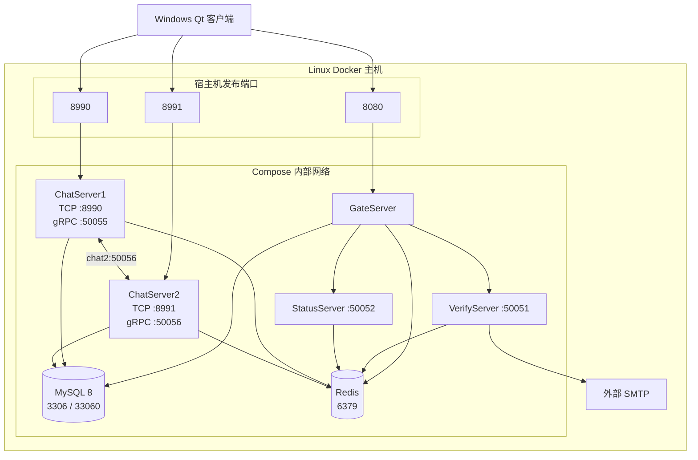
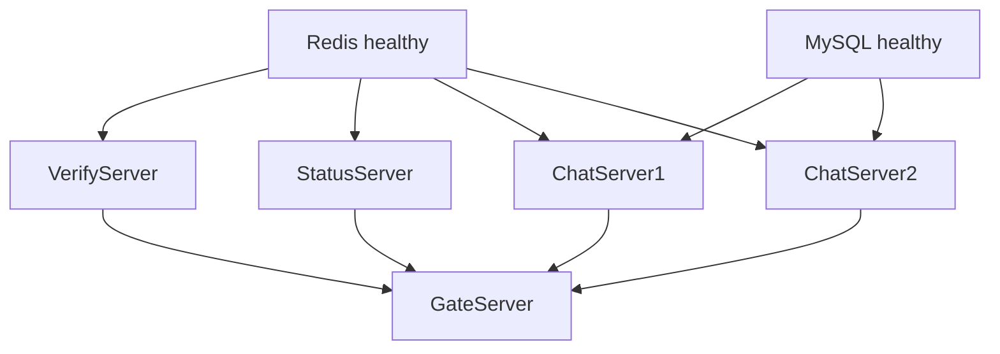

# v1 Linux Docker 部署链

## 0. 文档说明

### 0.1 目标

本文整理把当前 v1 服务端迁移到 Linux 单机 Docker 环境的完整链路。

范围包括：

```text
Linux 环境准备
  → Docker 构建文件补齐
  → C++ / Node.js 镜像构建
  → MySQL / Redis 初始化
  → 五个业务进程编排启动
  → 配置与网络连通
  → 端到端验证
  → 日常启停、升级和回滚
```

本文暂不涉及：

- 公网正式运营
- 域名和 ICP 备案
- HTTP HTTPS / 聊天 TCP TLS
- 多机高可用
- Kubernetes
- 消息持久化和离线消息改造

### 0.2 当前状态

当前仓库还没有实际 Docker 部署文件，因此本文是迁移实施基线，不代表仓库已经具备一键部署能力。

开始实施前需要新增：

- `vcpkg.json`
- C++ 服务 Dockerfile
- VerifyServer Dockerfile
- `docker-compose.yml`
- `.dockerignore`
- 部署配置模板
- MySQL 初始化脚本

### 0.3 当前架构事实

| 组件 | 运行形态 | 对外端口 | 主要依赖 |
| --- | --- | --- | --- |
| GateServer | C++ HTTP | 8080 | Verify、Status、MySQL、Redis |
| VerifyServer | Node.js gRPC | 50051 | Redis、SMTP |
| StatusServer | C++ gRPC | 50052 | Redis |
| ChatServer1 | C++ TCP + gRPC | 8990 / 50055 | MySQL、Redis、ChatServer2 |
| ChatServer2 | C++ TCP + gRPC | 8991 / 50056 | MySQL、Redis、ChatServer1 |
| MySQL | MySQL 8.x | 3306 / 33060 | 持久化卷 |
| Redis | Redis | 6379 | 持久化卷 |

`50055`、`50056` 是 ChatServer 之间的 gRPC 端口，不是客户端端口。

## 1. 目标部署拓扑



客户端最终连接的是 Linux 宿主机 IP，不会直接连接 Docker 容器 IP。

## 2. 宿主机与端口规划

### 2.1 宿主机要求

建议 Linux 内网测试环境至少满足：

- Linux x86_64
- Docker Engine
- Docker Compose v2
- 4GB 以上内存
- 20GB 以上可用磁盘
- 能访问 SMTP 服务

当前 VMware 测试 VM 为 Ubuntu 26.04 LTS、4 vCPU、4GB 内存、NAT 网络。它适合开发、迁移验证和内网演示。

### 2.2 端口发布策略

| 宿主机端口 | 容器端口 | 是否发布 | 说明 |
| --- | --- | --- | --- |
| 8080 | gate:8080 | 是 | Qt 客户端 HTTP |
| 8990 | chat1:8990 | 是 | Qt 客户端 TCP |
| 8991 | chat2:8991 | 是 | Qt 客户端 TCP |
| 50051 | verify:50051 | 否 | Gate 内部 gRPC |
| 50052 | status:50052 | 否 | Gate 内部 gRPC |
| 50055 | chat1:50055 | 否 | Chat2 内部 gRPC |
| 50056 | chat2:50056 | 否 | Chat1 内部 gRPC |
| 3306 | mysql:3306 | 否 | Docker 内部 SQL |
| 33060 | mysql:33060 | 否 | Docker 内部 X Protocol |
| 6379 | redis:6379 | 否 | Docker 内部缓存 |

内部服务只需要在 Compose 网络的 `expose` 或监听地址中出现，不需要映射到宿主机。

## 3. 实施交付物

建议目录结构：

```text
C++_Full-Stack_Chat_Project/
├── vcpkg.json
├── vcpkg-configuration.json
├── Dockerfile.cpp
├── Dockerfile.verify
├── docker-compose.yml
├── .dockerignore
└── deploy/
    ├── .env.example
    ├── config/
    │   ├── gate.ini
    │   ├── status.ini
    │   ├── chat1.ini
    │   ├── chat2.ini
    │   └── verify.json
    └── mysql/
        └── init/
            └── 001-schema.sql
```

交付物职责：

| 文件 | 职责 |
| --- | --- |
| `vcpkg.json` | 固定 Linux 构建依赖 |
| `vcpkg-configuration.json` | 固定 vcpkg baseline，保证可复现 |
| `Dockerfile.cpp` | 构建四个 C++ 服务及运行环境 |
| `Dockerfile.verify` | 构建 Node.js 验证码服务 |
| `docker-compose.yml` | 网络、端口、卷、启动顺序和健康检查 |
| `.dockerignore` | 缩小构建上下文并排除敏感文件 |
| `deploy/config/*` | 各服务的 Linux/容器配置 |
| `deploy/mysql/init/*.sql` | 数据库、表和业务账号初始化 |

## 4. 镜像构建链

### 4.1 C++ 服务

采用多阶段构建：

```text
Builder 镜像
  Ubuntu 基础镜像
  → 安装 gcc/g++、CMake、Ninja、pkg-config
  → 安装固定版本 vcpkg
  → 安装 gRPC、Protobuf、Boost、Redis++、MySQL Connector、libsodium
  → 复制源代码
  → CMake Release 构建 GateServer、StatusServer、ChatServer、ChatServer2

Runtime 镜像
  → 复制可执行文件
  → 复制所需动态库
  → 安装最小系统运行依赖
  → 设置工作目录和默认入口
```

四个 C++ 服务可以共用一个镜像，通过 Compose 的不同 `command` 启动，减少重复构建和存储。

必须确认：

- vcpkg triplet 为 `x64-linux-release`，只生成 Release 依赖。
- 运行阶段能找到 gRPC、Protobuf、Boost 等共享库。
- 镜像内不能依赖 Windows DLL 或 Windows 绝对路径。
- 可执行文件必须来自 Linux Builder。

### 4.2 VerifyServer

VerifyServer 使用独立 Node.js 镜像：

```text
Node.js LTS 基础镜像
  → 复制 package.json / package-lock.json
  → npm ci
  → 复制 server.js、proto、config 等运行文件
  → node server.js
```

不要复制 Windows 开发目录中的 `node_modules`。原生模块、路径和可执行权限可能与 Linux 不兼容。

### 4.3 镜像标签

使用明确版本：

```text
chat-cpp-services:v1
chat-verify:v1
mysql:8.0
redis:7
```

避免长期依赖无版本 `latest`。

## 5. Compose 编排链

### 5.1 服务组成

Compose 应包含七个服务：

```text
mysql
redis
verify
status
chat1
chat2
gate
```

### 5.2 启动依赖



健康检查建议：

- MySQL：`mysqladmin ping`
- Redis：`redis-cli ping`
- Gate：访问 `/get_test`
- Verify / Status / Chat：检查对应 gRPC 或 TCP 端口

业务服务使用 `restart: unless-stopped`，避免意外退出后长期不可用。

### 5.3 数据卷

至少使用：

```text
mysql_data → /var/lib/mysql
redis_data → /data
```

MySQL 是账号、好友关系的权威来源，不能只把数据保存在容器可写层。

## 6. 配置与地址链

### 6.1 GateServer

容器内访问其他服务时使用 Compose 服务名：

```ini
[VerifyServer]
Host = verify
Port = 50051

[StatusServer]
Host = status
Port = 50052

[Mysql]
Host = mysql
Port = 3306
XPort = 33060

[Redis]
Host = redis
Port = 6379
```

### 6.2 StatusServer

StatusServer 中登记的是返回给客户端的聊天节点地址：

```ini
[chatservers]
Name = chatserver1,chatserver2

[chatserver1]
Name = chatserver1
Host = LINUX_HOST_IP
Port = 8990

[chatserver2]
Name = chatserver2
Host = LINUX_HOST_IP
Port = 8991
```

`LINUX_HOST_IP` 必须是 Windows 客户端能访问的 Linux 地址，不能写：

- `127.0.0.1`
- Docker 容器 IP
- `chat1` / `chat2` Compose 服务名

### 6.3 ChatServer

自身 TCP 和 gRPC 监听地址：

```ini
[SelfServer]
Name = chatserver1
Host = 0.0.0.0
Port = 8990
RPCPort = 50055
```

ChatServer2 使用：

```ini
[SelfServer]
Name = chatserver2
Host = 0.0.0.0
Port = 8991
RPCPort = 50056
```

ChatServer 之间通过 Compose 服务名通信：

```ini
[chatserver2]
Name = chatserver2
Host = chat2
Port = 50056
```

### 6.4 VerifyServer

Redis 地址使用：

```json
{
  "redis": {
    "host": "redis",
    "port": 6379,
    "passwd": "<REDIS_PASSWORD>"
  }
}
```

SMTP 仍需要真实可用的发件账号和授权码。现有安全回归脚本可以绕过邮件直接向 Redis 写入验证码，但普通注册链路仍依赖 SMTP。

### 6.5 Windows 客户端

客户端 GateServer 地址改为 Linux 宿主机地址：

```ini
[GateServer]
host = LINUX_HOST_IP
port = 8080
```

当前客户端仍使用 HTTP，聊天仍使用明文 TCP。本迁移阶段只应在可信内网使用。

## 7. MySQL 初始化链

### 7.1 数据库版本

必须使用 MySQL 8.x，不能使用 MariaDB。

原因：

- C++ 使用 MySQL Connector C++ 的 X DevAPI。
- 连接端口是 `33060`，不只是 `3306`。
- 表结构使用 `utf8mb4_0900_ai_ci`。

### 7.2 初始化内容

初始化 SQL 应完成：

1. 创建 `guisan` 数据库。
2. 创建用户、好友申请、好友关系等表。
3. 创建 `chat_app` 业务用户。
4. 只授予 `guisan.*` 所需权限。

基础表来自 `server/sql/schema.sql`。

### 7.3 初始化时机

MySQL 官方镜像的 `/docker-entrypoint-initdb.d` 脚本只会在数据目录为空时执行。

这意味着：

- 首次创建 `mysql_data` 时会导入建表脚本。
- 数据卷已经存在时，修改初始化 SQL不会自动重放。
- 后续结构变化应使用正式 migration，而不是删除数据卷。

## 8. 从零操作链

以下命令在 Docker 交付文件补齐后才可执行。

### 8.1 获取代码

```bash
git clone <仓库地址>
cd C++_Full-Stack_Chat_Project
```

### 8.2 准备环境变量

```bash
cp deploy/.env.example deploy/.env
chmod 600 deploy/.env
```

需要填写：

- Linux 宿主机 IP
- MySQL root 密码
- MySQL 业务用户密码
- Redis 密码
- SMTP 用户和授权码
- 镜像版本

真实 `.env` 和 `config.ini/config.json` 不提交 Git。

### 8.3 校验 Compose

```bash
docker compose config
```

该命令会检查 Compose 语法和环境变量展开，不会启动容器。

### 8.4 构建镜像

```bash
docker compose build --pull
```

4GB 内存环境应避免并行构建多个重型镜像。

### 8.5 启动基础设施

```bash
docker compose up -d mysql redis
docker compose ps
docker compose logs -f --tail=200 mysql redis
```

确认 MySQL 正常启动且 X Protocol 端口可用。

### 8.6 启动业务服务

```bash
docker compose up -d verify status chat1 chat2 gate
docker compose ps
```

如果健康检查配置正确，Compose 会等待依赖健康后再启动。

### 8.7 查看运行状态

```bash
docker compose ps
docker compose logs -f --tail=200 gate
docker compose logs -f --tail=200 chat1 chat2
```

宿主机端口检查：

```bash
ss -lntp | grep -E '8080|8990|8991'
```

## 9. 端到端验证链

### 9.1 HTTP 基础检查

```bash
curl http://127.0.0.1:8080/get_test
```

### 9.2 账号与验证码

验证：

- VerifyServer 能访问 Redis。
- 验证码能写入 Redis。
- SMTP 能发出邮件，或测试脚本能直接写入验证码。
- Gate 能以 Argon2id 写入密码哈希。

### 9.3 登录与节点分配

验证：

- Gate 能访问 StatusServer。
- StatusServer 能访问 Redis。
- 登录响应中的 ChatServer Host 是 Linux 宿主机 IP。
- 客户端能连接 `8990/8991`。

### 9.4 双节点与好友

使用两个客户端或脚本分别登录 ChatServer1 和 ChatServer2，验证：

1. 用户搜索。
2. 好友申请。
3. 好友认证。
4. 同节点文本消息。
5. 跨节点文本消息。
6. 断线清理和在线计数。

### 9.5 自动回归

在 Linux 环境或能访问 Docker 网络的位置执行：

```bash
node server/tests/p0_security_smoke.js
```

需要根据 Docker 端口发布情况调整测试地址。

## 10. 日常操作与回滚

### 10.1 查看状态

```bash
docker compose ps
docker compose stats
```

### 10.2 重启单个服务

```bash
docker compose restart gate
```

### 10.3 更新应用镜像

```text
备份 MySQL
  → 构建或拉取新镜像
  → docker compose up -d
  → 健康检查
  → 运行回归
```

### 10.4 回滚

将 Compose 中的镜像版本切回上一个已验证版本，然后重新执行：

```bash
docker compose up -d
```

数据库迁移需要保证向后兼容，不能只依赖应用镜像回滚。

### 10.5 停止环境

```bash
docker compose down
```

默认不会删除命名卷。

以下命令会删除数据卷：

```bash
docker compose down -v
```

只有明确要清空 MySQL 和 Redis 测试数据时才应使用。

## 11. 迁移验收清单

- [ ] 所有 C++ 服务均在 Linux 镜像中构建。
- [ ] Windows `.exe`、`.dll` 未进入镜像。
- [ ] MySQL 8 的 `3306` 和 `33060` 正常。
- [ ] MySQL 数据使用命名卷持久化。
- [ ] Redis 密码与 Compose/配置一致。
- [ ] Gate 使用 Compose 服务名访问内部服务。
- [ ] Status 返回客户端可访问的 Linux 宿主机地址。
- [ ] ChatServer 自身监听 `0.0.0.0`。
- [ ] ChatServer 间 gRPC 使用服务名和内部 RPC 端口。
- [ ] Windows 客户端能完成 HTTP 登录和 TCP 登录。
- [ ] 双节点跨服消息验证通过。
- [ ] 断线后在线计数恢复。
- [ ] 容器异常退出会自动重启。
- [ ] 日志可通过 `docker compose logs` 查看。
- [ ] 不使用 `down -v` 作为常规重启命令。

## 12. 已知边界

本部署链只完成 Linux 内网迁移：

- HTTP 和聊天 TCP 未加密。
- 没有公开域名和 HTTPS。
- 单机 MySQL/Redis 没有高可用。
- 消息仍只支持在线转发。
- 没有消息持久化、离线消息和可靠投递。
- 没有完整的监控和告警。

这些边界不应与“Docker 迁移已完成”混淆。迁移完成不等于可公开运营。

## 13. 相关文档

- [Docker 部署知识：本项目实战](../技术专题/Docker部署知识-本项目实战.md)
- [v1 版本服务端架构与流程](../架构与流程/v1版本服务端架构.md)
- [CMake 管理](../技术专题/根据本项目架构的CMAKE管理.md)
